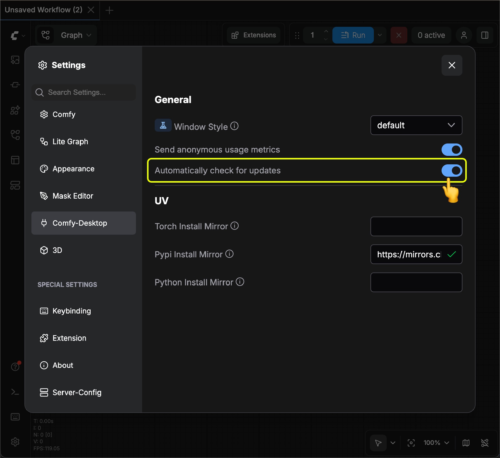
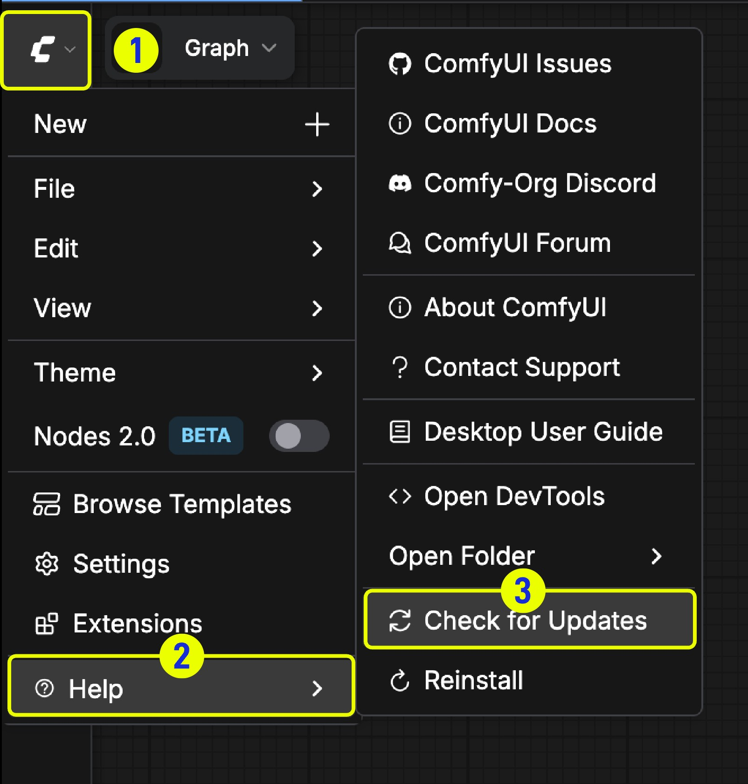

{/* translationSourceHash: 2770d24c */}
## Как обновить Comfy Desktop

Сейчас в Comfy Desktop используются автоматические обновления с детекцией, поэтому убедитесь, что автоматические обновления включены в настройках.

Вы также можете проверить наличие доступных обновлений вручную в `Menu` --> `Help` --> `Check for Updates`

