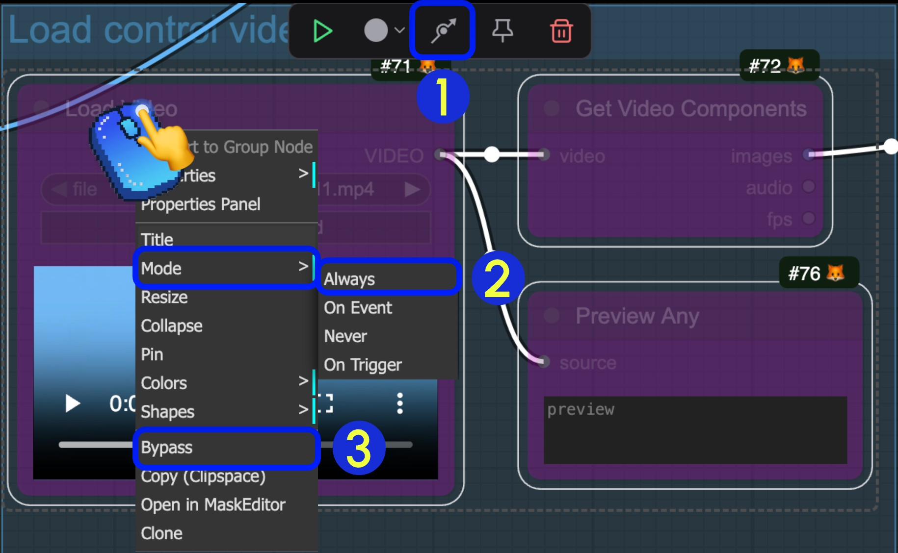

{/* translationSourceHash: 987c7169 */}
### Как переключить статус обхода узла

Когда узел переведён в статус обхода (Bypass), данные, проходящие через него, не обрабатываются узлом и выводятся напрямую. Мы часто переводим узлы в статус обхода, когда они не нужны.
Вот три способа переключить статус обхода узла:

1. Выделив узел, нажмите на стрелку в области индикатора панели выделения, чтобы быстро переключить статус обхода узла
2. Выделив узел, щёлкните по нему правой кнопкой мыши и выберите `Mode` -> `Always`, чтобы переключиться в режим Always
3. Выделив узел, щёлкните по нему правой кнопкой мыши и выберите пункт `Bypass`, чтобы переключить статус обхода