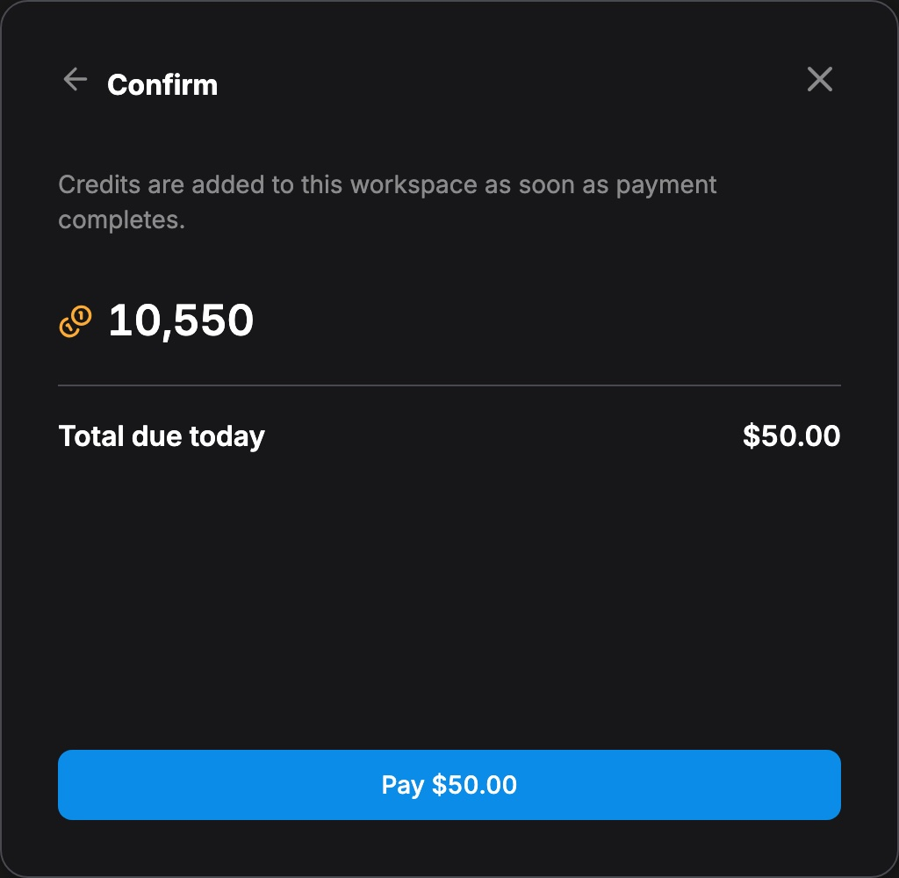
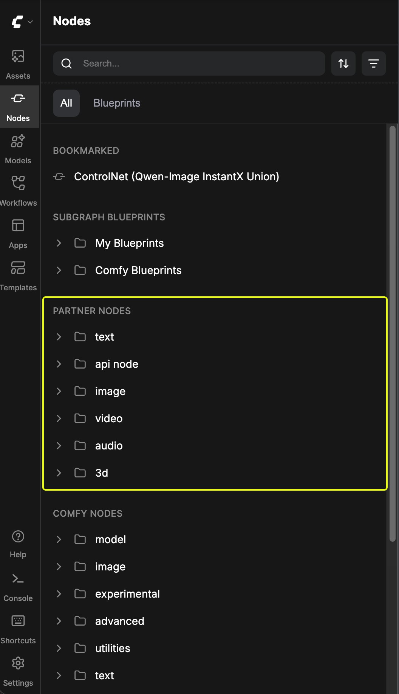

{/* translationSourceHash: c196b1a2 */}
## Требования для использования партнёрских узлов

Чтобы использовать партнёрские узлы, необходимо выполнить следующие требования:

### 1. Требования к версии ComfyUI

Обновите ComfyUI до последней версии: мы можем добавлять поддержку новых API, а соответствующие узлы будут обновляться, поэтому держите ComfyUI в актуальном состоянии.

<Tip>
Обратите внимание на разницу между ночной и релизной версиями. Мы рекомендуем использовать версию `nightly` (это последний коммит кода), так как релизная версия может обновляться несвоевременно.
Речь идёт о версии для разработки и стабильной версии, и поскольку мы всё ещё быстро развиваемся, этот документ может обновляться не сразу, поэтому обращайте внимание на различия версий.
</Tip>

### 2. Требования к аккаунту и кредитам

Вам нужно войти в ComfyUI со [своим аккаунтом Comfy](/ru/interface/user) и иметь баланс [кредитов](/ru/interface/credits) больше 0.

Войдите через `Settings` -> `User`:

Перейдите в `Settings` -> `Credits`, чтобы купить кредиты

Обратитесь к соответствующей документации по аккаунту и кредитам, чтобы выполнить это требование:
- [Аккаунт Comfy](/ru/interface/user): найдите раздел `User` в меню настроек, чтобы войти.
- [Кредиты](/ru/interface/credits): после входа в интерфейсе настроек появится меню кредитов, где можно купить кредиты. Мы используем предоплатную систему, поэтому неожиданных списаний не будет.

### 3. Требования к сетевому окружению

Для доступа к API необходимо, чтобы ваши запросы выполнялись в защищённой сетевой среде. Текущие требования к доступу к API таковы:

- Локальная сеть разрешает доступ только с `127.0.0.1` или `localhost`, и вы можете напрямую использовать функцию входа.
- Если вы обращаетесь из локальной сети или с сайта, которого нет в белом списке, войдите с помощью API-ключа. См. раздел [Вход с помощью API-ключа](/ru/interface/user#logging-in-with-an-api-key).
- У вас должен быть нормальный доступ к нашему сервису API (в некоторых регионах может потребоваться прокси).
- Доступ должен выполняться в среде `https`, чтобы обеспечить безопасность запросов.

<Note>
Доступ в небезопасном контексте создаёт значительные риски и может привести к следующим последствиям:
1. Данные аутентификации могут быть украдены, что приведёт к утечке информации о вашем аккаунте.
2. Ваш аккаунт могут злонамеренно использовать, что приведёт к финансовым потерям.

Даже если в будущем мы снимем это ограничение, мы настоятельно не рекомендуем обращаться к сервисам API через небезопасные сетевые запросы из-за высоких рисков.
</Note>

### 4. Использование соответствующих узлов

**Добавить в рабочий процесс**: добавьте партнёрский узел в рабочий процесс так же, как и любой другой узел.
**Запустить**: задайте параметры и запустите рабочий процесс.

