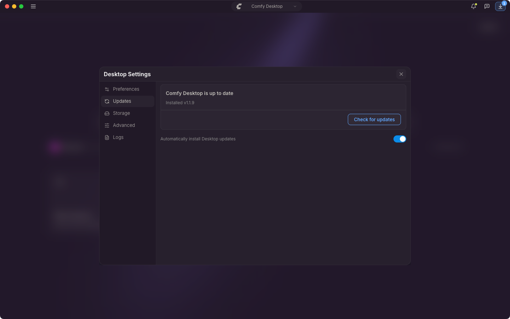

{/* translationSourceHash: 2dece496 */}
Comfy Desktop 启动后不久检查一次更新，运行期间每 10 分钟检查一次，而且每次检查都会下载找到的版本。两者都无法关闭。唯一的设置决定更新之后是否不经询问就安装。

## 自动更新

**自动安装桌面端更新**默认开启。标题栏会显示下载进度：先是 **正在下载更新…**，完成后是 **桌面端更新已就绪**。开启这个设置时，Comfy Desktop 会不经询问直接安装：macOS 上退出应用时安装，Windows 上在下次启动时安装。

如果想立刻重启，点击标题栏上的这个按钮：**重启并更新** 会退出 Comfy Desktop 并以新版本重新打开，应用里正在运行的内容也会一并关闭。**稍后** 只是关闭提示，更新仍会在之后自动应用。

## 手动更新

1. 点击 ☰，选择 **桌面端设置**。
2. 打开 **更新** 标签页。

卡片先给出状态，例如 **Comfy Desktop 已是最新** 或 **更新 v1.2.0 已准备好安装**，接着是已安装的版本、上次检查时间，以及存在新版本时的最新版本。主按钮随状态变化：**检查更新**、**下载** 或 **重启并更新**。下载进行中时，点击标题栏上的按钮会打开桌面端设置，**更新** 标签页里能看到进度。

关闭卡片下方的 **自动安装桌面端更新** 开关后，更新不会自行安装。文件仍会下载，需要你点击标题栏按钮并选择 **重启并更新**。
