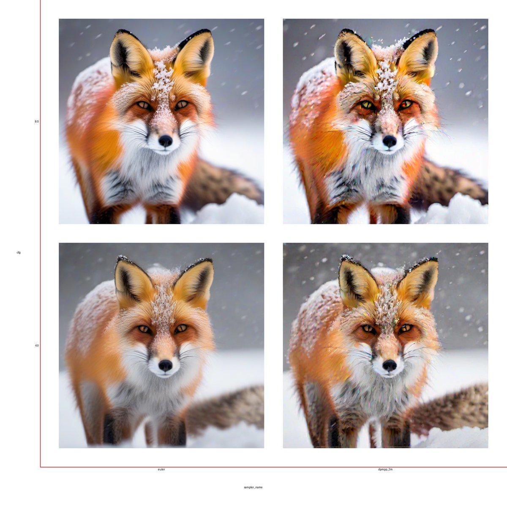

**Batch generation** means running one workflow many times and changing something between the runs: the seed, the prompt, the CFG, the sampler, the model, or several of these at once. A **settings grid** is one use of it: the same prompt and seed, with one or two settings changed per cell, so you can see what each setting does.

This guide starts with the simplest case and adds one step at a time:

1. [Batch seeds](#batch-seeds): many variations of one prompt
2. [Batch prompts](#batch-prompts): one run per prompt
3. [Batch any setting](#batch-any-setting): one run per value of CFG, steps or any other input
4. [Loops](#loops): Start Loop and End Loop
5. [Settings grids](#settings-grids): crossing two or more settings and laying out the results
6. [Scripting with the Comfy API](#scripting-with-the-comfy-api): any combination, at any size


| Method | What changes between runs | Section |
|--------|---------------------------|---------|
| Batch count | The seed, or any widget set to `increment` or `randomize` | [Batch seeds](#batch-seeds) |
| `batch_size` | The noise of each image in one sampling pass | [Batch seeds](#batch-seeds) |
| Lists | Any input you feed from a list: seed, prompt, CFG, steps | [Batch prompts](#batch-prompts), [Batch any setting](#batch-any-setting) |
| Start Loop / End Loop | Any input, one iteration at a time | [Loops](#loops) |
| An XY plot node | Two or three sampler settings, crossed | [Settings grids](#settings-grids) |
| A script | Anything, in every combination | [Scripting](#scripting-with-the-comfy-api) |

<Note>
Some steps use custom nodes. Every custom node named on this page is installed on [Comfy Cloud](https://cloud.comfy.org), where custom nodes are reviewed before they are added. On your own ComfyUI, [install the node pack](/installation/install_custom_node) first.
</Note>

## Batch Seeds

The seed decides the starting noise, so a new seed gives a new composition of the same prompt. Changing the seed is the simplest batch.

### Batch Count

**Batch count** sits in the run bar next to the **Run** button. It sets how many times the workflow is queued per click. See [the run bar](/interface/overview) for where it is.

1. Set `control after generate` on the `KSampler` seed to `randomize` or `increment`.
2. Set **Batch count** to the number of images you want.
3. Click **Run**. Each queued run gets the next seed.

`control after generate` works on any number widget that has it, not only the seed. If every widget is set to `fixed`, every queued run is identical and gives the same image.

### batch_size on the Latent

`batch_size` on the `Empty Latent Image` node creates several latents at once, and the `KSampler` denoises them together in one pass. Each image in the batch gets different noise.

1. On `Empty Latent Image`, set `batch_size` to the number of images, for example `4`.
2. Click **Run**. `Save Image` saves all of them.

A larger batch uses more VRAM, since all images are sampled at the same time.

### Specific Seeds

To re-run seeds you already like, for example to compare them under a new setting, feed the seed from a list:

1. Add an [Int](/built-in-nodes/PrimitiveInt) node for each seed.
2. Add a [Create List](/built-in-nodes/CreateList) node and connect each `Int` to its next free input. New inputs appear as you connect.
3. Connect the `list` output of `Create List` to the `seed` input of the `KSampler`.
4. Click **Run**. The `KSampler` runs once per seed.

The next section explains how lists work.

## Batch Prompts

When a node receives a **list**, ComfyUI runs it once for each item and passes every result downstream. A list of prompts connected to `CLIP Text Encode` gives one image per prompt.

### One Text Node per Prompt

1. Add a [Text (Multiline)](/built-in-nodes/PrimitiveStringMultiline) node for each prompt.
2. Join them with `Create List`.
3. Connect the `list` output to the `text` input of the positive `CLIP Text Encode`.
4. Click **Run**. Each prompt is encoded and sampled as its own run.

### One Prompt per Line

For more than a few prompts, keep them in one text box, one prompt per line, and split it into a list with the **splitlines (from data list)** node from the [Basic data handling](https://github.com/StableLlama/ComfyUI-basic_data_handling) pack.

1. Add a `Text (Multiline)` node and write one prompt per line.
2. Add a **splitlines (from data list)** node (search for `splitlines`) and connect the text to its `string` input. Leave `keepends` off, so the line breaks are not part of the prompts.
3. Connect its output to the `text` input of the positive `CLIP Text Encode`.
4. Click **Run**. Each line becomes its own run.

You can paste a whole prompt file into the text box this way. Empty lines become empty prompts, so remove them first.

## Batch Any Setting

A list can feed almost any input, not only the seed and the prompt. To connect a list to a widget such as `cfg`, drag the link onto the widget. To sweep CFG:

1. Add a [Float](/built-in-nodes/PrimitiveFloat) node for each CFG value, for example `3`, `6` and `9`.
2. Join them with `Create List` and connect the list to the `cfg` input of the `KSampler`.
3. Keep the seed fixed: set `control after generate` on the seed to `fixed`.
4. Connect `VAE Decode` to a [Make Image Grid](/built-in-nodes/ImageGrid) node and then to `Save Image`.
5. Click **Run**. The `KSampler` and `VAE Decode` run once per CFG value, and `Make Image Grid` receives all the images.

`steps`, `denoise`, image size and LoRA strength work the same way, with `Int` or `Float` nodes.

<Warning>
When a node gets **more than one list**, ComfyUI pairs the items by position: the first with the first, the second with the second, and the last item of the shorter list repeats. It does not make every combination. Three prompts and three seeds give three images, not nine. To cross two settings, see [Settings grids](#settings-grids) or [Scripting](#scripting-with-the-comfy-api).
</Warning>

**Dropdowns.** `sampler_name`, `scheduler` and model files are dropdowns, which a list of text values cannot feed directly. To compare a few, copy the `KSampler` and `VAE Decode` nodes once per value, connect them to the same model, prompts and latent, set each copy differently, and collect the images with `Make Image Grid`. For samplers and schedulers, the XY plot node in [Settings grids](#settings-grids) is quicker.

## Loops

The [Start Loop](/built-in-nodes/StartLoop) and [End Loop](/built-in-nodes/EndLoop) nodes run the nodes between them once per iteration. `Start Loop` has three modes:

| Mode | Iterations |
|------|------------|
| `simple` | `num_iterations` times, with `iteration_index` running from 0 |
| `For` | From `start_iteration_index` up to (not including) `max_iteration`, in steps of `step` |
| `List` | Once per item of the connected `list`; the current item comes out of `list_item` |

To loop over a list of values, for example CFG:

1. Build the list with `Float` nodes and `Create List`, as above. A list of prompts or seeds works the same way.
2. Add a `Start Loop` node, set `mode` to `List`, and connect the list to its `list` input.
3. Connect `list_item` from `Start Loop` to the input you want to change, here the `cfg` input of the `KSampler`.
4. Add an `End Loop` node. Connect the `IMAGE` output of `VAE Decode` to `output_value`, and turn on `accumulate` so End Loop returns the image from every iteration, not only the last one.
5. Connect the `outputs` of `End Loop` to `Make Image Grid`, then to `Save Image`.
6. Click **Run**.

For one list, a loop and a plain list give the same images. A loop also lets one iteration pass a value to the next (`next_iteration_value` on End Loop, `current_iteration_value` on Start Loop), and a loop can be nested inside another by connecting the outer loop's `iteration_index` to the inner loop's `parent_iteration`.

<Note>
Start Loop and End Loop are recent core nodes. If you can't find them, [update ComfyUI](/installation/update_comfyui). Comfy Cloud updates after each ComfyUI stable release.
</Note>

## Settings Grids

A settings grid holds the prompt, the model and the seed constant, and changes only sampler settings, so any difference between two cells comes from the setting you changed. With a random seed, each cell would also get a different composition, and you could no longer tell whether a change came from the setting or from the noise.

The four `KSampler` settings that change an image the most, apart from the prompt and the model, are:

| Setting | What it changes |
|---------|-----------------|
| `cfg` | How strictly the model follows the prompt. Low values look loose and soft; high values look saturated and over-sharpened. |
| `steps` | How many denoising steps the sampler takes. More steps add detail up to a point, then only add time. |
| `sampler_name` | The algorithm that removes noise at each step (`euler`, `dpmpp_2m`, and so on). |
| `scheduler` | How the noise level drops from step to step (`normal`, `karras`, `simple`, and so on). |

A full sweep multiplies quickly: 4 CFG values × 3 step counts × 3 samplers × 2 schedulers is 72 images. Start with one or two settings, find the range that looks good, then narrow it.

<Tip>
Open-model workflow pages on the [Comfy Hub](https://www.comfy.org/hub/workflows) have a **Grid** tab with a pre-rendered CFG × steps × sampler × scheduler sweep at one seed. You can browse it to find good settings for that model, then re-run the cells you choose on Comfy Cloud with your own prompt.
</Tip>

### Crossing Settings with an XY Plot Node

The **FL KSampler XYZ Plot** node from the [Fill-Nodes](https://github.com/filliptm/ComfyUI_Fill-Nodes) pack replaces the `KSampler` and crosses up to three settings for you. It renders every combination and returns one image with the values written along the axes.

1. Replace the `KSampler` with **FL KSampler XYZ Plot**. Connect `model`, `positive`, `negative`, `latent_image`, and the `vae` from your checkpoint loader.
2. Set the seed and the base values for the settings you are not changing.
3. Set `x_axis` and `y_axis` to two of `steps`, `cfg`, `denoise`, `sampler_name` and `scheduler`.
4. Type the values for each axis into `x_values` and `y_values`, separated by commas, for example `euler,dpmpp_2m` and `4,8`.
5. To cross a third setting, set `z_axis` and `z_values`. `z_stack_mode` places the extra grids below or beside each other.
6. Connect the `IMAGE` output to `Save Image` and click **Run**.



To cross other inputs, such as prompts × seeds or LoRA strength × CFG, use [nested loops](#loops) or a [script](#scripting-with-the-comfy-api).

### Laying Out Your Own Grid

When the images come from a list or a loop, the [Make Image Grid](/built-in-nodes/ImageGrid) node arranges them in rows, left to right and top to bottom.

| Input | What it does |
|-------|--------------|
| `columns` | Images per row. Set it to the number of values on your horizontal axis. |
| `cell_width`, `cell_height` | The size each image is resized to. |
| `padding` | Pixels between cells. |

To label each cell, put a [Draw Text Overlay](/built-in-nodes/TextOverlay) node between `VAE Decode` and `Make Image Grid`. Build a second list of labels, such as `CFG 3`, `CFG 6` and `CFG 9`, with `Text` nodes and `Create List`, and connect it to the `text` input. Because the images and the labels are both lists, each image gets the label at the same position. The grid at the top of this page was made this way.

## Scripting with the Comfy API

Past two or three settings, or to cross prompts, seeds and models, a script is simpler than a graph. It builds every combination, submits each one as its own job, and saves the results with a record of what each run changed.

### 1. Export the Workflow in API Format

1. Build and test the workflow for one run in ComfyUI.
2. Open the workflow menu and choose **Export (API)**. This saves the graph in [API format](/development/api-development/workflow-api-format), where every node is keyed by its ID.
3. Open the JSON and note the ID of each node you want to change. In the default text-to-image workflow, the `KSampler` is `"3"` and the positive `CLIP Text Encode` is `"6"`.

### 2. Queue One Job per Combination

[Comfy API v2](/api-reference/v2/overview) accepts the API-format graph at `POST /api/v2/jobs` and returns a job you can poll at `GET /api/v2/jobs/{id}`. The same API runs on Comfy Cloud and, through [comfy-api-proxy](https://github.com/Comfy-Org/comfy-api-proxy), on your own ComfyUI, so the script below works on both by changing `BASE_URL`.

Comfy Cloud runs a set number of jobs at a time per plan and holds the rest in a queue:

| Plan | Jobs running at a time |
|------|------------------------|
| Standard | 1 |
| Creator | 3 |
| Pro | 5 |

You can have up to 100 jobs queued. Running more than one job at a time needs the API and a paid plan. See [Cloud concurrency limits](/development/deploy/cloud-usage#concurrency-limits) for details.

In `AXES`, each key is `<node ID>.<input name>` and each value is the list of values to try. The script runs every combination. It keeps at most `MAX_IN_FLIGHT` jobs submitted at a time, so a large batch never fills the queue, and it backs off when the server answers `429`. It needs Python 3.9 or newer and `pip install requests`. Set `COMFY_API_KEY` to your [API key](/development/api-development/getting-an-api-key) first.

```python batch.py
import itertools, json, os, time
import requests

BASE_URL = "https://cloud.comfy.org"  # own ComfyUI via comfy-api-proxy: "http://127.0.0.1:8189"
API_KEY = os.environ.get("COMFY_API_KEY", "")
HEADERS = {"Authorization": f"Bearer {API_KEY}"} if API_KEY else {}

WORKFLOW_FILE = "workflow_api.json"  # from Export (API)
MAX_IN_FLIGHT = 5                    # match your plan's running limit; never above 100
OUT_DIR = "batch"

# "<node ID>.<input name>": values to try. Every combination is run.
AXES = {
    "3.seed": [42],
    "3.cfg": [3.0, 5.0, 7.0],
    "3.sampler_name": ["euler", "dpmpp_2m"],
    "6.text": ["a red fox in snow, photo", "a lighthouse at dusk, oil painting"],
}

def apply(graph, cell):
    for key, value in cell.items():
        node_id, name = key.split(".", 1)
        graph[node_id]["inputs"][name] = value

def submit(graph):
    while True:
        r = requests.post(f"{BASE_URL}/api/v2/jobs", headers=HEADERS, json={"workflow": graph})
        if r.status_code == 429:  # queue full or rate limited: wait and retry
            time.sleep(int(r.headers.get("Retry-After", "10")))
            continue
        r.raise_for_status()
        return r.json()["id"]

def save_outputs(job, name):
    files = []
    for i, output in enumerate(o for o in job["outputs"] if o["type"] == "image"):
        data = requests.get(output["url"], headers=HEADERS).content  # follows the redirect to storage
        ext = os.path.splitext(output["name"])[1] or ".png"
        path = os.path.join(OUT_DIR, f"{name}_{i}{ext}")
        with open(path, "wb") as f:
            f.write(data)
        files.append(path)
    return files

def main():
    os.makedirs(OUT_DIR, exist_ok=True)
    with open(WORKFLOW_FILE) as f:
        base = json.load(f)

    cells = [dict(zip(AXES, values)) for values in itertools.product(*AXES.values())]
    pending = [(f"{n:04d}", cell) for n, cell in enumerate(cells)]
    in_flight = {}  # job id -> (name, cell)
    manifest = {}   # name -> what that run changed, and its files

    while pending or in_flight:
        while pending and len(in_flight) < MAX_IN_FLIGHT:
            name, cell = pending.pop(0)
            graph = json.loads(json.dumps(base))
            apply(graph, cell)
            in_flight[submit(graph)] = (name, cell)

        time.sleep(3)
        for job_id, (name, cell) in list(in_flight.items()):
            r = requests.get(f"{BASE_URL}/api/v2/jobs/{job_id}", headers=HEADERS)
            if r.status_code != 200:
                continue  # rate limited or a transient error: check again next round
            job = r.json()
            if job["status"] == "succeeded":
                manifest[name] = {"settings": cell, "files": save_outputs(job, name)}
                with open(os.path.join(OUT_DIR, "manifest.json"), "w", encoding="utf-8") as f:
                    json.dump(manifest, f, indent=2, ensure_ascii=False)
            elif job["status"] not in ("failed", "canceled", "expired"):
                continue  # still queued or running
            else:
                print(f"{name} {cell}: {job['status']} {job.get('error')}")
            del in_flight[job_id]
            print(f"{len(cells) - len(pending) - len(in_flight)}/{len(cells)} done")

if __name__ == "__main__":
    main()
```

The files are numbered (`0000_0.png`, `0001_0.png` and so on), and `batch/manifest.json` records the settings of each one.

Some common `AXES` entries:

```python
"3.seed": list(range(1, 9)),             # eight seeds
"3.seed": [42],                          # one fixed seed, for a settings grid
"3.scheduler": ["normal", "karras"],     # any dropdown, by its option name
"6.text": [line.strip() for line in open("prompts.txt", encoding="utf-8") if line.strip()],  # one prompt per line
```

<Tip>
The [Comfy SDKs](/development/api-development/sdks) for Python and TypeScript wrap these endpoints, including uploads, waiting for jobs and retrying when the queue is full.
</Tip>

### 3. Lay Out the Results

To turn a scripted batch into a grid, assemble the saved files with a few lines of [Pillow](https://pillow.readthedocs.io/) (`pip install pillow`). This example puts one setting on the columns and another on the rows, holds the rest fixed, and writes the values along the edges:

```python make_grid.py
import json
from PIL import Image, ImageDraw

COLS = ("3.cfg", [3.0, 5.0, 7.0])
ROWS = ("3.sampler_name", ["euler", "dpmpp_2m"])
FIXED = {"3.seed": 42, "6.text": "a red fox in snow, photo"}
CELL, LABEL = 384, 100

with open("batch/manifest.json", encoding="utf-8") as f:
    runs = list(json.load(f).values())

def path(col, row):
    want = {COLS[0]: col, ROWS[0]: row, **FIXED}
    for run in runs:
        if all(run["settings"].get(k) == v for k, v in want.items()):
            return run["files"][0]
    raise KeyError(f"no run with {want}")

sheet = Image.new("RGB", (LABEL + CELL * len(COLS[1]), LABEL + CELL * len(ROWS[1])), "white")
draw = ImageDraw.Draw(sheet)
for x, col in enumerate(COLS[1]):
    draw.text((LABEL + x * CELL + 8, 12), f"{COLS[0]} {col}", fill="black")
for y, row in enumerate(ROWS[1]):
    draw.text((6, LABEL + y * CELL + 8), f"{row}", fill="black")
    for x, col in enumerate(COLS[1]):
        img = Image.open(path(col, row)).convert("RGB").resize((CELL, CELL))
        sheet.paste(img, (LABEL + x * CELL, LABEL + y * CELL))
sheet.save("grid.png")
```

Make one sheet per combination of the remaining settings, for example one CFG × sampler sheet for each prompt.

## Try It Yourself

1. Download the grid image at the top of this page and drag it into ComfyUI. It loads the CFG sweep workflow (it uses `sd_xl_base_1.0.safetensors`).
2. Replace the `Float` nodes with `Int` nodes and connect the list to `seed` instead, or replace them with a **splitlines (from data list)** node and connect it to the prompt.
3. When you need every combination of several settings, export the workflow with **Export (API)** and run it with the script.
