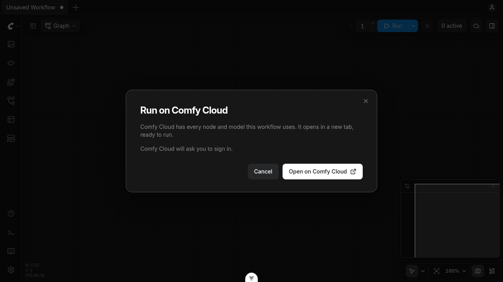
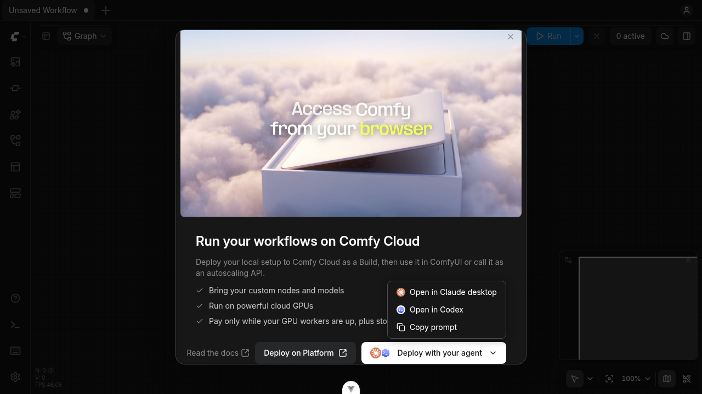

## 概述

运行栏中的 Cloud 按钮会将你当前打开的工作流发送到 Comfy Cloud。ComfyUI 会先对照 Comfy Cloud 检查该工作流，然后在新浏览器标签页中打开它，并加载其中的工作流图。

该按钮仅在以下情况显示：ComfyUI 运行于你自己的机器上（localhost、私有局域网地址或桌面应用），并且你的账户已启用“在云端打开”的灰度发布。Comfy Cloud 本身不会显示它。如果找不到该按钮，请将 ComfyUI 更新到最新版本并重新加载页面。

## 在 Comfy Cloud 上打开工作流

1. 打开你想在 Comfy Cloud 上运行的工作流。
2. 点击运行栏中的云图标。ComfyUI 会检查该工作流使用了哪些节点包和模型。
3. 如果 Comfy Cloud 具备所有这些节点包和模型，**在 Comfy Cloud 上运行**对话框会打开。点击 **在 Comfy Cloud 上打开**。
4. Comfy Cloud 会在新标签页中打开，并将工作流加载到编辑器中。如果系统要求，请在那里登录。

有些模型输入无法从本地检查，例如经过连线的模型输入，或同一个文件匹配到多个本地文件夹的模型。对话框会把这些条目标记为未检查，它们不会阻止工作流打开。

请保持本地标签页打开，直到工作流出现在 Comfy Cloud 中。Cloud 标签页加载完成后，工作流图就会被移交过去，而 ComfyUI 会在 10 分钟后放弃等待。如果工作流始终没有出现，请再次点击 Cloud 按钮。

如果你的浏览器阻止了新标签页，请为你的 ComfyUI 地址允许弹出窗口，然后重试。没有活动节点的工作流会被拒绝并显示一条消息，因此请添加节点或取消节点静音，保存，然后再次点击按钮。

## 当 Comfy Cloud 缺少模型文件时

如果唯一缺少的只是模型文件，对话框会列出 Comfy Cloud 没有的文件，并且不提供打开操作。在那里也无法从你的 ComfyUI 上传，因此请关闭对话框，改为将这些文件导入到 Comfy Cloud。请参阅[导入模型](/zh/cloud/import-models)。

## 当工作流需要自定义节点或不寻常的模型时

如果工作流使用了 Comfy Cloud 没有的自定义节点包，或者使用了 Comfy Cloud 无法解析为单个文件的模型，对话框会改为提供部署你的设置的选项。**在平台上部署**会将你的自定义节点和模型打包成 Developer Platform 上的一个 Build。**使用您的代理部署**会将同样的设置交给 Claude desktop 或 Codex，或复制提示词；它会要求你先保存工作流。请参阅[自定义构建](/zh/development/deploy/cloud-custom-builds)。

## 在桌面应用中

桌面应用会通过自己的中继将工作流交给 Comfy Cloud。当中继不可用时，ComfyUI 会将工作流下载为 JSON 文件，打开 Comfy Cloud，并提示你将文件拖放到 Comfy Cloud 编辑器中。
