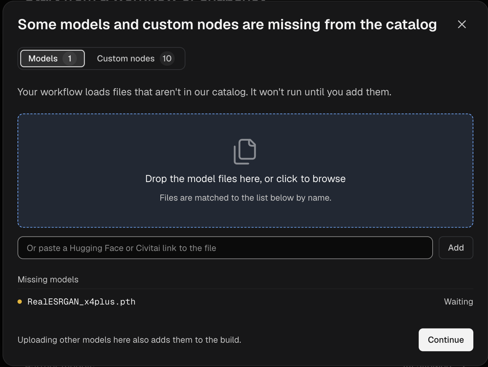

一个构建（Build）会打包你的自定义节点、私有自定义节点、LoRA 和其他模型以及 Python 依赖关系，使你的工作流能够在 Comfy Cloud 上运行。你在 Comfy Cloud 编辑器中启动构建，在开发者平台上创建并部署它，然后在编辑器中让工作流在其上运行。

部署构建还会为你提供仅服务于你的工作流的 GPU 工作节点，即使 Comfy Cloud 已经支持这些工作流中的每一个节点。

<Note>
  如果要在 Comfy Cloud 已支持的节点上使用你自己的 LoRA 或其他模型，你不需要构建。只需将模型上传到你的**模型库**即可。参见[添加你自己的 LoRA 或模型](#添加自己的-lora-或模型)。
</Note>

### 前提条件

在创建构建之前，请确保你具备以下条件：

- **在 Comfy Cloud 上保存的工作流**
- **有效的订阅或大于零的 Comfy 积分余额**

<Warning>
  创建或保留构建不产生任何费用。部署会在 GPU 为其开启时消耗 GPU 时间。只要部署存在，即使它已停止或没有开启 GPU，也会产生存储费用。部署对话框会在你确认之前显示预估费用。若要停止付费，请删除该部署。参见[停止或删除你的部署](#停止或删除部署)。
</Warning>

## 从工作流创建 Build

如果你的工作流使用了 Comfy Cloud 不支持的自定义节点，打开该工作流时 Comfy Cloud 会显示一个对话框。对话框会列出缺失的自定义节点包（自定义节点的分组）和模型，例如 LoRA。要运行该工作流，请用它们创建一个 Build。当你选择已保存的工作流时，开发者平台会找到它的自定义节点和模型，并为你选中它们。

<Steps>
  <Step title="打开开发者平台">
    在对话框中，点击 **在平台上创建**。开发者平台会在新标签页中打开，并停留在 **部署** 页面。

    

    

    <Tip>
      如需不通过对话框创建 Build，请点击 **运行** 左侧的云端菜单。默认情况下，它被设为 **Comfy Cloud**。

      - 如果你的工作区还没有任何部署，选择 **创建自定义部署**，然后点击 **在平台上创建**。
      - 如果已有部署，选择 **管理部署**。
    </Tip>
  </Step>
  <Step title="开始一个新的 Build">
    在 **部署** 页面，点击 **新建 Build**。如果你还没有任何 Build，请改为点击 **从零开始**。
  </Step>
  <Step title="选择你的工作流">
    1. 点击 **从 Comfy Cloud 选择**。
    2. 选择你的工作流，然后点击 **添加 1 个工作流**。

    你也可以把工作流的 `.json` 文件，或用它生成的 `.png` 图像拖到拖放区域。

    

    当工作流的名称带对勾出现在拖放区域下方，且 **建议的默认配置** 列表显示该 Build 的 **自定义节点** 时，这一步即成功。
  </Step>
  <Step title="使用建议的默认配置构建">
    点击 **使用默认配置构建…**。此时会打开 **选择构建目标** 对话框。

    如果 **使用默认配置构建…** 不可用，按钮下方会有一行文字说明原因。当它显示 *请先在各步骤中添加缺失的模型和自定义节点。* 时，请添加缺失的内容：

    1. 点击 **自定义 Build**。
    2. 点击 **下一步**，直到某个步骤列出缺失的自定义节点或模型。
    3. 对每一项点击 **使用建议** 或 **上传**。
  </Step>
</Steps>

要更改 Build 包含的内容，请改为点击 **自定义 Build** 并逐步完成各个步骤。有两个步骤决定 Build 包含什么：

- **构建需要哪些自定义节点？**：选择自定义节点。
- **构建中打包哪些模型？**：选择该 Build 包含哪些模型。Build 未包含的模型会在作业首次使用它时下载。

### 发布 Build

发布会把你的 Build 变成一个带编号的版本，例如 `v1`，你可以现在部署，也可以以后再部署。发布是免费的。

1. 在 **选择构建目标** 对话框中，保持选中 **Serverless 构建**。它是在 Comfy Cloud 上运行的目标。
2. 点击 **发布**。

你的 Build 页面会打开并显示新版本。**Serverless 构建** 一行会显示构建进度。构建通常需要 10 到 15 分钟，你可以离开页面稍后再回来。构建完成后，**Serverless 构建** 一行会显示 **部署** 按钮。

要稍后回到该版本：

1. 在 **开发者平台侧边栏** 中，点击 **部署**。
2. 在 **Builds** 区域，点击你的 Build。
3. 在 **版本** 下，点击最新版本。

<AccordionGroup>
  <Accordion title="如果构建失败怎么办？">
    有些自定义节点会构建失败。出现这种情况时，你的 Build 页面上的 **Serverless 构建** 一行会显示 **构建失败**。

    1. 在该行打开 **日志**，查看失败的原因。
    2. 点击 **编辑 Build**，修改该 Build，例如移除构建失败的那个自定义节点。
    3. 重新发布该 Build。

    该行的 **使用你的 agent 调试** 按钮会打开一段描述该失败的提示词。把它复制给编码 agent，即可修复该 Build。
  </Accordion>
</AccordionGroup>

### 部署并运行你的工作流

部署就是你的构建在 Comfy Cloud GPU 上运行。先部署构建，然后把 Comfy Cloud 编辑器切换到该部署来运行你的工作流。

1. 在 **Serverless build** 行上，点击 **Deploy**。此时会打开 **Deploy v1 of** _你的构建名称_ 对话框。
2. 选择一个 GPU。每个 GPU 都会显示其 VRAM（GPU 内存）和每小时价格。
3. 如果对话框显示 **Ready for the Cloud editor**，请保持选中状态。该选项默认开启。
4. 其他设置保持默认值。当 **Always-warm workers** 为 `0` 时，部署会在没有任务进入时关闭其 GPU。默认情况下，**Keep worker up after a job** 会在最后一个任务结束后让 GPU 继续运行 3 分钟，这段空闲时间会按 GPU 费率计费。
5. 查看 **Estimated cost** 面板。它会显示每小时的 GPU 时间和每月的模型存储费用。
6. 点击 **Create deployment**。随后会打开该部署的页面。等待部署名称下方的状态显示为 **Ready**。
7. 在 Comfy Cloud 编辑器中，点击 **Run** 左侧的云端菜单。在 **Run on** 下，选择你的部署。编辑器会重新加载，你的标签页会保持打开。

    

8. 打开你的工作流，然后点击 **Run**。部署启动 GPU 期间，你的第一个任务可能需要等待。

只要你不选择其他部署，这个浏览器就会一直在该部署上运行你的工作流。要切回，请在同一菜单中选择 **Comfy Cloud**。如果某个工作流有未保存的更改，会打开 **Save your workflows before switching?** 对话框。点击 **Save and switch** 或 **Switch without saving**。

## 添加自己的 LoRA 或模型

**模型库**存储你的工作区上传的模型。你上传的模型可在 Comfy Cloud 和你的部署上运行。

在上传模型之前，请确保满足以下要求：

- **有效的 Pro、Creator、Team 或企业版套餐**：你的工作区需要拥有其中一种套餐才能上传模型。
- **不超过 2 GB 的 `.safetensors` 文件**：请将更大的基础模型（例如 SDXL 或 Flux）放入构建中。

<Warning>
  某些在模型库中的模型可用之前创建的部署无法加载这些模型。要使用模型库中的模型，请创建新的部署。在较旧的部署上，任务可能会失败并显示 `Library model "<file name>" is unavailable on this deployment. Retry the job. If it still fails, contact support with the job ID.`
</Warning>

### 上传模型

你可以在 Comfy Cloud 编辑器或开发者平台上上传。请根据你当前使用的环境选择对应标签页。

<Tabs>
  <Tab title="云编辑器">
    1. 在**运行**左侧的云菜单中，确保在**运行于**下选择了 **Comfy Cloud**。在部署上，**模型库**没有**导入**按钮。
    2. 在**左侧边栏**中，点击**模型库**，然后点击**导入**。
    3. 点击**选择文件**，或将 `.safetensors` 文件拖入对话框。
    4. 在**这是什么类型的模型？**下，如果是 LoRA，请保留 **LoRA**，或选择与该文件匹配的类型。
    5. 点击**上传**。当对话框显示 _模型已成功导入。_ 时，点击**完成**。

    

    如需改为从 Civitai 或 Hugging Face 链接导入模型：

    1. 在**导入**对话框中，在**粘贴链接到此**中粘贴模型的链接。
    2. 点击**继续**。
    3. 在**这是什么类型的模型？**下，选择模型类型。
    4. 点击**导入**。

    以其他格式（例如 `.ckpt`）进行的链接导入会导入到**模型库**，但不会在部署上运行。
  </Tab>
  <Tab title="开发者平台">
    1. 在构建流程的**构建中包含哪些模型？**步骤中，点击**上传模型**。
    2. 选择**工作区库**。
    3. 将 `.safetensors` 文件拖到拖放区域，或点击该区域进行浏览。
    4. 在**模型类型**下，如果是 LoRA，请保留 **LoRA**，或选择与该文件匹配的类型。
    5. 点击**上传**。

    
  </Tab>
</Tabs>

### 在工作流中使用模型

模型上传后，你可以在 Comfy Cloud 或你的部署上使用它。

1. 在**运行**左侧的云菜单中，选择运行位置：**Comfy Cloud** 或你的部署。
2. 添加一个 `Load LoRA (Model and CLIP)` 节点，或打开包含该节点的工作流。
3. 在该节点的 `lora_name` 列表中，选择你的文件。
4. 点击**运行**。

<Tip>
  在部署上，首次运行会下载模型，队列中该任务所在行会显示 `Downloading <file name>`。同一张正在运行的 GPU 上的后续任务会跳过下载。部署稍后启动的 GPU 会再次下载模型。要跳过下载，请将模型添加到构建中。
</Tip>

请遵循以下规则，以便任务能找到你的模型：

- **选择匹配的类型。** 加载器节点只列出其类型的模型。`Load LoRA (Model and CLIP)` 节点会列出作为 LoRA 上传的模型。
- **使用新的文件名。** 如果你的构建中已有同名模型，则部署上的任务会使用构建中的文件，而不是你上传的文件。
- **匹配基础模型。** LoRA 必须与你的工作流加载的基础模型匹配。
- **使用 Comfy Cloud 支持的加载器节点。** 如果该加载器节点来自 Comfy Cloud 不支持的自定义节点，请将模型添加到构建中。

### 更改或删除模型库中的模型

当在**运行于**下选择部署时，**模型库**只列出构建中的模型。要更改或删除你上传的模型，请先[切换回 Comfy Cloud](#部署并运行你的工作流)，然后在**左侧边栏**中点击**模型库**。

要更改模型类型：

1. 将鼠标悬停在模型卡片上，然后点击**模型信息**。
2. 选择新的**模型类型**。

<Warning>
  删除模型会将其从**模型库**中永久移除。仍在使用该文件的任务会在加载器节点上失败，并显示 `Value not in list` 错误。
</Warning>

要删除模型：

1. 将鼠标悬停在模型卡片上，点击**更多**，然后点击**删除**。
2. 在**删除此模型？**中，点击**删除**。

## 停止或删除部署

部署在删除之前会一直产生存储费用，即使已停止也是如此。停止部署可将其保留以备后用，同时不运行任务。删除部署即可停止付费。

打开部署页面：

1. 在**开发者平台侧边栏**中，点击 **部署**。
2. 在**部署**区域中，点击部署的名称。

停止部署：

1. 点击 **停止**。
2. 在 **停止部署** 对话框中，点击 **停止**。

状态会显示为 **正在停止**，然后变为 **已停止**。

再次运行部署：

- 点击 **启动**。

<Warning>
  删除会永久移除部署及其历史记录。你的 Build 及其版本会保留，因此之后可以再次部署。
</Warning>

删除部署：

1. 在已停止的部署上，点击 **删除**。对于正在运行的部署，打开 **更多操作** 菜单，然后选择 **删除**。
2. 在 **删除部署** 对话框中，点击 **删除**。

下次在此浏览器中打开编辑器时，编辑器会在 Comfy Cloud 上运行你的工作流。

## 后续步骤

<CardGroup cols={2}>
  <Card title="在 API 请求中使用库模型" icon="code" href="/zh/development/serverless/overview#use-workspace-library-models-in-api-requests">
    从终端上传模型，并在每次请求中通过 `lora_name` 选择该模型。
  </Card>
  <Card title="Comfy API 快速入门" icon="cloud-arrow-up" href="/zh/development/serverless/quickstart">
    从你自己的代码中以自动扩缩容端点的方式调用你的部署。
  </Card>
  <Card title="用量与限制" icon="gauge" href="/zh/development/deploy/cloud-usage">
    了解 Comfy Cloud 积分与并发任务限制的工作方式。
  </Card>
  <Card title="工作流 API 格式" icon="file-code" href="/zh/development/api-development/workflow-api-format">
    以 API 请求所发送的格式导出工作流。
  </Card>
</CardGroup>
