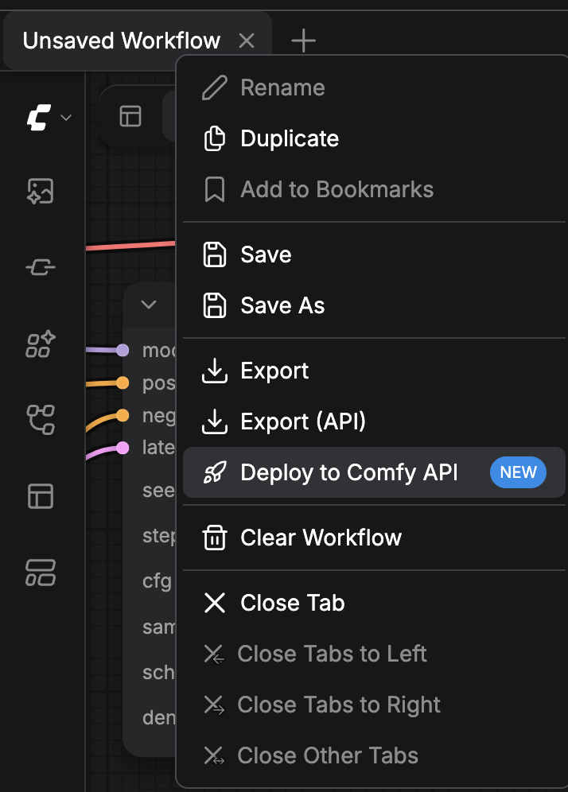
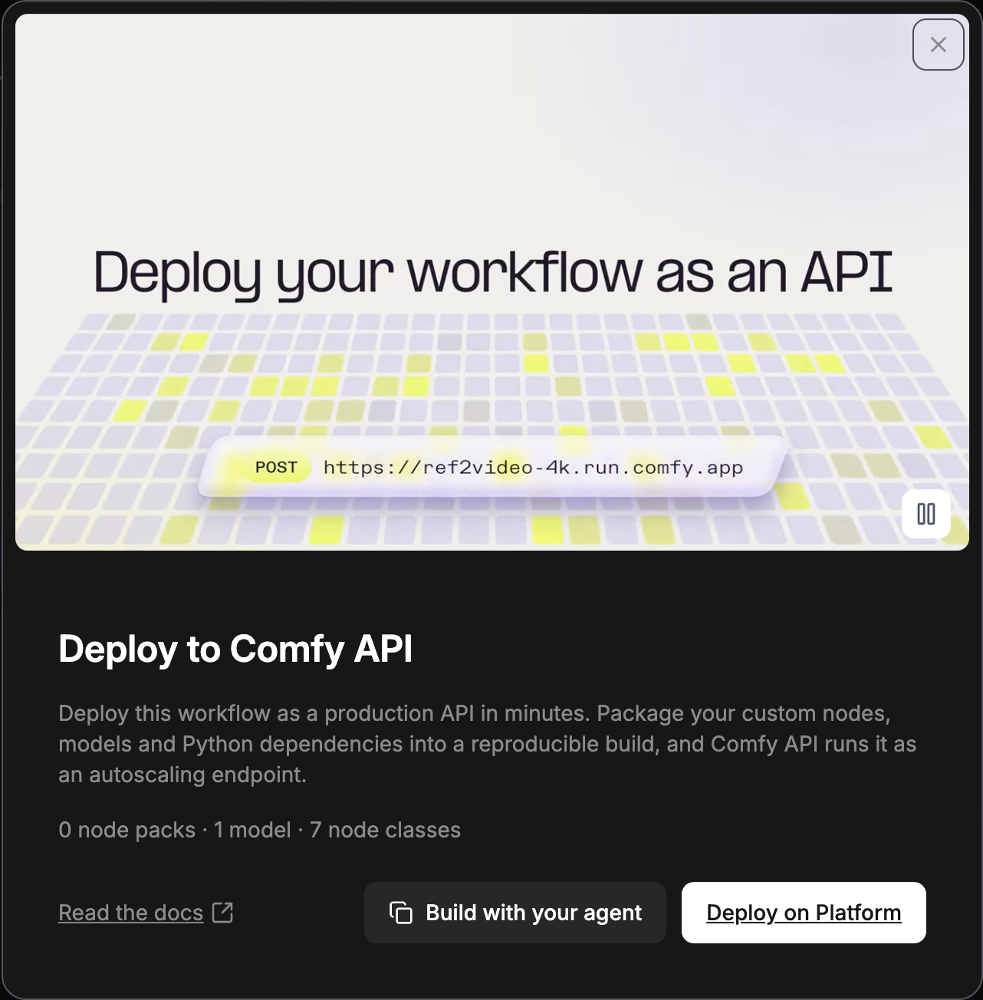

你可以在 Comfy Cloud、自己的 Comfy API 部署，或自己管理的服务器上运行 ComfyUI 工作流。Comfy Cloud 和 Comfy API 运行在 Comfy GPU 上，因此你的电脑不需要 GPU。选择适合你工作流的方案，并从其对应的卡片开始。

<CardGroup cols={2}>
  <Card title="Comfy Cloud" icon="cloud" href="/zh/development/deploy/cloud">
    运行自定义节点和模型已在 Comfy Cloud 上提供的工作流，无需构建或部署。
  </Card>
  <Card title="Comfy Cloud 上的自定义构建" icon="puzzle-piece" href="/zh/development/deploy/cloud-custom-builds">
    在 Comfy Cloud 编辑器中运行需要你自己的自定义节点和模型的工作流，并使用你在浏览器中创建的构建。
  </Card>
  <Card title="Comfy API" icon="cloud-arrow-up" href="/zh/development/serverless/quickstart">
    将自定义节点、模型和 Python 依赖关系打包为构建，并作为可自动扩缩容的端点运行。
  </Card>
  <Card title="自托管" icon="server" href="/zh/development/deploy/self-hosting">
    在你管理的机器上运行 ComfyUI，并用 `--listen` 在网络中提供服务。
  </Card>
</CardGroup>

要从自己的代码调用上述任一方案，请以 [API 格式](/zh/development/api-development/workflow-api-format) 发送工作流。

## 从 ComfyUI 应用中部署

在电脑上的 ComfyUI 或 Comfy Desktop 中，**Deploy to Comfy API** 卡片会从当前打开的工作流启动 Comfy API 构建。

<Warning>
  发布版本免费。构建完成后，**Serverless build** 行会出现 **Deploy** 按钮。部署后从部署那一刻起产生存储费用，以及 worker 运行期间的 GPU 时间费用。确认前，部署对话框会显示预估费用。
</Warning>

<Steps>
  <Step title="打开 Workflow actions 菜单">
    在 **Top bar** 中，右键点击工作流标签页。也可以点击 **Canvas** 左上角的 **Workflow actions** 按钮。

    
  </Step>
  <Step title="选择 Deploy to Comfy API">
    选择 **Deploy to Comfy API**。该入口标有 **NEW**。**Deploy to Comfy API** 卡片会打开，并统计工作流使用的节点包、模型和节点类。

    
  </Step>
  <Step title="在 Developer Platform 上继续">
    点击 **Deploy on Platform**。Developer Platform（[platform.comfy.org](https://platform.comfy.org)）会在新标签页中打开。
  </Step>
</Steps>

在 Developer Platform 上，你可以从工作流创建构建、发布版本并部署。[构建来源](/zh/development/serverless/build-sources)介绍如何从工作流文件启动构建，[Comfy API 快速开始](/zh/development/serverless/quickstart)介绍使用 comfy-cli 的同一流程。

## 从 Cloud 编辑器运行部署

如需从 Comfy Cloud 编辑器创建部署、在其上运行工作流，以及停止或删除部署，请参阅[向 Comfy Cloud 添加自定义构建](/zh/development/deploy/cloud-custom-builds)。

## 从应用程序运行工作流

当部署为 **Ready** 时，请参阅[运行工作流](/zh/development/run-workflows/overview)，从应用程序中调用它。[Comfy SDK](/zh/development/api-development/sdks) 适用于 Comfy Cloud 和你的部署。自托管的 ComfyUI 需要 [API Proxy](/zh/development/comfyui-server/api-proxy) 来提供 Comfy API v2。
