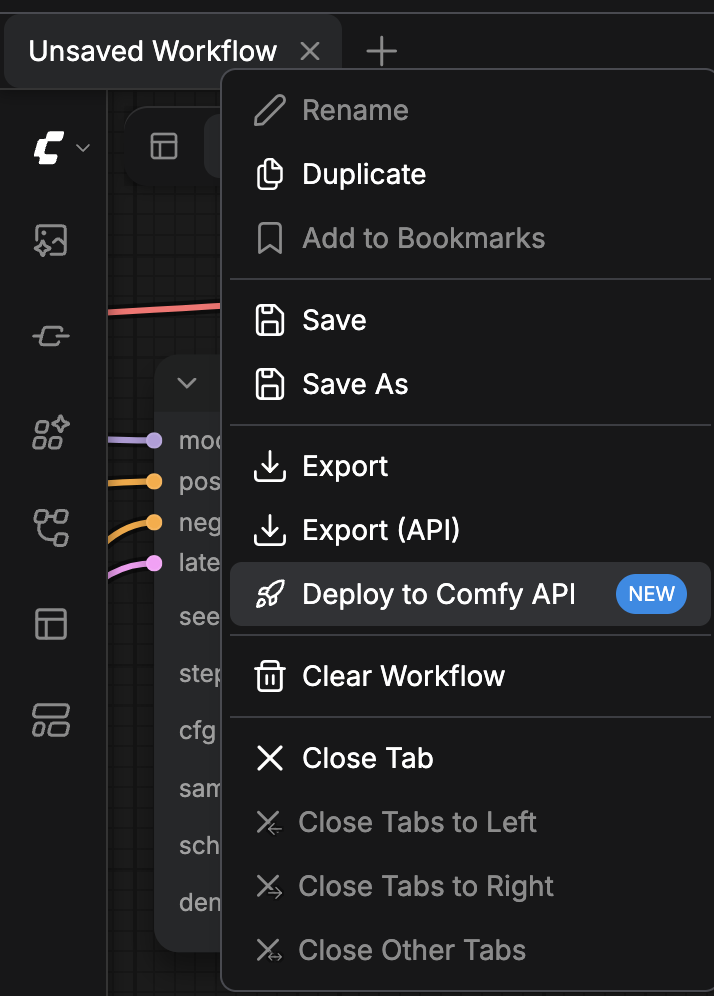

在 Comfy Cloud 上部署 Build 之后，你可以发布该 Build 的新版本、更改部署的 GPU 和 worker，并通过部署自有的 URL 从你的应用调用该部署。部署在其 worker 运行期间会产生 GPU 时间费用，并且在你删除它之前会持续产生存储费用。创建之后，你仍可继续管理它。本页介绍如何从其他来源启动 Build、发布版本、选择 GPU 和 worker、调用部署、观察其运行状态，以及停止或删除它。

要创建你的第一个 Build 和部署，请参阅[自定义 Build](/zh/development/deploy/cloud-custom-builds)。

<Note>
  如果 Comfy Cloud 已支持你的工作流中的每个节点，你无需 Build 或部署即可在 Comfy Cloud 上运行该工作流。请参阅[在 Comfy Cloud 上部署](/zh/development/deploy/cloud)。
</Note>

## 开始之前

本页的每个任务都可以在两个地方完成：浏览器中的 [platform.comfy.org](https://platform.comfy.org) 开发者平台，以及终端中的 comfy-cli。请确保具备以下条件：

- **拥有 Comfy 积分或有效套餐的工作区**：创建或启动部署需要满足其中一项条件。
- **对于 comfy-cli 标签页，comfy-cli 已登录到你的 Comfy 账户**：运行 `comfy cloud login`。

<Tip>
  如需使用 comfy-cli 而不是浏览器创建构建和部署，请在 `ComfyUI` 安装文件夹中运行以下命令：

  ```bash
  comfy build init
  comfy build push --release --target linux/nvidia
  comfy deploy up
  ```

  `comfy build init` 会将构建文件 `comfy-build.yaml` 写入该文件夹。后续的 `comfy build` 命令会读取它，因此请在同一文件夹中运行这些命令。
</Tip>

## 从 Comfy Desktop、工作流文件或 ComfyUI 开始构建

如果还没有构建，可以从已有的内容开始创建一个。[自定义构建](/zh/development/deploy/cloud-custom-builds) 介绍了主要的浏览器流程，起点是保存在 Comfy Cloud 上的工作流。请选择与你所用起点对应的标签页。

<Tabs>
  <Tab title="Comfy Desktop 快照">
    Comfy Desktop 快照会把实例的 ComfyUI 版本、自定义节点和 Python 包带入构建。它不包含模型，因此需要在构建后续步骤中添加模型。

    1. 在 Comfy Desktop 中，点击实例上的 **管理**，然后点击 **快照** 标签页。
    2. 如果列表中没有该实例的当前状态，请点击 **创建快照**。
    3. 在所需快照上，点击 **导出**。

       

    4. 在开发者平台中，在 **开发者平台侧边栏** 里点击 **部署**，然后点击 **新建构建**。如果还没有任何构建，请改为点击 **从零开始**。
    5. 在 **从工作流还是快照开始？** 步骤中，把导出的 `.json` 文件拖放到放置区域，或点击该区域进行浏览。

    再拖入另一个快照会替换当前的快照。请继续阅读自定义构建中的[使用建议的默认值进行构建](/zh/development/deploy/cloud-custom-builds#从工作流创建-build)。
  </Tab>
  <Tab title="工作流文件">
    1. 在开发者平台中，在 **开发者平台侧边栏** 里点击 **部署**，然后点击 **新建构建**。如果还没有任何构建，请改为点击 **从零开始**。
    2. 在 **从工作流还是快照开始？** 步骤中，把工作流的 `.json` 文件，或用它生成的 `.png` 图像拖放到放置区域。你也可以点击该区域进行浏览。

    

    开发者平台会读取该工作流使用的模型和自定义节点。每拖入一个工作流，都会追加到之前的条目中。请继续阅读自定义构建中的[使用建议的默认值进行构建](/zh/development/deploy/cloud-custom-builds#从工作流创建-build)。
  </Tab>
  <Tab title="ComfyUI">
    在 ComfyUI 中，**部署到 Comfy API** 入口会统计当前打开的工作流所需的内容，然后打开开发者平台。

    1. 在 **顶部栏** 中，右键点击工作流的标签页。你也可以点击 **工作流操作** 按钮。

       

    2. 选择 **部署到 Comfy API**。**部署到 Comfy API** 卡片会打开，并统计该工作流使用的节点包、模型和节点类数量。

       

    3. 点击 **在平台上部署**。开发者平台会在新标签页中打开。

    要从此工作流开始构建，请在同一菜单中选择 **导出**，把工作流保存为 `.json` 文件，然后按 **工作流文件** 标签页的步骤操作。
  </Tab>
</Tabs>

## 查找你的部署

从这里开始，本页面假定你有一个至少包含一个部署的 Build。后续每个任务都从部署开始，因此请先找到它。查看部署不会产生任何费用。请根据你工作的位置选择相应的标签页。

<Tabs>
  <Tab title="Developer Platform">
    1. 在 **Developer Platform 侧边栏**中，点击 **Deploy**。
    2. 在 **Deployments** 区域中，点击部署的名称。

    部署页面随即打开。在部署名称下方，会显示其状态（例如 **Ready** 或 **Stopped**）以及运行的版本（例如 `v2`）。**Overview** 标签页会显示其 **Runtime configuration**。
  </Tab>
  <Tab title="comfy-cli">
    列出工作区中的每个部署：

    ```bash
    comfy deploy ls --workspace
    ```

    每一行显示部署的名称、ID、状态以及运行的版本。后续指令通过 `--deployment` 后跟部署 ID 来选择部署。像 `production` 这样的裸名称仅在 Build 的文件夹中运行指令时有效。在其他位置，请使用 ID 或 `<build>/<name>`。
  </Tab>
</Tabs>

## 发布 Build 的一个版本

Build 的已发布版本永远不会改变。要添加自定义节点或模型，你需要发布一个版本，然后将部署迁移到该版本。Developer Platform 将版本称为 `v1`、`v2` 等。comfy-cli 则称之为 release（发行版）。

<Warning>
  将部署迁移到另一个版本或进行回滚时，由于旧版本和新版本会同时运行，因此会消耗 GPU 时间。在 Developer Platform 上，**Change version** 对话框会显示该数量。
</Warning>

<Tabs>
  <Tab title="Developer Platform">
    要发布一个版本：

    1. 在 **Developer Platform 侧边栏**中，点击 **Deploy**。
    2. 在 **Builds** 区域中，点击你的 Build。
    3. 点击 **New version**，并在各步骤中进行更改。
    4. 在最后一步，点击 **Save changes**。Build 页面会显示 **Changed since v**_N_，其中 _N_ 是最新版本。
    5. 点击 **Publish**。在 **Choose build targets** 对话框中，保持 **Serverless build** 处于已选择状态，然后点击 **Publish**。

    构建通常需要 10 到 15 分钟。如果构建失败，请参阅[修复失败的构建或部署](#修复失败的构建或部署)。

    要将部署迁移到该版本：

    1. 打开部署的页面。当较新版本准备就绪时，页面会在部署名称下方显示 **v**_N_ **available**。
    2. 点击 **Change version**。
    3. 选择该版本，然后点击 **Update to v**_N_。

    在新版本准备就绪之前，部署会继续提供其正在运行的版本，并且其 URL 保持不变。更新完成后，部署名称下方的版本会显示为 **v**_N_。

    要返回到较早的版本：

    1. 在部署页面中，点击 **History** 选项卡。
    2. 在该版本所在行，点击 **Roll back to this version**。
  </Tab>
  <Tab title="comfy-cli">
    在 Build 的文件夹中运行以下命令。

    1. 更改 ComfyUI 安装后，将其重新扫描到 Build 文件中：

       ```bash
       comfy build update --yes
       ```

    2. 将 Build 文件与安装内容以及 Comfy Cloud 上的 Build 进行比较：

       ```bash
       comfy build status
       ```

    3. 推送 Build 文件，并为部署运行的目标 `linux/nvidia` 创建一个发行版：

       ```bash
       comfy build push --release --target linux/nvidia
       ```

    4. 跟踪该发行版的构建日志，直到构建完成：

       ```bash
       comfy build release logs --target linux/nvidia --follow
       ```

    5. 将部署迁移到最新的发行版：

       ```bash
       comfy deploy up --deployment <deployment>
       ```

    `comfy deploy up` 会跟踪部署，直到迁移完成。在此之前，部署会继续提供其当前发行版。

    要返回到较早的发行版：

    - 要返回到当前发行版之前的发行版，请运行：

      ```bash
      comfy deploy rollback --deployment <deployment>
      ```

    - 要返回到特定发行版，请添加 `--to`，例如 `--to v5`。
  </Tab>
</Tabs>

每个 Build 的每个版本都会计入工作区的 Build 版本数量上限。达到上限后，请删除不再需要的版本。请参阅[清理](#清理)。

## 更改 GPU 或区域

GPU 决定工作流可获得的 VRAM 容量，以及每个 worker 每小时的成本。区域决定部署运行的位置，并且可选的 GPU 取决于区域。

<Warning>
  对于正在运行的部署，更改 GPU 或区域会在新 GPU 上启动该部署的副本。旧副本会继续提供服务，并持续消耗 GPU 时间，直到 Comfy Cloud 将部署迁移到新副本。对于已停止的部署，更改会在下次启动时生效。
</Warning>

<Tabs>
  <Tab title="开发者平台">
    创建部署时选择 **位置**：**任意地点** 或 **美国**。开发者平台无法更改现有部署的位置。要在其他位置运行，请从该 Build 的页面重新部署。

    要更改 GPU：

    1. 在部署页面中，点击 **编辑设置**。
    2. 在 **编辑部署** 中，选择一个 GPU。每个 GPU 都会显示其 VRAM 和每小时价格。
    3. 点击 **保存更改**。
  </Tab>
  <Tab title="comfy-cli">
    1. 列出各区域以及每个区域提供的 GPU：

       ```bash
       comfy deploy refs compute
       ```

       表格会显示每个区域、每个 GPU 类别、其 VRAM 以及可用性。要列出单个区域，请添加 `--region <region>`。

    2. 设置 GPU 类别、区域或两者：

       ```bash
       comfy deploy scale --deployment <deployment> --gpu <gpu-class> --region <region>
       ```

    如果命令因部署正在运行而拒绝执行，请先运行 `comfy deploy stop --deployment <deployment>`，再次运行 `scale`，然后运行 `comfy deploy start --deployment <deployment>`。新的 GPU 或区域会在部署启动时生效。
  </Tab>
</Tabs>

## 缩放 worker

每个 worker 是一块运行你的作业的 GPU。你需要设置两个数值：

- **常驻热备 worker**：保持运行的 worker，使作业无需等待 GPU 启动。设为 `0` 时，部署会在没有作业进入时关闭其 GPU。
- **最大 worker 数**：作业到达时，部署可同时运行的最大 worker 数量。超出该上限的请求会在部署的队列中等待，直到有 worker 空闲。

<Warning>
  **常驻热备 worker** 在整个运行期间都会按 GPU 时间计费，即使没有作业也是如此。
</Warning>

<Tabs>
  <Tab title="开发者平台">
    1. 在部署页面中，点击 **编辑设置**。
    2. 设置 **常驻热备 worker** 和 **最大 worker 数**。
    3. 点击 **保存更改**。

    **运行时配置** 会显示你保存的值。
  </Tab>
  <Tab title="comfy-cli">
    同时设置上下限。`--min` 的取值范围为 `0` 到 `20`，`--max` 的取值范围为 `1` 到 `20`：

    ```bash
    comfy deploy scale --deployment <deployment> --min 0 --max 3
    ```

    该指令会输出 `Scaled deployment <id> to min=0, max=3`。
  </Tab>
</Tabs>

你的套餐决定了一个部署最多可运行的 worker 数量。要查看该数量，请在开发者平台上打开 [**限制**](https://platform.comfy.org/settings/limits)，并查看 **每个部署的最大 worker 数**。

## 停止和启动部署 {#stop-and-start-a-deployment}

停止部署可以保留该部署及其 URL 和模型，同时不再运行任务。需要时再启动它即可。

<Warning>
  已停止的部署仍会产生存储费用。只有当您删除该区域中该 Build 的最后一个部署后，存储计费才会结束。请参阅[清理](#清理)。
</Warning>

<Tabs>
  <Tab title="开发者平台">
    要在浏览器中停止和启动部署，请参阅[停止或删除您的部署](/zh/development/deploy/cloud-custom-builds#停止或删除部署)。

    要在另一个版本上启动已停止的部署：

    1. 点击 **Start** 旁的箭头，然后选择 **Start on v**_N_。
    2. 在对话框中，点击 **Start on v**_N_。
  </Tab>
  <Tab title="comfy-cli">
    停止部署：

    ```bash
    comfy deploy stop --deployment <deployment>
    ```

    再次启动它：

    ```bash
    comfy deploy start --deployment <deployment>
    ```

    每条指令都会打印服务已接受该操作。要持续跟踪部署直到其状态稳定，请参阅[监控部署](#监控部署)。
  </Tab>
</Tabs>

## 从应用中调用部署

你的应用使用工作区 API 密钥，通过 [Comfy API v2](/zh/api-reference/v2/overview) 将 API 格式的工作流发送到部署的 URL。发送任务之前，请检查部署的状态是否显示为 **就绪**。对于始终预热工作进程数为 `0` 的部署，任务可能需要在 GPU 启动期间等待几分钟。

<Tabs>
  <Tab title="开发者平台">
    1. 在部署页面上，找到**概览**选项卡中的**通过 API 运行**。
    2. 复制**部署 URL**。
    3. 点击**创建 API 密钥**，然后复制该密钥。
    4. 复制 Python、JavaScript 或 cURL 代码片段。
    5. 使用 `COMFY_API_KEY` 环境变量中的密钥运行该代码片段。

    要在页面上测试部署，请使用**快速测试**。它会在部署上运行一个不包含模型的小型工作流。

    <Warning>
      **快速测试**会消耗部署上的 GPU 时间。
    </Warning>

    1. 打开**测试此部署**。
    2. 选择**快速测试**。
    3. 点击**运行**。

    测试完成后，会显示**已完成，用时**，后面跟着所花的时间。
  </Tab>
  <Tab title="comfy-cli">
    发送一个 API 格式的工作流并等待其输出：

    ```bash
    comfy deploy run --deployment <deployment> --workflow workflow_api.json
    ```

    该指令会等待任务，并将其输出下载到 `outputs` 文件夹。要保存到其他位置，请添加 `--output-dir <folder>`。
  </Tab>
</Tabs>

在你自己的代码中，请使用 [Comfy SDKs](/zh/development/api-development/sdks)。将 `COMFY_BASE_URL` 设置为**部署 URL**。请参阅[选择基础 URL](/zh/development/api-development/sdks#选择基础-url)。

## 在 API 请求中使用工作区库模型

部署会运行工作区库中的 `.safetensors` 模型，即使其发布版本并不包含这些模型。若要在每次请求中选用不同的 LoRA，只需将该 LoRA 上传到库一次，然后在发送的每个工作流中指定其文件名。

<Steps>
  <Step title="将 LoRA 上传到工作区库">
    要在 Comfy Cloud 编辑器中或开发者平台上上传模型，请参阅[添加自己的 LoRA 或模型](/zh/development/deploy/cloud-custom-builds#添加自己的-lora-或模型)。该页面还列出了上传所需的套餐和文件大小。

    要从终端上传，请使用 `--type` 设置模型类型：

    ```bash
    comfy assets library upload my_style.safetensors --type loras
    ```

    上传完成后，该指令会输出 `Added my_style.safetensors to loras`。
  </Step>
  <Step title="在工作流中设置 lora_name">
    在 [API 格式的工作流](/zh/development/api-development/workflow-api-format)中，将加载器的 `lora_name` 输入设置为库中的文件名（包括 `.safetensors`）：

    ```json
    "10": {
      "class_type": "LoraLoader",
      "inputs": {
        "lora_name": "my_style.safetensors",
        "strength_model": 1.0,
        "strength_clip": 1.0,
        "model": ["4", 0],
        "clip": ["4", 1]
      }
    }
    ```
  </Step>
  <Step title="发送请求">
    按[从应用调用部署](#从应用中调用部署)所示发送工作流。
  </Step>
</Steps>

要使用其他 LoRA，只需在下一次请求中把 `lora_name` 改为另一个库文件名。无需新的 Build、发布或重新部署。

- 一个工作流最多可以引用 100 个库模型。如果某个加载器引用了第 101 个库模型，就会失败，表现得就像该文件不在库中一样。
- 请确保同一个加载器所读取的各个文件夹中文件名唯一。如果库中这类文件夹里的两个文件夹包含相同的文件名，通过 API 发送的任务将不会加载其中任何一个文件。

## 监控部署

在部署启动时、修改部署之后以及作业失败时，检查部署的状态。

<Tabs>
  <Tab title="开发者平台">
    在部署的页面上：

    - 部署启动过程中，部署名称下方的状态会显示 **排队中**、**预配中** 或 **启动中**，当它开始处理作业时显示 **就绪**。
    - 部署启动期间，**部署进度** 会显示每个步骤，例如 **复制模型**。部署会在 Comfy 侧继续启动，因此你可以关闭页面，稍后再回来。
    - **启动日志** 标签页显示部署启动期间 ComfyUI 打印的内容。
    - **历史记录** 标签页列出部署运行过的版本以及推动其变更的操作。

    在 **部署** 页面上，**部署** 区域会在 **Spend · 7d** 中显示每个部署过去七天的 GPU 积分。不包含模型存储。
  </Tab>
  <Tab title="comfy-cli">
    在 Build 的文件夹中，跟踪部署直到其状态稳定：

    ```bash
    comfy deploy status --deployment <deployment> --watch
    ```

    该指令会报告状态（例如 `Deployment <name>: ready`）、是否有更新的发布版本正在等待，以及有多少作业在排队。如需查看更多信息：

    ```bash
    comfy deploy logs --deployment <deployment>      # 启动时 ComfyUI 打印的内容
    comfy deploy events --deployment <deployment>    # 其状态变更，按顺序排列
    comfy deploy history --deployment <deployment>   # 它运行过的发布版本
    ```
  </Tab>
</Tabs>

## 清理

删除某个构建在某个区域中的最后一个部署后，该构建便不再产生存储费用；删除版本则会释放构建版本上限中的一个名额。当某个构建或版本仍被部署使用时，你无法将其删除，因此请先删除该部署。

<Warning>
  删除部署、版本或构建都是永久性的。删除部署会移除其 URL，因此调用该部署的应用将停止工作。构建及其版本会保留，所以你可以再次部署。之后创建的部署会获得新的 URL，因为 URL 由部署的 ID 生成。若要保留该 URL，请改为[停止该部署](#stop-and-start-a-deployment)。
</Warning>

<Tabs>
  <Tab title="开发者平台">
    要删除部署，请参阅[停止或删除你的部署](/zh/development/deploy/cloud-custom-builds#停止或删除部署)。

    要删除版本：

    1. 打开该构建的页面。
    2. 在该版本所在行，打开 **版本操作**，然后选择 **删除版本**。
    3. 点击 **删除**。

    要删除构建：

    1. 在构建页面上，点击 **删除**。
    2. 在 **删除构建** 对话框中，点击 **删除**。
  </Tab>
  <Tab title="comfy-cli">
    要删除部署：

    ```bash
    comfy deploy delete --deployment <deployment>
    ```

    要删除版本：

    ```bash
    comfy build release delete <release-id>
    ```

    要删除构建：

    ```bash
    comfy build delete --id <build-id>
    ```

    每条指令都会要求你确认。要列出某个构建的发布版本及其 ID，请运行 `comfy build release ls --id <build-id>`。要列出你的构建，请运行 `comfy build ls`。
  </Tab>
</Tabs>

## 修复失败的构建或部署

当构建或部署失败时，日志会指出原因。修复原因，然后重新发布或重新启动。

<AccordionGroup>
  <Accordion title="构建失败">
    在 Developer Platform 上，请遵循 Custom Builds 中的[如果构建失败怎么办？](/zh/development/deploy/cloud-custom-builds#发布-build)。

    使用 comfy-cli 时，请在构建的文件夹中查看发布版本的状态及其构建日志：

    ```bash
    comfy build release show
    comfy build release logs --target linux/nvidia
    ```

    更改 ComfyUI 安装，例如移除失败的自定义节点，然后[再次发布](#发布-build-的一个版本)。
  </Accordion>

  <Accordion title="部署状态显示为 Failed">
    部署页面会显示错误，并带有 **此部署未启动。请修复错误指出的问题，然后再次启动。** 点击**复制**来复制错误信息。**启动日志**标签页会显示 ComfyUI 输出的内容。

    使用 comfy-cli 时，`comfy deploy status` 会输出原因。有关日志和状态变化，请参阅[监控部署](#监控部署)。

    修复错误指出的问题，然后重新启动部署。
  </Accordion>

  <Accordion title="部署启动时间过长">
    按照部署页面上的**部署进度**步骤操作，或运行 `comfy deploy status --deployment <deployment> --watch`。版本中的模型越多，**复制模型**步骤耗时越长。在 Developer Platform 上创建部署时，部署对话框中的**预计时间**会显示部署启动所需的时间。

    如果所选 GPU 没有可用容量，请[更改 GPU 或区域](#更改-gpu-或区域)。使用 comfy-cli 时，`comfy deploy refs compute` 会显示每个 GPU 的可用情况。
  </Accordion>

  <Accordion title="状态显示为 Stopped: out of credits">
    当工作区积分已用完时，部署会停止。添加积分，然后重新启动部署。
  </Accordion>

  <Accordion title="状态显示为 Stop failed">
    停止请求失败，因此部署可能仍在计费。再次点击**停止**，或再次运行 `comfy deploy stop --deployment <deployment>`。
  </Accordion>

  <Accordion title="版本更新失败">
    部署页面显示 **更新到 v**_N_ **失败。**，并且部署会继续提供之前运行的版本。点击**重试**，或修复该版本并重新发布。
  </Accordion>
</AccordionGroup>

## 常见问题

关于部署如何计费，请参阅“使用与限制”中的[部署计费](/zh/development/deploy/cloud-usage#部署计费)。

<AccordionGroup>
  <Accordion title="一个 Build 可以来自多个工作流吗？">
    可以。在开发者平台上创建 Build 时，你可以上传一个或多个工作流，以预选它们所需的模型和自定义节点。请包含你计划运行的所有工作流所需的依赖关系，然后将每个 API 格式的工作流发送到该部署。

    每个部署使用一种 GPU 类型。若要在不同的 GPU 类型上运行工作流，请为同一个 Build 创建多个独立的部署。
  </Accordion>
</AccordionGroup>

## 后续步骤

部署运行起来后，请使用以下页面从你自己的代码向其提交工作流。

<CardGroup cols={2}>
  <Card title="Comfy SDKs" icon="code" href="/zh/development/api-development/sdks">
    从 Python 或 TypeScript 应用提交工作流，并处理输入、进度和输出。
  </Card>
  <Card title="Comfy API v2" icon="cloud" href="/zh/api-reference/v2/overview">
    使用任意语言调用 HTTP API，并查看其请求与响应格式。
  </Card>
  <Card title="工作流 API 格式" icon="file-code" href="/zh/development/api-development/workflow-api-format">
    为 API 请求准备工作流 JSON，或排查其输入和输出问题。
  </Card>
  <Card title="开始使用 comfy-cli" icon="terminal" href="/zh/comfy-cli/getting-started">
    安装 comfy-cli，并使用 `comfy cloud login` 登录 Comfy Cloud。
  </Card>
</CardGroup>
