本页先帮你生成第一张图，再帮你理解工作流是如何搭建的。

本教程使用你自己电脑上的 ComfyUI：Comfy Desktop、ComfyUI Portable 或手动安装。开始之前，请先安装 ComfyUI 并打开它。

<Tip>
  若想无需安装、直接在浏览器中使用 ComfyUI，请[在 Comfy Cloud 中打开 Z-Image-Turbo 文生图模板](https://cloud.comfy.org/?template=image_z_image_turbo&utm_source=docs&utm_medium=referral&utm_campaign=first_generation)。
</Tip>

## 选择开始方式

用下方标签页选择一条开始路径。**模板**适合先用较新的模型出一张图。**从零搭建工作流**用 Stable Diffusion 1.5 在空白画布上学习节点与连线。

<Tabs>
<Tab title="模板（推荐）">
当前 ComfyUI 模板包含较新的开源模型。**Z-Image-Turbo** 很适合作为第一张图像：采样步数少、体量相对小但质量不错，并且有官方维护的模板。与「从零搭建工作流」不同，这条路径**不用**手搭节点——打开模板、装好模型，然后运行即可。

<iframe width="560" height="315" src="https://www.youtube.com/embed/HvaEsnyOfSw?si=bsOQzcL0vsPcaE83" title="YouTube video player" frameborder="0" allow="accelerometer; autoplay; clipboard-write; encrypted-media; gyroscope; picture-in-picture; web-share" referrerpolicy="strict-origin-when-cross-origin" allowfullscreen></iframe>

### 1. 打开 Z-Image-Turbo 模板

1. 在 ComfyUI 中打开模板浏览器（**Workflow → Browse Templates**，或你所用界面中的 Templates 入口）。
2. 搜索 **Z-Image-Turbo**（文生图）。
3. 打开模板，使其加载到画布上。

<Tip>
  若想无需安装、直接在浏览器中使用，请[在 Comfy Cloud 打开同一模板](https://cloud.comfy.org/?template=image_z_image_turbo&utm_source=docs&utm_medium=referral&utm_campaign=first_generation)。完整模型卡片与更多工作流见：[Z-Image-Turbo 在 ComfyUI 中的用法](/tutorials/image/z-image/z-image-turbo)。
</Tip>

### 2. 安装模型

Z-Image-Turbo 需要 **三个** 文件（文本编码器 + 扩散模型 + VAE），不是单个 SD 1.5 checkpoint：

| 文件 | 文件夹 |
| --- | --- |
| `qwen_3_4b.safetensors` | `ComfyUI/models/text_encoders/` |
| `z_image_turbo_bf16.safetensors` | `ComfyUI/models/diffusion_models/` |
| `ae.safetensors` | `ComfyUI/models/vae/` |

**最省事 — 缺失模型界面**

1. 模板加载后若出现缺失模型提示，点击**查看详情**。
2. 在**问题**标签的**缺失模型**下，若 Comfy Desktop 提供**下载**，请使用它。
3. 在 **Portable** 或**手动安装**中，打开每个文件的链接（或复制 URL），下载后移到文件名下方标注的文件夹——思路与[修复缺失的模型](#fix-a-missing-model)相同。
4. 按 `R`（或在缺失模型中点击**刷新**），让 ComfyUI 重新扫描。

**手动下载** — 若问题面板没有**下载**按钮，请使用 [Z-Image-Turbo 模型下载](/tutorials/image/z-image/z-image-turbo#z-image-turbo-model-downloads) 中的卡片与目录说明。

### 3. 运行并查看图像

1. 如需修改提示词，编辑画布上的提示词控件。
2. 点击 **Run**，或按 `Ctrl+Enter`（macOS 上为 `Cmd+Enter`）。工作流会进入队列，随后 ComfyUI 生成图像。
3. 运行结束后，在模板的保存 / 预览节点中查看结果。
4. 或从**左侧边栏**打开**资产 → 已生成**。Portable 与手动安装还会把 PNG 写到 `ComfyUI/output`。

若出现**缺少必需输入**，参见[缺少必需输入](#required-input-missing)。若仍提示缺模型，回到步骤 2 或[修复缺失的模型](#fix-a-missing-model)。

你现在已经在较新的模型栈上得到第一张图像。若想用 Stable Diffusion 1.5 逐个连接节点，请切换到**从零搭建工作流**标签页。

</Tab>
<Tab title="从零搭建工作流">
在这条路径中，你将在空白**画布**上构建一个文生图工作流。你输入一段对画面的描述，ComfyUI 便会使用 **Stable Diffusion 1.5** 模型生成一张 512 × 512 的图像。每个节点都由你自己添加并连接。每一步都会说明该节点做什么，以及如何判断这一步是否成功。

这里故意选用体积小、结构简单的 SD 1.5：一个 checkpoint 文件、一段简短工作流，教学价值清晰。它**不是**最新的画质目标——若想用较新的默认方案，请切换到**模板（推荐）**标签页（或其他模型教程）。

## 了解工作流的组成部分 {#learn-the-parts-of-a-workflow}

工作流是由连线连接的一组节点。每个节点执行一项任务：

- **输入**是节点左侧的圆点。它们从其他节点接收数据。
- **输出**是节点右侧的圆点。它们将数据发送到其他节点。
- **控件**是节点内部的设置，例如文本框、数字或列表。
- **连线**是从某一输出将数据传送到相同类型输入的线，例如从 `CLIP` 输出到 `clip` 输入。

路径 B 中的工作流包含七个节点，共六种类型。最后一列是每个节点在**添加节点**菜单中的位置；[添加节点](#add-a-node)一节对此进行了说明。

| 节点 | 功能 | **添加节点**路径 |
| --- | --- | --- |
| `Load Checkpoint` | 加载模型文件。其输出为模型（`MODEL`）、文本编码器（`CLIP`）和图像解码器（`VAE`）。 | **模型** > **加载器** |
| `CLIP Text Encode (Prompt)` | 将文本提示词转换为引导模型的数据。你需要添加两个：一个用于你希望出现的内容，一个用于你不希望出现的内容。 | **模型** > **条件** |
| `Empty Latent Image` | 创建空白的起始图像，并设置其宽度和高度。 | **模型** > **Latent** |
| `KSampler` | 使用模型和两个提示词，逐步将空白的起始图像变成你的图像。 | **模型** > **采样** |
| `VAE Decode` | 将 `KSampler` 的结果转换为普通图像。 | **模型** > **Latent** |
| `Save Image` | 显示图像并将其保存到输出文件夹。 | **图像** |

## 下载模型 {#download-the-model}

`Load Checkpoint` 节点需要一个模型文件。本教程使用 `v1-5-pruned-emaonly-fp16.safetensors`。

- 从 Hugging Face 下载 [`v1-5-pruned-emaonly-fp16.safetensors`](https://huggingface.co/Comfy-Org/stable-diffusion-v1-5-archive/blob/main/v1-5-pruned-emaonly-fp16.safetensors)。

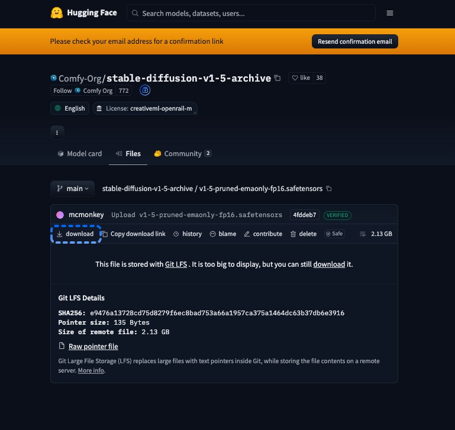

## 将模型放入 `checkpoints` 文件夹 {#put-the-model-in-the-checkpoints-folder}

只有当文件位于 ComfyUI 会读取的 `checkpoints` 文件夹中时，ComfyUI 才会列出该 checkpoint。请将你下载的文件移动到你所安装版本对应的文件夹中。

<Tabs>
  <Tab title="Comfy Desktop">
    默认情况下，每个 Comfy Desktop 实例都会读取共享模型文件夹。Comfy Desktop 会将下载的模型保存在标记为 **Downloads** 的共享模型文件夹中。

    1. 在 Comfy Desktop 的**标题栏**中，点击**菜单**，然后选择**桌面设置**。
    2. 选择**存储**选项卡。
    3. 在**共享模型**下，点击标记为 **Downloads** 的文件夹路径。该文件夹会在你的文件管理器中打开。
    4. 将 `v1-5-pruned-emaonly-fp16.safetensors` 移动到其中的 `checkpoints` 文件夹。如果没有 `checkpoints` 文件夹，请创建一个。
  </Tab>
  <Tab title="ComfyUI Portable">
    - 将 `v1-5-pruned-emaonly-fp16.safetensors` 移动到 `ComfyUI_windows_portable\ComfyUI\models\checkpoints`。

    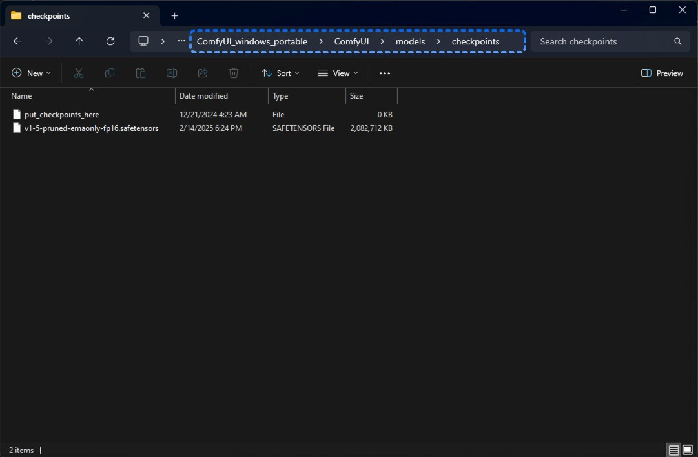
  </Tab>
  <Tab title="手动安装">
    1. 打开你安装 ComfyUI 的文件夹，即包含 `main.py` 的那个文件夹。
    2. 将 `v1-5-pruned-emaonly-fp16.safetensors` 移动到其中的 `models/checkpoints` 文件夹。
  </Tab>
</Tabs>

如果 ComfyUI 已经打开，请按 `R`，让它重新读取模型文件夹。

## 打开空白工作流

**画布**是用于放置节点的大面积区域。如果画布上已经显示了一个工作流，请打开一个空白工作流：

1. 在**左侧边栏**顶部，点击 ComfyUI 标志（**菜单**）。
2. 选择**新建**。

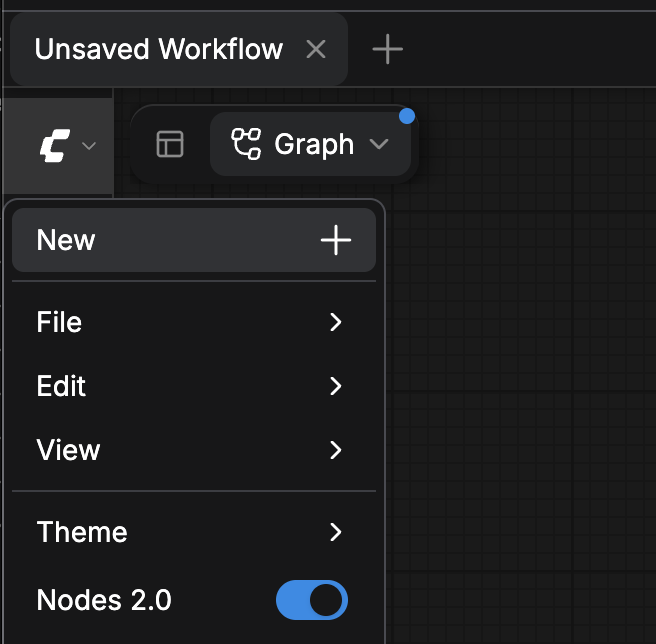

此时**画布**为空。

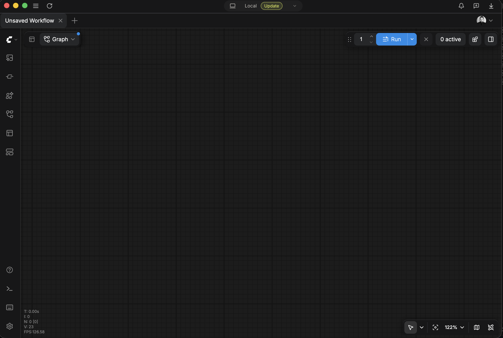

<Tip>
  在**顶栏**中，已打开工作流标签页旁边的加号（**+**）按钮也可用于新建空白工作流。

  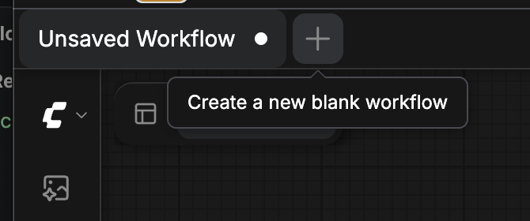
</Tip>

## 添加节点 {#add-a-node}

添加节点有三种方式。后续步骤会说明使用哪一种。

### 使用添加节点菜单 {#use-the-add-node-menu}

1. 在**画布**的空白处右键点击。将打开一个菜单。
2. 选择**添加节点**，然后按照该节点的**添加节点**路径依次选择每个类别。[节点表](#learn-the-parts-of-a-workflow) 列出了本教程中每个节点的路径。
3. 选择该节点。它会出现在你右键点击的位置。

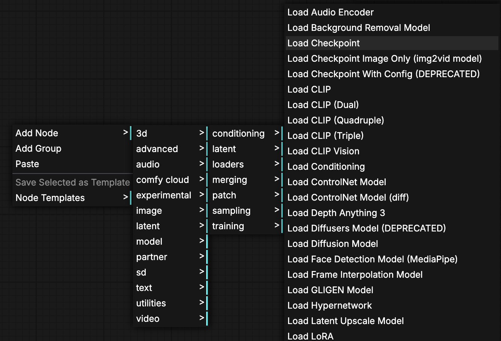

### 搜索节点库 {#search-the-node-library}

1. 按 `N`，或点击**左侧边栏**中的**节点**。将打开**节点库**。
2. 如果**节点库**显示多个标签页，选择**全部节点**。
3. 在**搜索节点...**框中输入节点名称。
4. 在结果中点击该节点，然后在**画布**上你想要放置它的位置点击。节点会出现在那里。

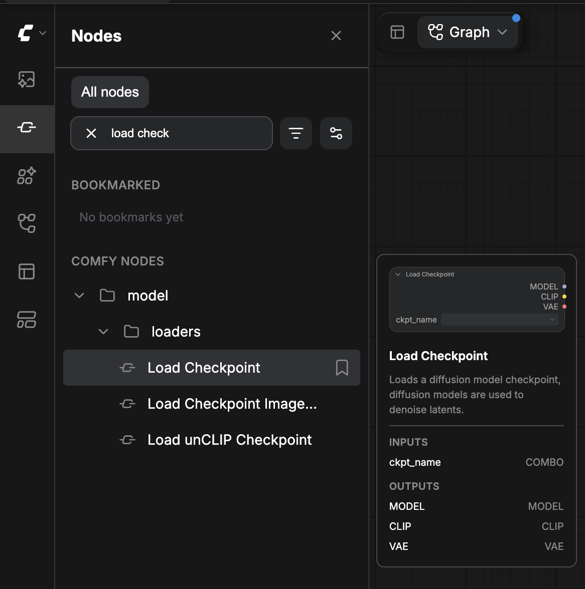

### 将连线拖到空白画布 {#drag-a-link-to-empty-canvas}

将连线拖到空白画布，可一步完成添加节点并连接。

1. 从已放置节点的输出圆点开始拖动。
2. 在**画布**的空白处释放。默认会在该处打开节点搜索框。
3. 输入节点名称，然后选择该节点。ComfyUI 会添加该节点，并将它连接到你拖出的输出。

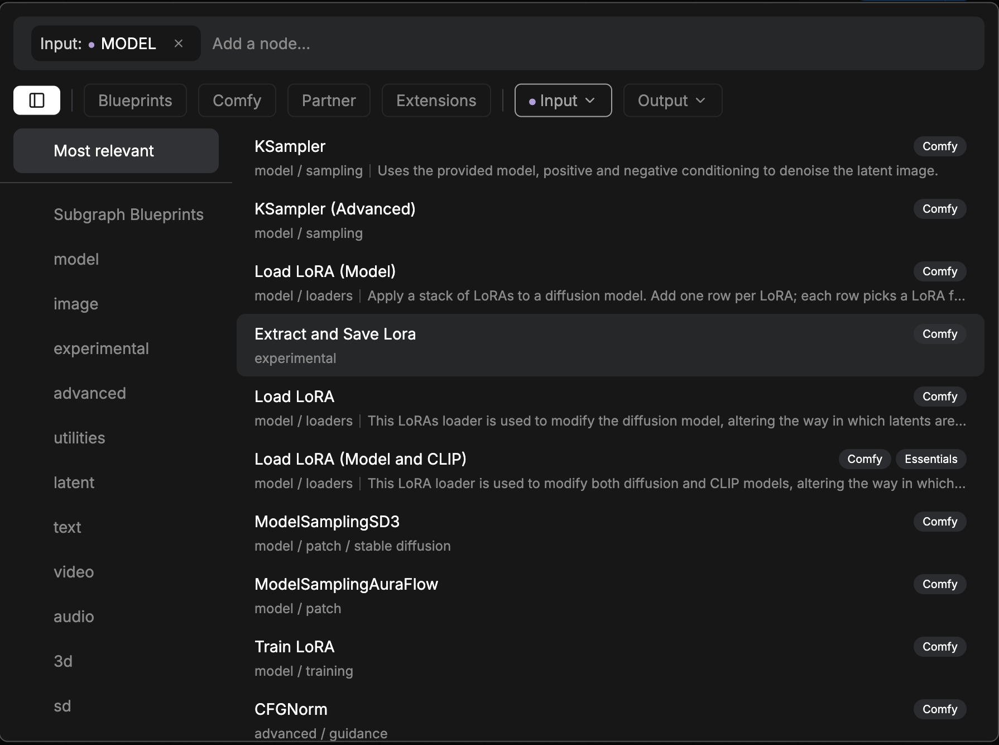

要在释放时打开菜单而不是搜索框，请在释放时按住 `Shift`。

## 连接两个节点 {#connect-two-nodes}

连线将数据从一个节点的输出传送到另一个节点的输入。

1. 从一个节点上的输出圆点开始拖动。
2. 在另一个节点的输入圆点上释放。两个圆点之间会出现一条连线。

以下规则适用于每一条连线：

- 一个输出可以供给多个输入。
- 一个输入只接受一条连线。连接到某个输入的新连线会替换其原有连线。
- 连线连接的是相同类型的输出和输入。ComfyUI 不会在不同类型之间绘制连线。

## 添加 `Load Checkpoint` 节点

`Load Checkpoint` 节点用于加载模型文件。

1. 使用[**添加节点**菜单](#use-the-add-node-menu)添加 `Load Checkpoint` 节点：**模型** > **加载器** > `Load Checkpoint`（菜单中显示为 **Checkpoint加载器（简易）**）。
2. 在该节点中，点击 `ckpt_name` 控件，然后选择 `v1-5-pruned-emaonly-fp16.safetensors`。

该节点右侧显示三个输出：`MODEL`、`CLIP` 和 `VAE`。

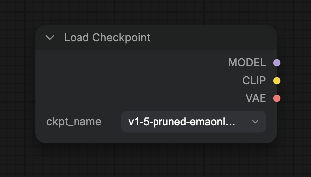

如果 `ckpt_name` 列表中没有显示该文件，请参阅[模型不在 Checkpoint 列表中](#the-model-isnt-in-the-checkpoint-list)。

## 添加 `KSampler` 节点

`KSampler` 节点负责执行生成。它需要四条连线：模型、两个提示词，以及空白的起始图像。

1. 通过[**节点库**](#search-the-node-library)添加一个 `KSampler` 节点：搜索 `KSampler`（菜单中显示为 **K采样器**）。
2. 将 `Load Checkpoint` 上的 `MODEL` 输出[连接](#connect-two-nodes)到 `KSampler` 上的 `model` 输入。

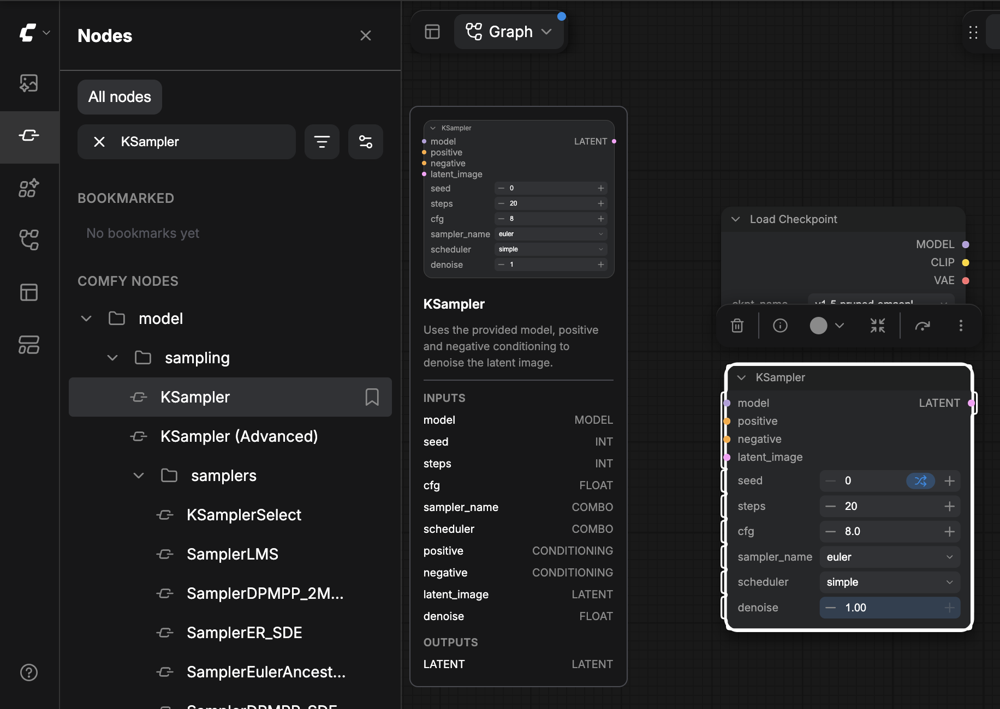

其余三条连线将在接下来的两节中绘制。

将 `KSampler` 的控件保持为默认值。例如，`steps` 为 `20`，`cfg` 为 `8.0`。

## 添加提示词节点

提示词用于描述图像。正向提示词说明你想要看到的内容，负向提示词说明你不想要的内容。

1. 使用 [**添加节点** 菜单](#use-the-add-node-menu)（**模型** > **条件**）或 [**节点库**](#search-the-node-library) 添加一个 `CLIP Text Encode (Prompt)` 节点（菜单中显示为 **CLIP文本编码**）。
2. 点击它的文本框，输入正向提示词，例如 `beautiful scenery nature glass bottle landscape, purple galaxy bottle`。
3. 右键点击该节点，然后选择 **复制**。此时会出现第二个 `CLIP Text Encode (Prompt)` 节点。
4. 点击第二个节点的文本框，输入负向提示词，例如 `text, watermark`。

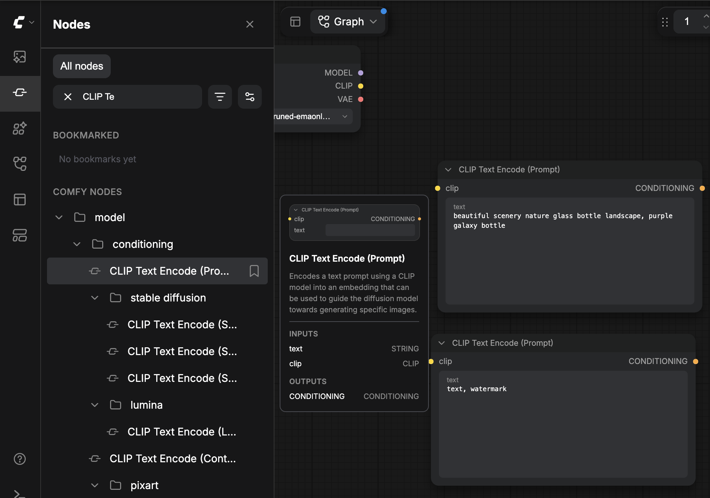

[连接](#connect-two-nodes)提示词：

1. 将 `Load Checkpoint` 上的 `CLIP` 输出连接到每个 `CLIP Text Encode (Prompt)` 节点上的 `clip` 输入。两个提示词节点共用同一个 `CLIP` 输出。
2. 将正向提示词节点上的 `CONDITIONING` 输出连接到 `KSampler` 上的 `positive` 输入。
3. 将负向提示词节点上的 `CONDITIONING` 输出连接到 `KSampler` 上的 `negative` 输入。

## 设置图像尺寸

`Empty Latent Image` 节点用于设置图像尺寸。它的 `width` 和 `height` 初始值为 `1024`。本工作流使用 `512`，即[从图像加载工作流](#load-a-workflow-from-an-image)中的示例工作流所用尺寸。

1. 通过[**添加节点**菜单](#use-the-add-node-menu)添加一个 `Empty Latent Image` 节点：**模型** > **Latent** > `Empty Latent Image`（菜单中显示为 **空Latent图像**）。
2. 将 `width` 设置为 `512`。
3. 将 `height` 设置为 `512`。
4. 将 `batch_size` 保持为 `1`。
5. [连接](#connect-two-nodes)其 `LATENT` 输出到 `KSampler` 上的 `latent_image` 输入。

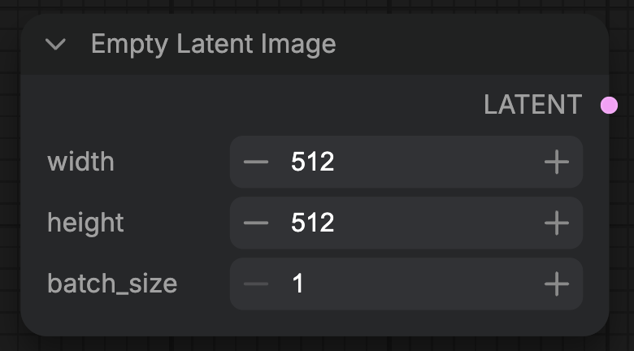

`KSampler` 的四个输入现在都已具有连线。

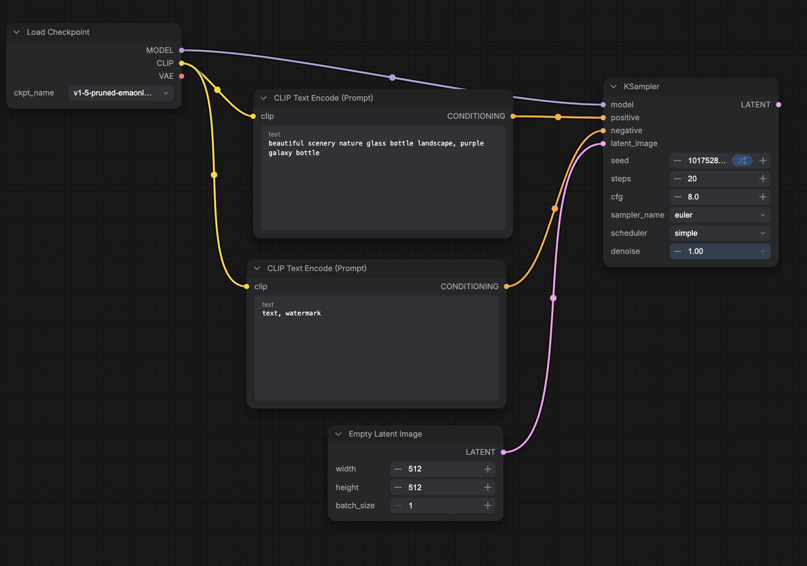

## 解码并保存图像

`KSampler` 输出的是 Latent，不是图像。`VAE Decode` 将其转换为图像，`Save Image` 则负责存储图像。

1. 通过[**节点库**](#search-the-node-library)添加 `VAE Decode` 节点：搜索 `VAE Decode`（菜单中显示为 **VAE解码**）。
2. [连接](#connect-two-nodes) `KSampler` 上的 `LATENT` 输出到 `VAE Decode` 上的 `samples` 输入。
3. 将 `Load Checkpoint` 上的 `VAE` 输出连接到 `VAE Decode` 上的 `vae` 输入。
4. 通过[将连线拖到空白画布](#drag-a-link-to-empty-canvas)添加 `Save Image` 节点：从 `VAE Decode` 上的 `IMAGE` 输出拖动，在空白**画布**上释放，然后选择 `Save Image`（菜单中显示为 **保存图像**）。其 `images` 输入已链接到 `IMAGE`。

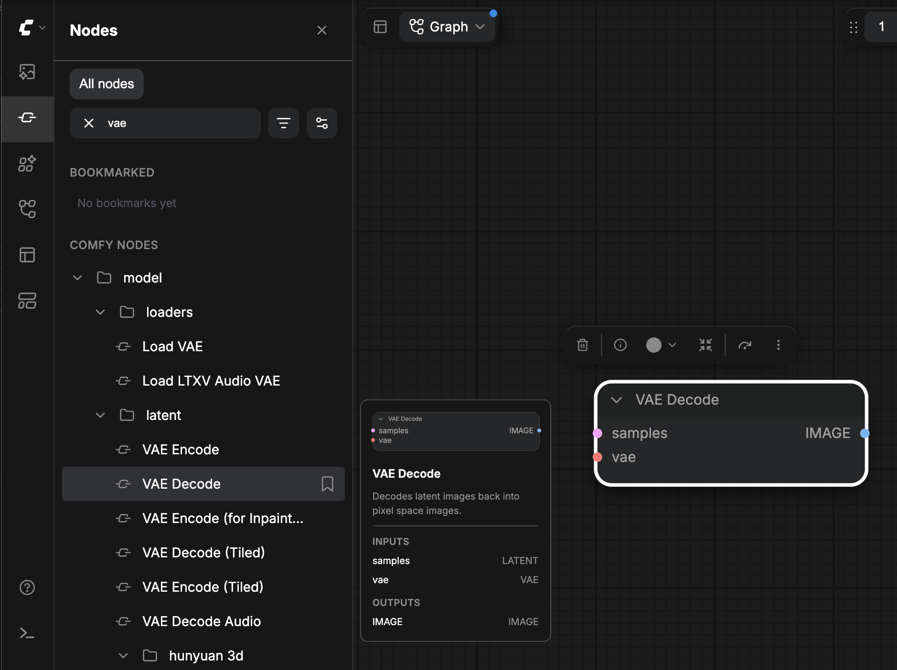

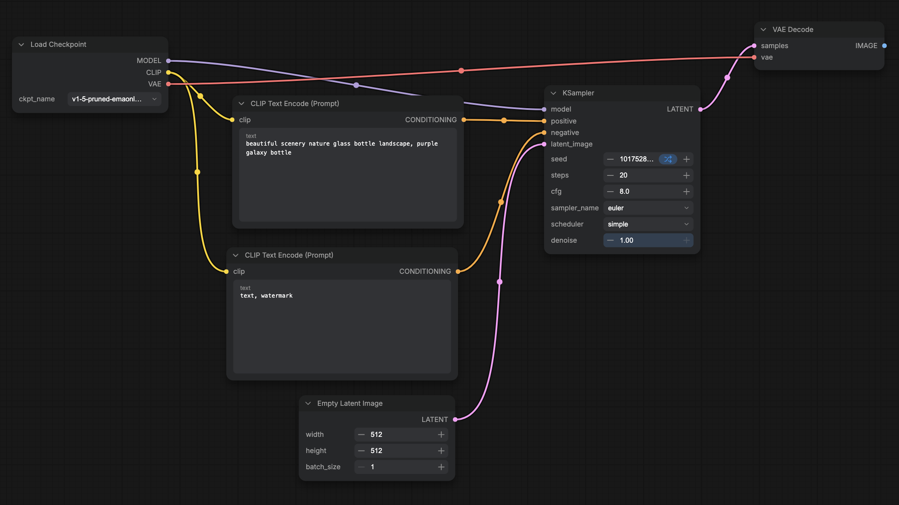

你的工作流包含七个节点和九条连线。

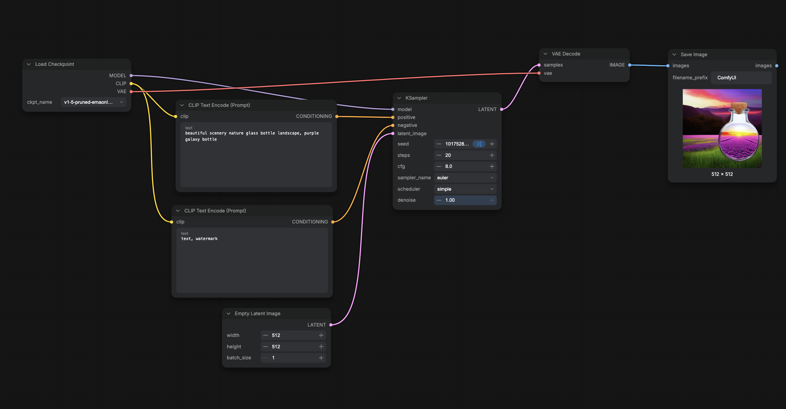

<Tip>
  在未选中任何节点时，按 `.` 可使整个工作流适应屏幕。
</Tip>

## 运行工作流

运行工作流会将其加入队列，随后 ComfyUI 生成图像。

- 点击 **运行**，或按 `Ctrl+Enter`（macOS 上为 `Cmd+Enter`）。

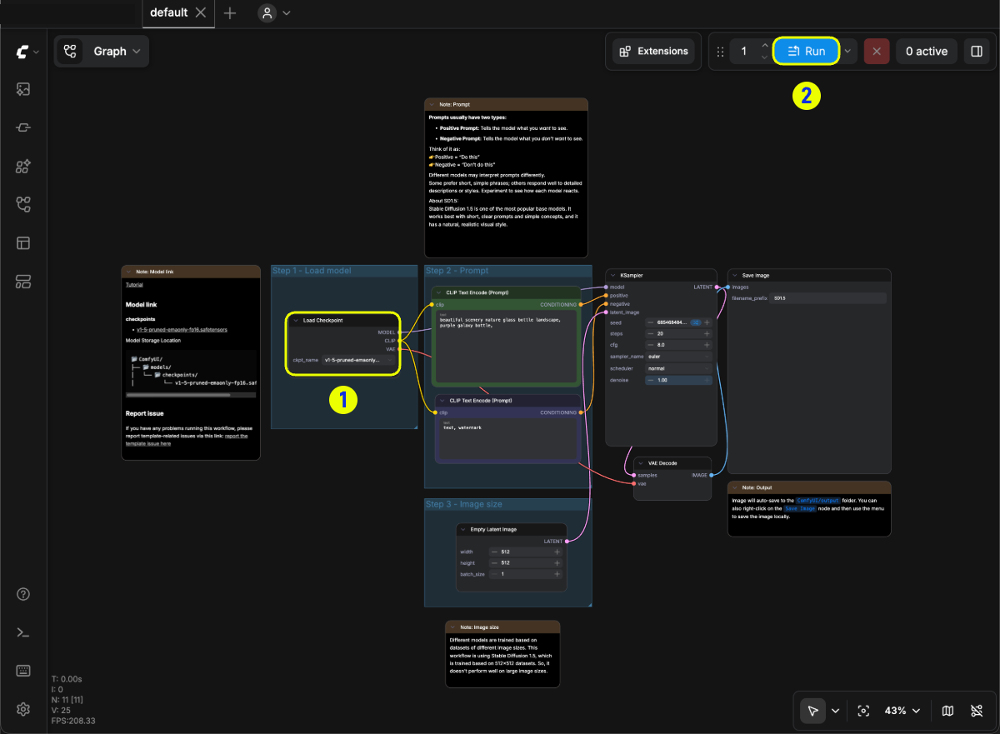

如果 ComfyUI 显示 **缺少必需输入**，请参阅[缺少必需输入](#required-input-missing)。

## 找到生成的图像

运行结束后，图像会出现在 `Save Image` 节点中。要从**左侧边栏**打开它：

- 点击**资产**，然后选择**已生成**选项卡。

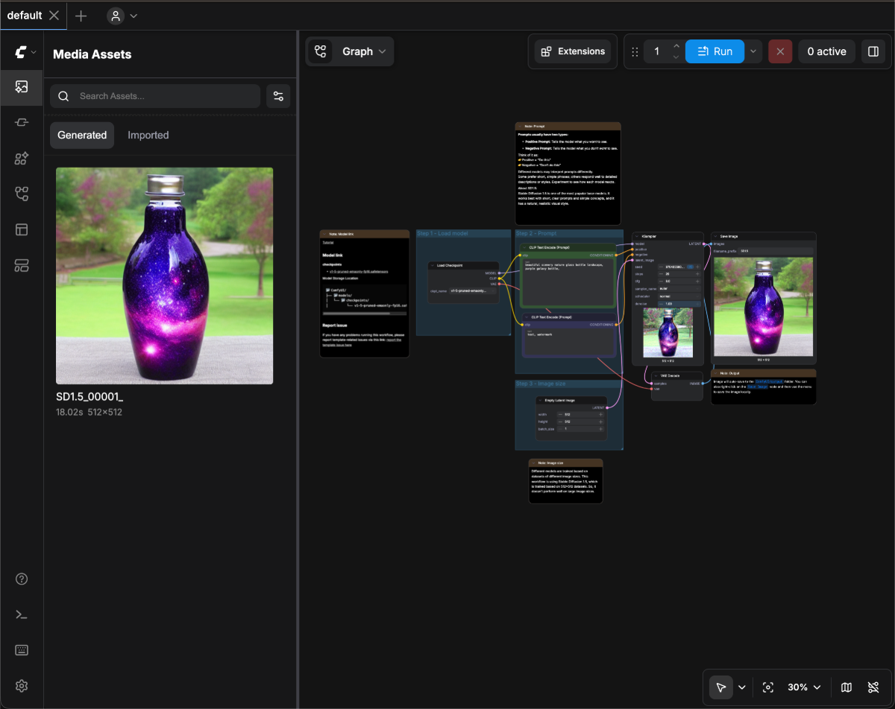

`Save Image` 还会将图像以 PNG 文件的形式写入输出文件夹，文件名为 `ComfyUI_00001_.png`。每生成一张新图像，编号就会递增。在 ComfyUI Portable 和手动安装版本中，输出文件夹为 `ComfyUI/output`。

## 从图像加载工作流 {#load-a-workflow-from-an-image}

默认情况下，`Save Image` 写出的每个 PNG 文件都包含生成该图像的工作流。加载下面的示例图像，将其工作流与你在路径 B 中构建的工作流进行对比。

1. 将此图像保存到你的计算机：

   

2. 将 PNG 文件拖到**画布**上。你也可以点击**左侧边栏**中的 ComfyUI 标志（**菜单**），选择 **文件** > **打开**，然后选择该文件。

图像中的工作流会打开。如果出现的是 `Load Image` 节点，说明你拖入的文件中没有保存工作流。

</Tab>
</Tabs>

## 修复缺失的模型 {#fix-a-missing-model}

当你加载的工作流所用的模型文件不在你的模型文件夹中时，ComfyUI 会显示一条提示，指出缺失的模型，例如 `v1-5-pruned-emaonly-fp16.safetensors is missing`。

1. 点击**查看详情**。**右侧面板**会打开**问题**标签页，并在**缺失模型**下列出该文件。文件应放入的文件夹（例如 `checkpoints`）会显示在文件名下方。
2. 如果该行有**下载**按钮，请点击它。
   - **Comfy Desktop**：Comfy Desktop 会将文件下载到你**DOWNLOADS** 模型文件夹中的 `checkpoints` 文件夹。
   - **ComfyUI Portable 和手动安装**：浏览器会下载该文件。请将其移动到文件名下方标注的文件夹；SD 1.5 checkpoint 参见[将模型放入 checkpoints 文件夹](#put-the-model-in-the-checkpoints-folder)。
3. 如果该行没有**下载**按钮，请自行获取文件：
   1. 点击文件名旁的链接图标。该链接图标会复制下载链接（**复制链接**）；当工作流没有链接时，则复制文件名（**复制模型名称**）。
   2. 下载该文件。路径 B 的模型请参见[下载模型](#download-the-model)。路径 A 请使用 [Z-Image-Turbo 教程](/tutorials/image/z-image/z-image-turbo) 中的链接。
   3. 将文件移动到文件名下方标注的文件夹中，例如 `checkpoints`、`diffusion_models`、`text_encoders` 或 `vae`。
4. 点击**缺失模型**标题栏中的**刷新**（圆形箭头），或按 `R`，让 ComfyUI 重新检查模型文件夹。

只要满足以下任一条件，缺失模型的行就不会显示**下载**按钮：

- 工作流没有该模型的下载链接。[从图像加载工作流](#load-a-workflow-from-an-image)中的示例图像就属于这类工作流。
- 下载链接不是 Hugging Face 或 Civitai 链接。
- 文件名不以 `.safetensors`、`.sft`、`.ckpt`、`.pth` 或 `.pt` 结尾。
- 工作流未说明该文件应放入哪个模型文件夹。

<Note>
  Comfy Cloud 对缺失模型从不显示**下载**，而是显示**导入**，以便你将模型导入 Comfy Cloud。由不支持导入模型的节点所使用的模型会列在**不支持导入**下。
</Note>

## 故障排除 {#troubleshoot}

当运行失败或模型文件无法加载时，请参考以下条目。

### 缺少必需输入 {#required-input-missing}

某个输入没有连线。提示消息会指明节点和输入的名称，例如 `KSampler is missing a required input: latent_image`。请[连接](#connect-two-nodes)消息中提到的输入，然后再次运行工作流。

### 模型不在 checkpoint 列表中 {#the-model-isnt-in-the-checkpoint-list}

该文件不在 ComfyUI 读取的 `checkpoints` 文件夹中。请将其移动到该文件夹，具体操作参见[将模型放入 checkpoints 文件夹](#put-the-model-in-the-checkpoints-folder)，然后按下 `R`。

## 接下来 {#next-steps}

- 继续使用较新的图像模型：[Z-Image-Turbo](/tutorials/image/z-image/z-image-turbo)、[FLUX.3 Klein](/tutorials/flux/flux-3-klein)、[Qwen-Image-2.1](/tutorials/image/qwen/qwen-image-2-1)
- 了解更多 SD 1.5 风格基础：[文生图教程](/tutorials/basic/text-to-image)
- 界面导览：[界面概览](/interface/overview)
