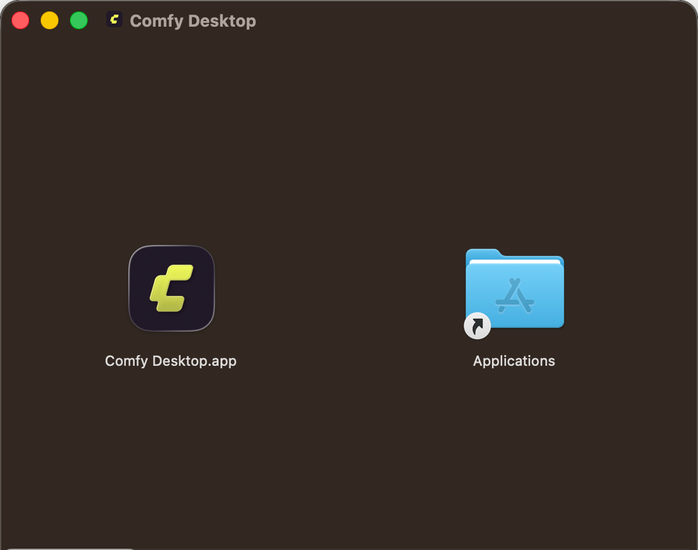
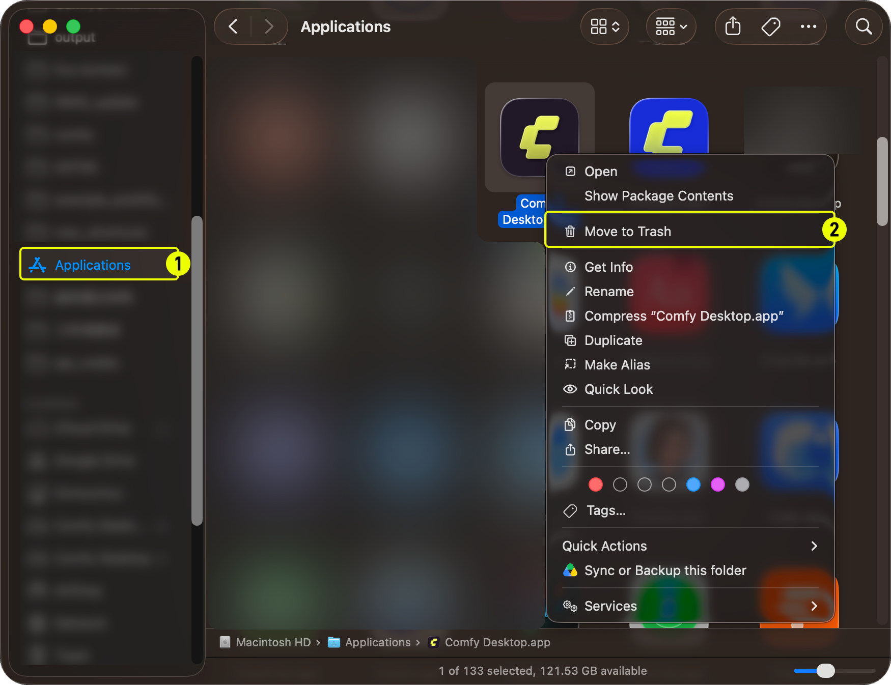

import MigrateTip from '/snippets/zh/desktop/migrate.mdx'
import UpdateGuide from '/snippets/zh/desktop/update.mdx'

**Comfy Desktop** 是一个多实例管理器，让您从一个启动器运行多个 ComfyUI 实例。本指南介绍如何在 macOS 上安装和卸载 Comfy Desktop。

## 系统要求

- **系统：** macOS 13 (Ventura) 或更新版本
- **硬件：** Apple Silicon（M1 或更新）
- **磁盘空间：** 每个安装建议至少 4.85 GB

<Card title="下载 Comfy Desktop" icon="download" href="https://comfy.org/download">
    下载 macOS 最新安装程序。页面会自动检测您的平台。
</Card>

## 安装

1. 打开下载的 `.dmg` 文件
2. 将 **Comfy Desktop** 拖入 **Applications** 文件夹
3. 从 Launchpad 或 Spotlight 启动



首次启动时，macOS 可能显示安全警告。前往**系统设置 → 隐私与安全性**，点击**仍要打开**以允许运行。

<MigrateTip />

<Card title="下一步：使用 Comfy Desktop" icon="book-open" href="/zh/installation/desktop/usage/overview">
  安装完成后，了解如何创建实例、管理安装和配置设置。
</Card>

## 更新 Comfy Desktop

<UpdateGuide />

## 卸载

### 卸载 Comfy Desktop

1. 在访达中打开 **Applications** 文件夹
2. 右键点击 **Comfy Desktop**，选择 **移到废纸篓**



### 卸载应用不会删除的内容

卸载 Comfy Desktop 只会移除启动器本身。以下数据**不会被删除**，如需完全清理请手动删除：

| 数据 | 默认位置 | 说明 |
|------|---------|------|
| 安装实例 | `~/ComfyUI-Installs` | 每个 ComfyUI 安装（也可在应用内删除）。自定义安装路径也不会被删除。 |
| 共享模型和输出 | `~/ComfyUI-Shared` | 共享模型库、输入/输出目录 |
| 应用设置和记录 | `~/Library/Application Support/Comfy Desktop` | 设置和安装记录 |
| 日志 | `~/Library/Logs/Comfy Desktop` | 桌面应用日志（`app.log`） |

<Warning>
上述目录包含您的**个人 ComfyUI 数据**：模型、输出、设置和安装实例。它们**不是** Comfy Desktop 应用程序文件。删除它们将永久移除您的数据。
</Warning>

要完全清除所有数据：

1. **删除应用数据文件夹**：`~/Library/Application Support/Comfy Desktop`
2. **删除日志文件夹**：`~/Library/Logs/Comfy Desktop`
3. **从应用内删除单个安装**，或手动删除 `~/ComfyUI-Installs` 以及你配置过的自定义安装目录
4. **删除共享模型库** `~/ComfyUI-Shared`（仅当不再需要这些文件时）

## 应用启动后界面异常

手动更新后，Comfy Desktop 可能出现界面没有样式、翻译缺失，或按钮和下拉菜单点击无反应。常见原因是上一版本残留的 Chromium 配置文件或已缓存的待更新包。

请先退出 Comfy Desktop，然后运行 [Comfy-Desktop 仓库](https://github.com/Comfy-Org/Comfy-Desktop/blob/main/scripts/reset-mac.sh)里的重置脚本：

```bash
curl -fsSLO https://raw.githubusercontent.com/Comfy-Org/Comfy-Desktop/main/scripts/reset-mac.sh && bash reset-mac.sh
```

脚本会先列出将要删除的每个路径，确认后才删除。它清理当前版本以及早期应用名下的设置、缓存和 Chromium 配置文件，避免旧版本残留重新生效。Comfy Desktop 正在运行时，脚本会拒绝执行。日志文件夹也在删除范围内，如果需要反馈问题，请先复制日志，见[应用日志在哪里](#应用日志在哪里)。

`~/ComfyUI-Installs` 里的 ComfyUI 安装和 `~/ComfyUI-Shared` 里的共享模型不会被删除，但记录安装列表的文件会随其他应用数据一起删除，下次启动时可能需要用 **Add Existing Instance** 重新添加。脚本还会列出它在 Mac 上找到的额外应用副本但不删除，因为 Dock 里同时存在旧副本，是“重置后依旧异常”的常见原因。

### 应用日志在哪里

如果重置没有解决问题，想把问题反馈到 [Comfy-Desktop 的 issue](https://github.com/Comfy-Org/Comfy-Desktop/issues) 时，需要附上的文件是 `~/Library/Logs/Comfy Desktop` 下的 `app.log`。这个文件夹也在重置的删除范围内，请先把它复制到别处再运行脚本。Comfy Desktop 每次启动都会新写一个 `app.log`，并把最近的 50 个旧文件以 `app.log_<timestamp>.log` 的名字保留在同一目录，请选出现问题那次会话的文件。单个文件达到 5 MB 后会切换到新文件，因此一次很长的会话可能分散在多个文件里。
