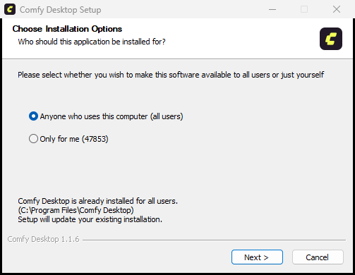
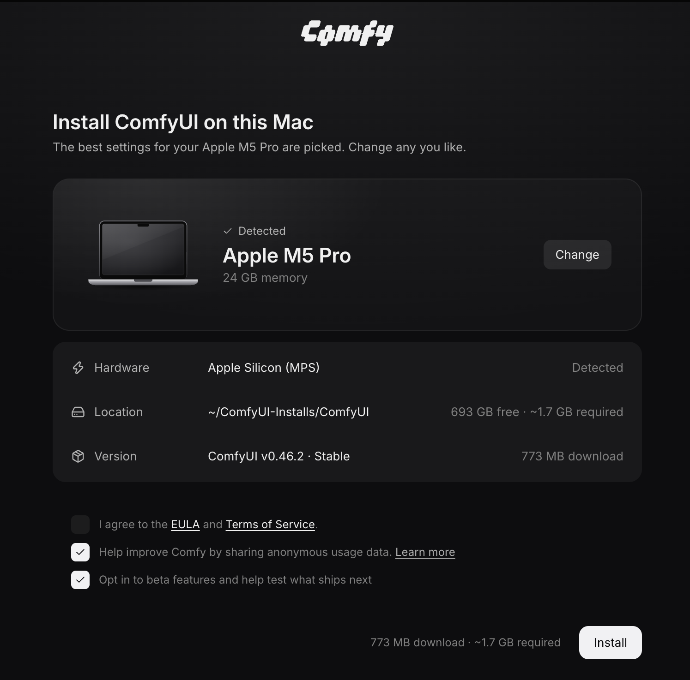
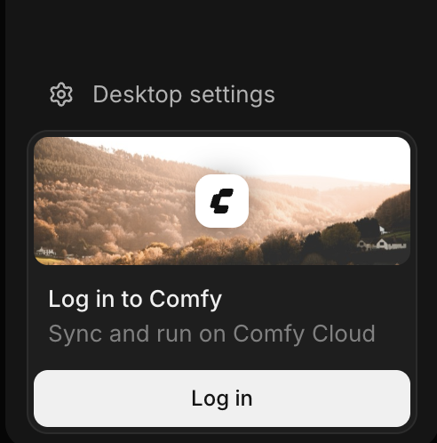
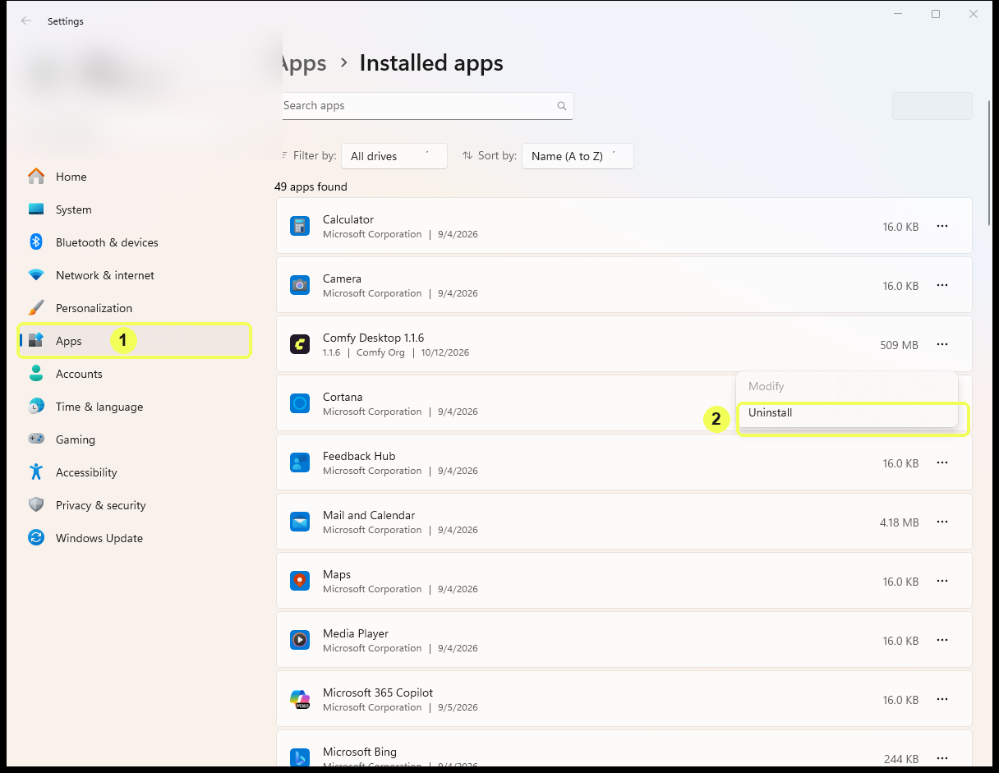

Comfy Desktop 是你用来运行 ComfyUI 的应用：既可以运行安装在本机上的副本（本地构建），也可以运行在 Comfy Cloud 上，后者在云端 GPU 上运行，在任何电脑上都能使用。它会下载并配置好 ComfyUI 所需的一切，因此你只需安装 Comfy Desktop 这一个应用。本页将引导你下载 Comfy Desktop、确认首次启动时打开的设置界面，并打开 ComfyUI。


<Note>
  Comfy Desktop 将每个 ComfyUI 副本称为一个构建。如果你使用过旧版本的 Comfy Desktop，你原来的实例会显示为构建，模型和设置保持不变。
</Note>

## 选择 ComfyUI 的运行位置

Comfy桌面版会在两个位置运行 ComfyUI：在本机上作为本地构建运行，或在 [Comfy Cloud](https://comfy.org/cloud) 上运行。开始前请先选择所需的方式，因为首次启动时的设置界面会安装本地构建。

| | 本地构建 | Comfy Cloud |
| --- | --- | --- |
| 运行位置 | 本机 | 云端的 GPU，因此可在任何电脑上使用 |
| 设置 | 首次启动时由设置界面安装 | 无。**主页**会显示 **Comfy Cloud** 卡片 |
| 费用 | 免费 | Comfy 积分，仅在 GPU 运行时消耗 |
| 需要 | 安装所需的可用磁盘空间（设置界面会显示具体数量） | Comfy 账户 |

如果只想使用 Comfy Cloud，请在设置界面出现时跳过安装。[在 Comfy桌面版中打开 Comfy Cloud](#在-comfy桌面版中打开-comfy-cloud) 说明了操作方法。

## 下载 Comfy 桌面版

下载页面提供了适用于 Windows、macOS 和 Linux 的安装程序。

1. 访问 [comfy.org/download](https://comfy.org/download)。
2. 点击 **DOWNLOAD DESKTOP**。该按钮会下载页面所检测到的操作系统对应的安装程序。安装程序的名称会显示在按钮文字下方。
3. 如需选择其他安装程序，请点击按钮旁的箭头（**All installers**），然后选择一个安装程序。列表中提供 **Windows x64**、**Windows ARM64 (NVIDIA only)**、**macOS (Apple Silicon)** 和 **Linux x64 (AppImage)**。

   

## 为你的操作系统安装 Comfy桌面版

选择你的操作系统对应的标签页，查看其系统要求，并安装你下载的文件。

<Tabs>
  <Tab title="Windows">
    **系统要求**

    - Windows 10 或更高版本，x64 或 ARM64。
    - 推荐使用独立的 NVIDIA 或 AMD GPU，但并非必需。在 ARM64 上，本地构建需要 NVIDIA GPU。
    - 每个构建至少需要 4.85 GB 的可用磁盘空间。

    **安装**

    1. 运行你下载的 `.exe` 安装程序，并按照提示操作。
    2. 从**开始**菜单或桌面快捷方式打开 Comfy桌面版。

    
  </Tab>
  <Tab title="macOS">
    **系统要求**

    - macOS 13（Ventura）或更高版本。
    - 搭载 Apple 芯片（M1 或更高版本）的 Mac。
    - 每个构建至少需要 4.85 GB 的可用磁盘空间。

    **安装**

    1. 打开你下载的 `.dmg` 文件。
    2. 将 **Comfy桌面版** 拖入 **应用程序** 文件夹。
    3. 从启动台或 Spotlight 打开 Comfy桌面版。

    

    如果 macOS 在你首次打开时显示安全警告，请前往 **系统设置** > **隐私与安全性**，然后点击 **仍要打开**。
  </Tab>
  <Tab title="Linux">
    **系统要求**

    - x64 架构上的 Linux。推荐 Ubuntu 22.04 或更高版本。
    - 推荐使用独立的 NVIDIA 或 AMD GPU，但并非必需。
    - 每个构建至少需要 4.85 GB 的可用磁盘空间。

    下载页面提供 AppImage。Debian 和 Ubuntu 的 `.deb` 软件包也可从[通用下载链接](https://dl.todesktop.com/241130tqe9q3y)获取，该链接会检测你的平台。

    **安装 .deb 软件包**

    ```bash
    sudo apt install ./*.deb
    ```

    软件包会将 Comfy桌面版安装到 `/opt/Comfy Desktop`，并添加一个 APT 源，因此新版本会随常规系统更新（`sudo apt update` 和 `sudo apt upgrade`）一起提供。在 Ubuntu 24.04 及更高版本上，它还会安装一个 AppArmor 档案，使 Electron 的沙盒正常工作。如果你在 Ubuntu 22.04 上安装了该软件包，然后升级到了 24.04，请运行 `sudo apt reinstall comfyui-desktop-2` 来添加该档案。

    **运行 AppImage**

    1. 安装 AppImage 所需的 FUSE 2。在 Ubuntu 24.04 及更高版本上，运行 `sudo apt install libfuse2t64`。在 Ubuntu 22.04 上，运行 `sudo apt install libfuse2`。
    2. 使文件可执行并运行它：

       ```bash
       chmod +x ./*.AppImage
       ./*.AppImage
       ```

    AppImage 通过替换你启动的文件来更新自身，因此请将其放在你的用户账户可写入的文件夹中。如果由于你的发行版阻止 Electron 的沙盒而导致它无法启动，请使用 `--no-sandbox` 运行它。该标志会为所有进程关闭沙盒，因此仅在正常启动失败时使用。

    <Accordion title="从源码构建并运行">
      用于开发时，请从其[仓库](https://github.com/Comfy-Org/Comfy-Desktop#development)运行 Comfy桌面版。你需要 Node.js 24、通过 Corepack 使用的 pnpm 10、`build-essential` 和 `git`。

      ```bash
      sudo apt install build-essential git
      nvm install 24 && nvm use 24
      corepack enable
      git clone https://github.com/Comfy-Org/Comfy-Desktop.git
      cd Comfy-Desktop
      pnpm run init
      ./linux-dev.sh
      ```

      源码检出不会自行更新。要更新，请运行 `git pull` 和 `pnpm run init`，然后再次启动 `./linux-dev.sh`。
    </Accordion>
  </Tab>
</Tabs>

然后打开 Comfy桌面版。首次启动时，它会打开设置界面。

<Tip>
  中文下载页面 [comfy.org/zh-CN/download](https://comfy.org/zh-CN/download) 提供相同的安装程序。其按钮文字为 **下载桌面版**。要从中国境内的镜像下载 ComfyUI 的文件，请参阅[确认设置界面](#确认设置界面)。
</Tip>

## 确认设置界面

首次启动时，Comfy 桌面版会打开设置界面。在 macOS 上，其标题为 **在此 Mac 上安装 ComfyUI**；在 Windows 上为 **在此 PC 上安装 ComfyUI**；在 Linux 上为 **在此计算机上安装 ComfyUI**。在你点击 **安装** 之前，不会下载任何内容。



Comfy 桌面版会为你的计算机选择设置。安装前请检查这些设置：

- **检测到**：顶部的面板显示 Comfy 桌面版找到的 GPU 或处理器，以及其内存。
- **硬件**：该构建所适用的硬件。**无 GPU 加速** 表示 ComfyUI 在你的处理器上运行。
- **版本**：ComfyUI 版本及其发布通道，例如 **Stable**。
- **位置**：该构建安装到的文件夹，以及该驱动器上的可用空间。

在 **安装** 旁边，设置界面会显示下载大小。将指针移到旁边的信息图标上，即可查看安装需要多少磁盘空间。

要选择其他设置，请点击 **更改**，在 **更改设置** 界面上进行编辑，然后点击 **保存更改**。

<Tip>
  首次安装时，请保留 Comfy 桌面版所选定的设置。[构建](/zh/installation/desktop/usage/instance-management) 介绍了你可以更改的每一项设置。
</Tip>

要安装：

1. 勾选 **我同意 EULA 和服务条款。** 点击 **EULA** 或 **服务条款** 可阅读其中任一内容。
2. 点击 **安装**。

其余两个复选框是可选的：

- **通过共享匿名使用数据帮助改进 Comfy**：发送匿名使用数据。**了解更多** 会打开隐私政策。
- **选择加入测试版功能，帮助测试即将发布的内容**：允许 Comfy 桌面版在此计算机上的构建中启用早期的 ComfyUI 功能。只有在开启数据共享时才能开启此选项。

如果你在勾选条款框之前点击 **安装**，其旁边会出现 **同意安装。**

<Note>
  如果 Comfy 桌面版以中文运行，它会在你点击 **安装** 后询问 **启用中国镜像？**。**启用镜像** 会从 `gitcode.com`、`mirrors.aliyun.com` 和 `mirrors.cloud.tencent.com` 下载。**暂不** 则保留 `github.com` 和 `pypi.org`。
</Note>

#

### 保留现有构建或迁移

- **使用我的构建**：当此计算机已存在除传统桌面版以外的本地构建时，该选项会显示在 **安装** 旁边。勾选条款框并点击它即可跳过安装。**主页** 打开后会显示你的构建。
- **迁移**：当 Comfy 桌面版发现传统桌面版安装时，它会替换 **安装**。[从传统桌面版迁移](/zh/installation/desktop/usage/migrate) 列出了会迁移的内容。

## 在主页查看安装过程

设置屏幕关闭后，**主页**会打开。Builds 行中你的构建卡片会显示进度，例如 **正在安装 ComfyUI · 60%**，随后显示 **启动 ComfyUI**。


安装进行期间，卡片可能显示较旧的 ComfyUI 版本。安装的最后一步会将构建更新为设置屏幕中显示的版本。

默认情况下，ComfyUI 准备就绪后会在其自己的窗口中打开，卡片会显示 **运行中**。

如果安装或启动失败，请参阅[故障排除](#troubleshoot)。

## 在 Comfy桌面版中打开 Comfy Cloud

**主页**会在构建行中显示 **Comfy Cloud** 卡片，与任何本地构建并排。


#

### 跳过本地安装并前往主页

除非你已经有构建，否则设置屏幕没有跳过按钮。若只想使用 Comfy Cloud 并前往**主页**：

1. 在设置屏幕中，勾选条款复选框。
2. 在**检测到**面板中，点击**更改**。
3. 在**标题栏**中，点击**菜单**，然后选择**跳过新手引导**。

**主页**打开时，**Comfy Cloud** 卡片会出现在构建行中。

#

### 登录并打开 Comfy Cloud

登录之前，**Comfy Cloud** 卡片会显示**登录以使用**。

<Warning>
  Comfy Cloud 在其 GPU 运行期间会消耗 Comfy 积分。打开它之前，请检查你的**积分**余额。
</Warning>

1. 在**侧边栏**中，在**登录 Comfy** 卡片上，点击**登录**。卡片会显示**在浏览器中继续**。

   

2. 在浏览器中完成登录。**侧边栏**会显示你的**积分**余额，这确认你的账户可以正常使用。
3. 在**主页**上，点击 **Comfy Cloud** 卡片。

Comfy Cloud 会在自己的窗口中打开。

<Tip>
  如果想改为在浏览器中使用 Comfy Cloud，请打开 [cloud.comfy.org](https://cloud.comfy.org/)。
</Tip>

## 打开 ComfyUI

首次安装之后，你从**主页**启动一个构建并打开 ComfyUI：

- 点击右上角的**打开 ComfyUI**。它会打开你最新的构建。要打开其他构建，点击按钮右侧的箭头（**选择要打开的构建**），然后选择要打开的构建。
- 或者点击构建行中某个构建的卡片。

你也可以在**构建**页面点击某个构建的磁贴，或在构建页面点击**启动**。在**侧边栏**中点击构建会打开其页面，但不会启动它。

ComfyUI 启动期间，构建会显示**正在启动…**。准备就绪后，ComfyUI 会在独立窗口中打开，构建会显示**正在运行**，并在**侧边栏**中带有绿色圆点。之后若要重新打开该窗口，再次点击正在运行的构建即可。

如果 ComfyUI 没有启动，请参阅[修复启动失败的构建](/zh/installation/desktop/usage/instance-management#修复失败的构建)。要了解**主页**和**侧边栏**的其余内容，请参阅[浏览 Comfy Desktop](/zh/installation/desktop/usage/overview)。要生成你的第一张图像，请按照[在 ComfyUI 中生成你的第一张图像](/zh/get_started/first_generation)操作。

## 卸载 Comfy桌面版

卸载 Comfy桌面版只会移除应用本身。你的构建、共享模型与输出、设置和日志都会保留在电脑上，直到你主动删除它们。如果只想移除某一个构建，请参阅[移除构建](/zh/installation/desktop/usage/instance-management#移除构建)。

<Warning>
  以下文件夹存放的是你自己的数据：构建、模型、输出和设置。删除后无法恢复。
</Warning>

在 macOS 和 Linux 上，你可以先通过[桌面设置](/zh/installation/desktop/usage/settings#storage)中的 **移除 Comfy桌面版数据** 清理应用的日志、缓存和临时文件。

<Tabs>
  <Tab title="Windows">
    1. 打开 **设置** > **应用** > **已安装的应用**。
    2. 找到 **Comfy桌面版**，然后点击 **卸载**。

    

    | 数据 | 默认位置 |
    | --- | --- |
    | 构建 | `%LOCALAPPDATA%\Comfy-Desktop\ComfyUI-Installs`（较旧的构建：`%USERPROFILE%\ComfyUI-Installs`），以及你自行选择的任何文件夹 |
    | 共享模型、输入和输出 | `%LOCALAPPDATA%\Comfy-Desktop\ComfyUI-Shared`（较旧的版本：`%USERPROFILE%\ComfyUI-Shared`） |
    | 设置和构建列表 | `%APPDATA%\Comfy Desktop` |
    | 日志 | `%APPDATA%\Comfy Desktop\logs` |

    如需移除全部内容，请删除这些文件夹。只有在不再需要其中的模型和输出时，才删除共享文件夹。
  </Tab>
  <Tab title="macOS">
    1. 在 Finder 中打开 **应用程序** 文件夹。
    2. 右键点击 **Comfy桌面版**，然后选择 **移到废纸篓**。

    

    | 数据 | 默认位置 |
    | --- | --- |
    | 构建 | `~/ComfyUI-Installs`，以及你自行选择的任何文件夹 |
    | 共享模型、输入和输出 | `~/ComfyUI-Shared` |
    | 设置和构建列表 | `~/Library/Application Support/Comfy Desktop` |
    | 日志 | `~/Library/Logs/Comfy Desktop` |

    如需移除全部内容，请删除这些文件夹。只有在不再需要其中的模型和输出时，才删除共享文件夹。
  </Tab>
  <Tab title="Linux">
    - **.deb**：运行 `sudo apt remove comfyui-desktop-2`。该命令还会移除 AppArmor 档案。如需一并移除 APT 来源，请运行 `sudo apt purge comfyui-desktop-2`。
    - **AppImage**：删除该 `.AppImage` 文件。

    | 数据 | 默认位置 |
    | --- | --- |
    | 构建 | `~/ComfyUI-Installs`，以及你自行选择的任何文件夹 |
    | 共享模型、输入和输出 | `~/ComfyUI-Shared` |
    | 设置 | `~/.config/comfyui-desktop-2` |
    | 应用数据，包括构建列表 | `~/.local/share/comfyui-desktop-2` |
    | 缓存 | `~/.cache/comfyui-desktop-2` |
    | 状态 | `~/.local/state/comfyui-desktop-2` |
    | 日志 | `~/.config/Comfy Desktop/logs` |

    如需移除全部内容，请删除这些文件夹，或运行仓库中的 [reset-linux.sh](https://github.com/Comfy-Org/Comfy-Desktop/blob/main/scripts/reset-linux.sh) 脚本，该脚本会清理应用的文件夹，但不会改动 `~/ComfyUI-Installs` 和 `~/ComfyUI-Shared`。只有在不再需要其中的模型和输出时，才删除共享文件夹。
  </Tab>
</Tabs>

## 故障排除 {#troubleshoot}

当设置界面或安装过程不如预期时，可使用以下条目。

<AccordionGroup>
  <Accordion title="修复点击后无反应的安装按钮">
    - **硬件**行显示**不支持**：请使用 Comfy Cloud。先[跳过本地安装并前往主页](#跳过本地安装并前往主页)，然后[登录并打开 Comfy Cloud](#登录并打开-comfy-cloud)。
    - **无法连接到 ComfyUI 下载服务器**：检查网络连接，然后点击**重试**。
    - 条款盒子旁的**同意并安装。**：请参阅[确认设置界面](#确认设置界面)。
  </Accordion>
  <Accordion title="释放磁盘空间">
    当驱动器空间不足时，**位置**行会显示**仅剩 … 可用，安装大约需要 …**。请[更改位置](#确认设置界面)到空间更大的驱动器，或在此驱动器上释放空间。
  </Accordion>
  <Accordion title="修复未安装成功的构建">
    当安装未完成时，**主页**上的构建卡片会显示**安装失败**。

    <Warning>
      卸载会永久删除该构建及其所有文件。其他构建不受影响。请先把要保留的内容从该构建的文件夹中复制出来。
    </Warning>

    1. 点击构建卡片，该构建的页面会打开。
    2. 点击**更多**，然后选择**卸载**。再点击**卸载**确认。
    3. 在**主页**上点击**新建构建**，安装一个新的构建。
  </Accordion>
  <Accordion title="关闭设置后的恢复">
    如果在设置过程中关闭 Comfy 桌面版，它会询问**是否退出设置？**。点击**退出设置**后，Comfy 桌面版不会保存你的选择。下次启动 Comfy 桌面版时，设置界面会再次打开。
  </Accordion>
  <Accordion title="修复未能启动的构建">
    当 ComfyUI 无法启动时，**主页**上的构建卡片会显示**未启动**。

    1. 点击构建卡片，会打开一个标题为 **ComfyUI 未启动**的对话框。
    2. 点击**查看日志**，了解出错的原因。
    3. 点击**重试**。
  </Accordion>
  <Accordion title="在 macOS 上 Comfy 桌面版启动后显示异常">
    手动更新后，Comfy 桌面版打开时可能出现没有样式、文本缺失或按钮点击无反应的情况。这通常是由上一个版本的档案或缓存更新导致的。

    1. 如果你可能需要反馈该问题，请先把 `app.log` 从 `~/Library/Logs/Comfy Desktop` 复制出来，因为重置会删除该文件夹。
    2. 退出 Comfy 桌面版。
    3. 运行[重置脚本](https://github.com/Comfy-Org/Comfy-Desktop/blob/main/scripts/reset-mac.sh)。它会列出将要删除的每个路径，并在删除任何内容前询问：

       ```bash
       curl -fsSLO https://raw.githubusercontent.com/Comfy-Org/Comfy-Desktop/main/scripts/reset-mac.sh && bash reset-mac.sh
       ```

    `~/ComfyUI-Installs` 中的构建和 `~/ComfyUI-Shared` 中的模型会保留，但构建列表会被删除。可通过[添加现有构建](/zh/installation/desktop/usage/instance-management#添加已有的-comfyui)将它们重新添加回来。如需反馈该问题，请在 [Comfy 桌面版问题跟踪器](https://github.com/Comfy-Org/Comfy-Desktop/issues)上附上 `app.log`。
  </Accordion>
</AccordionGroup>

## 查看源代码 {#view-the-source-code}

Comfy 桌面版的源代码位于 [GitHub](https://github.com/Comfy-Org/Comfy-Desktop)。它采用双重许可：AGPL-3.0-or-later，或来自 Comfy Org 的商业许可证。
