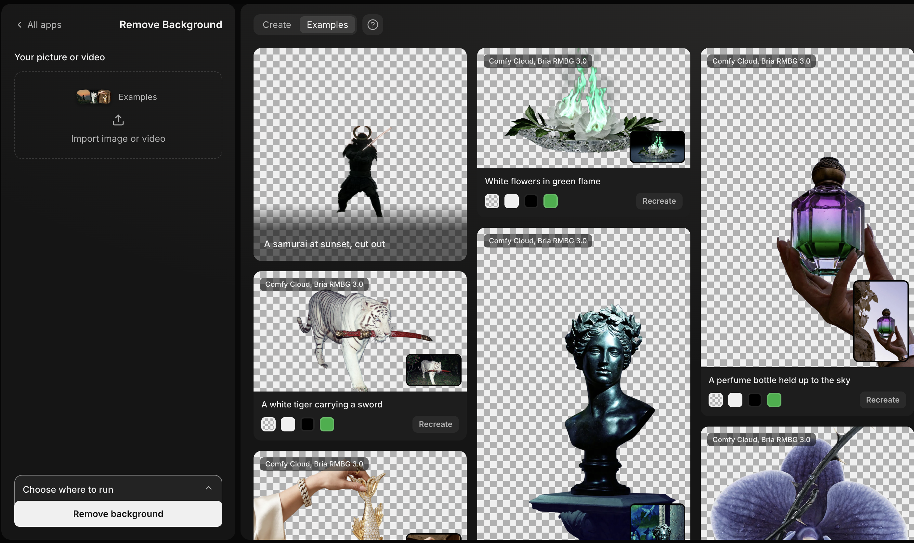

Comfy 桌面版中的应用是由 Comfy 构建的现成工具。每个应用通过简单的界面完成一项任务：你只需添加图像、视频或文本并运行，无需构建工作流。应用在 Comfy 桌面版内打开，并运行在 Comfy Cloud 或你自己的 GPU 上。

| 应用 | 功能 |
| --- | --- |
| **移除背景** | 从任意图像或视频中制作干净的抠图。 |
| **SDR 转 HDR** | 将标准图像提升到高动态范围。 |
| **商品广告** | 将商品照片转化为可直接用于广告的视觉素材。 |
| **扩展图像** | 在原始画框之外执行 outpainting。 |
| **角色替换** | 替换场景中的角色。 |
| **商品替换** | 替换场景中的商品。 |

<Note>
  桌面版应用不同于 ComfyUI 内部的 **应用** 标签页（该标签页列出你自己保存的应用工作流），也不同于 [App 模式](/zh/interface/app-mode)。请参阅 [ComfyUI 应用标签页](/zh/interface/apps)。
</Note>

## 查找应用

通过以下任一方式打开**应用**页面：

- 在**侧边栏**中，点击**应用**。
- 在**首页**上，点击应用行下方的**查看所有应用**。

每个应用都是一张带有其名称的卡片。将指针悬停在卡片上，可以查看该应用的功能。要查找应用，请在右上角的**搜索应用**中输入。搜索会匹配应用的名称和描述。该页面没有分类或筛选器。

在**首页**上，点击任一侧的卡片，应用行会轮转。点击中间的卡片即可打开该应用。

## 运行应用

1. 点击应用的卡片。应用会在 Comfy 桌面版窗口中、**侧边栏**旁打开。
2. 在左侧面板中添加输入。点击**示例**从示例开始，或导入自己的图像或视频。有些应用还会要求提供提示词或模型。
3. 点击**选择运行位置**，然后选择 **Comfy Cloud** 或 **此电脑**。参见[应用的运行位置](#应用在哪里运行)。
4. 点击面板底部的按钮。按钮名称与应用对应，例如**生成**或**移除背景**。

右侧的**示例**标签页显示该应用的示例结果。点击**创建**查看你自己的结果。

输入更多的应用（例如**角色换脸**）需要角色图像、视频、提示词、模型以及画质设置：

## 切换或离开应用

- 点击应用左上角的 **所有应用**，或点击 **侧边栏** 中的 **应用**，即可返回列表。
- 应用打开时，其名称会显示在 **侧边栏** 的 **应用** 下方。点击该名称即可返回到你离开时的应用。

一个窗口一次只能容纳一个应用。打开另一个应用会替换当前打开的应用。指向应用外部的链接会在浏览器中打开。

## 应用在哪里运行

**选择运行位置** 提供两个位置：

- **Comfy Cloud**：应用在 Comfy 的云端 GPU 上运行。它需要你的 Comfy 账户，如果你尚未登录，应用会要求你登录。请参阅[登录并打开 Comfy Cloud](/zh/installation/desktop/overview#登录并打开-comfy-cloud)。
- **此计算机**：应用在你自己的 GPU 上运行，使用你的某个本地构建。Comfy桌面版会选择应用所要求的构建；如果没有，则选择一个正在运行的构建；如果仍没有，则选择你上次使用的构建。它还会跳过早于应用所需 ComfyUI 版本的构建。它会在后台启动该构建，而不显示 ComfyUI 窗口。仅为某个应用而启动的构建，在无事可做 10 分钟后会停止。

应用不会在远程构建或传统桌面构建上运行。要添加本地构建，请参阅[构建](/zh/installation/desktop/usage/instance-management#安装新构建)。

## 积分

浏览和打开应用是免费的。运行一次的费用取决于应用使用的模型以及运行位置：

- 基于开放模型构建的应用在您自己的 GPU 上运行是免费的。
- 使用合作伙伴模型的应用无论在哪里运行，都会消耗 Comfy 积分。
- 在 Comfy Cloud 上运行会消耗 Comfy 积分，与任何 Comfy Cloud 运行相同。

关闭应用时，**侧边栏**底部的 **积分** 余额会刷新。有关套餐和定价，请参阅 [Comfy Cloud](/zh/get_started/cloud)。

## 在 ComfyUI 中打开应用的工作流

应用可以在 ComfyUI 中打开其背后的工作流，以便你自行修改。请使用应用自身的控件完成此操作。如果构建尚未运行，Comfy Desktop 会启动它，打开其 ComfyUI 窗口，并在其中加载工作流。根据应用运行的位置，工作流会在 Comfy Cloud 或本地构建中打开。

## 保存并查看结果

当应用显示结果时，Comfy Desktop 会在查看器中打开它：

- **下载**：当文件还不在本机上时，保存一份副本。
- **在访达中显示**、**在资源管理器中显示**或**在文件夹中显示**：当文件在本机上时，打开该文件所在的文件夹。
- **打开工作流**：打开生成该文件的工作流。
- **在资产中查看**：在[资产](/zh/installation/desktop/usage/assets)页面打开 Comfy Cloud 的结果。

当本机上运行的应用需要某个模型时，下载内容会出现在[下载](/zh/installation/desktop/usage/downloads)托盘中。对于应用，Comfy Desktop 只会从 Hugging Face 下载 `.safetensors` 模型。

## 申请应用

**应用**页面上的最后一张卡片显示 **缺少应用？**

1. 点击 **申请应用**。
2. 在 **你想要哪个应用？** 中，用最多 500 个字符描述该应用。
3. 点击 **发送**。

对话框会显示 **感谢，我们已收到你的请求。** 你的请求将帮助决定 Comfy 接下来构建哪些应用。

## 故障排除

<AccordionGroup>
  <Accordion title="侧边栏中没有显示应用">
    你的 Comfy Desktop 目前还无法使用应用。此类应用由 Comfy 开启，没有对应的设置项。**首页** 会改为显示示例工作流。
  </Accordion>
  <Accordion title="应用未能加载">
    **应用** 页面显示 **应用未能加载**，或者 **首页** 显示 **无法加载应用。请检查你的连接后重试。** 请检查你的网络连接，然后点击 **重试**。
  </Accordion>
  <Accordion title="某个应用未能加载">
    该应用显示 **{app} 未能加载** 和 **请检查你的网络连接，然后重试。** 点击 **重试**，或点击 **全部应用** 返回列表。
  </Accordion>
  <Accordion title="应用无法在此电脑上运行">
    该应用会显示以下消息之一：

    - **在 Comfy Desktop 中添加本地构建，即可在此电脑上运行应用。** [安装构建](/zh/installation/desktop/usage/instance-management#安装新构建)，或在 Comfy Cloud 上运行该应用。
    - **此应用需要 ComfyUI {version} 或更高版本。请更新 Comfy Desktop 中的本地构建。** 在构建中[更新 ComfyUI](/zh/installation/desktop/usage/instance-management#更新-comfyui)。
    - **{name} 仍在安装中。安装完成后请重试。** 在 **首页** 等待安装完成，然后再次运行该应用。
    - **Comfy Desktop 无法启动 {name}。** 参见[修复失败的构建](/zh/installation/desktop/usage/instance-management#修复失败的构建)。
  </Accordion>
  <Accordion title="搜索没有找到结果">
    页面显示 **没有匹配项**。请尝试其他关键词，或点击 **清除搜索**。如需请求一个尚不存在的应用，请点击 **请求添加应用**。
  </Accordion>
</AccordionGroup>
