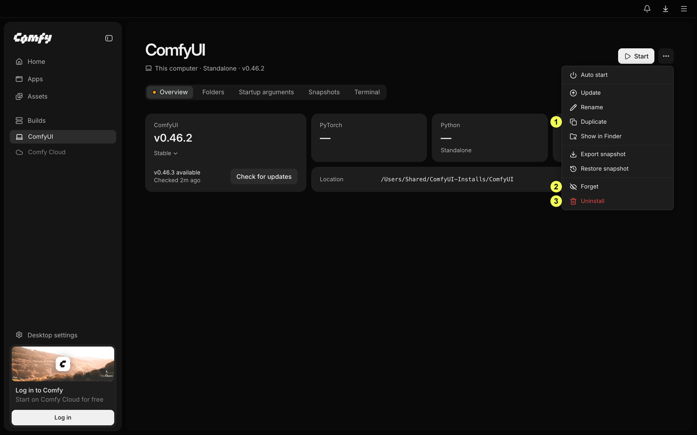

本页介绍如何复制构建、忘记构建和卸载构建。安装、添加或连接构建的方法请参阅[构建](/zh/installation/desktop/usage/instance-management)。

构建页的 **More** 菜单里有本页讲的三项操作。

1. **Duplicate**：以新名称复制构建。
2. **Forget**：从 Comfy 桌面版移除构建，保留它的文件夹。
3. **Uninstall**：移除构建并删除它的文件。

## 复制构建

副本是构建的一份拷贝，你可以对它进行修改，而不会影响原始构建。你可以从团队的工作区中复制 **Standalone** 构建或 Developer Platform Build。

1. 在[快速操作菜单](/zh/installation/desktop/usage/instance-management#从构建列表进行快捷操作)或 **More** 菜单中，选择 **Duplicate**。
2. 在 **Duplicate build** 中，为副本输入名称。
3. 点击 **Duplicate**。

Comfy Desktop 会在原始构建旁边创建副本。副本准备就绪后，Comfy Desktop 会打开该副本的构建页面。如需一步完成复制并修改构建，请使用[更新 ComfyUI](/zh/installation/desktop/usage/build-management#更新-comfyui) 中的 **Copy & update**，或[更改 PyTorch](/zh/installation/desktop/usage/build-management#更改-pytorch) 中的 **Copy & change PyTorch**。

## 移除构建

有两种操作可以移除构建。**遗忘**会将构建的文件保留在磁盘上。**卸载**会删除这些文件。

**遗忘**会从 Comfy Desktop 中移除该构建。它的文件夹仍保留在你的电脑上，你可以通过 [**添加现有构建**](/zh/installation/desktop/usage/instance-management#添加已有的-comfyui) 再次添加它。

1. 打开[构建页面](/zh/installation/desktop/usage/instance-management#管理构建)，然后点击 **更多**。
2. 选择 **遗忘**，然后在 **遗忘构建** 中确认。

对于远程构建，**遗忘**会移除连接。服务器不会发生变化。由 Comfy Desktop 从 Legacy Desktop 创建的 **独立**构建没有 **遗忘**。

**卸载**会从这台电脑上移除构建。对于远程构建，它会从 Comfy Desktop 中移除该构建，且不会更改服务器。

<Warning>
  **卸载**会永久删除该构建及其所有文件，且无法撤回。其他构建不受影响。如果你取消卸载，则无法恢复 Comfy Desktop 已经删除的文件。
</Warning>

1. 如果构建正在运行，请先停止它。
2. 在[快捷操作菜单](/zh/installation/desktop/usage/instance-management#从构建列表进行快捷操作)或 **更多** 菜单中，选择 **卸载**。
3. 检查对话框显示的文件夹，然后点击 **卸载**。

构建会显示 **正在卸载** 和百分比。完成后，该构建会从**侧边栏**和**构建**页面中消失。

要停止卸载：

1. 在快捷操作菜单中，选择 **取消**。
2. 点击 **停止卸载**。

该构建仍保留在你的构建列表中。你无法恢复 Comfy Desktop 已经删除的文件，因此请再次卸载该构建以完成操作。如果卸载失败，请参阅[修复失败的构建](/zh/installation/desktop/usage/build-troubleshooting#修复失败的构建)。
