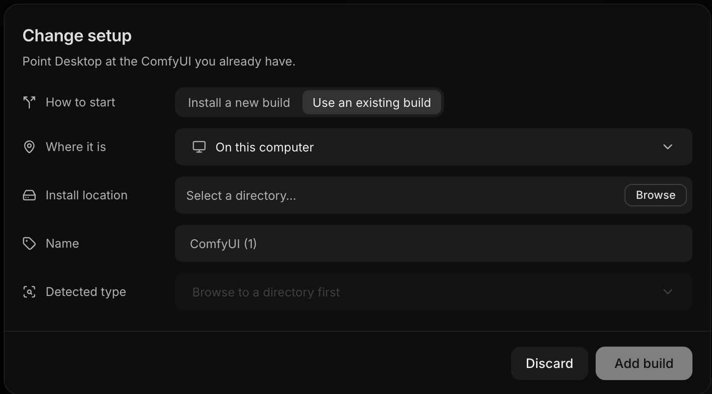
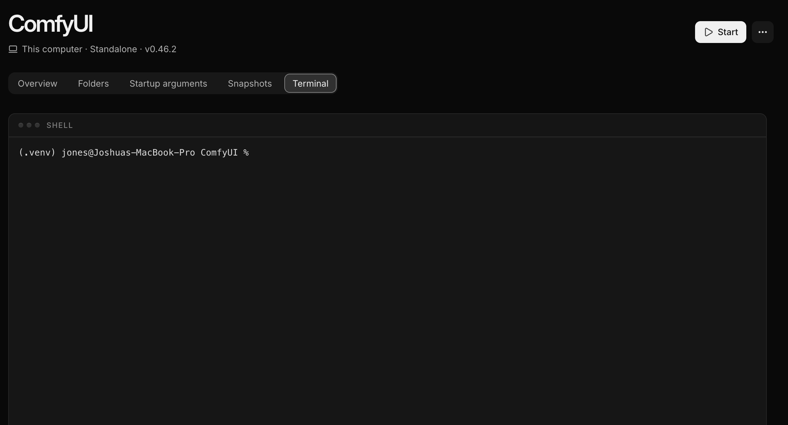

在 Comfy Desktop 中，你可以在这台电脑上运行 ComfyUI，也可以在 Comfy Cloud 上运行，还可以在另一台机器上的 ComfyUI 服务器上运行。上述每一种都是一个构建。Comfy Desktop 会为你列出 Comfy Cloud，而其他任何构建都需要你先安装、添加或连接，然后才能打开。在本页中，你将设置并运行一个构建，在其构建页面中更新和配置它，并在不再需要时将其移除。

## Comfy 构建类型

构建的运行位置决定了你可以用它做什么。**构建**页面会按运行位置对构建进行分组：

| 运行位置 | 是什么 | 如何获取 |
| --- | --- | --- |
| **此计算机** | 安装在此计算机上的 ComfyUI。其类型为 **Standalone**、**Git clone**、**Portable**、**传统 Desktop** 或 **Build**（来自团队工作区的 Developer Platform 构建）。 | [安装新构建](#安装新的构建)，或[添加已有的 ComfyUI](#添加已有的-comfyui)。 |
| **云端** | Comfy Cloud。它运行在云端的 GPU 上，需要 Comfy 账户。 | Comfy Desktop 会将其作为 **Comfy Cloud** 为你列出。 |
| **远程** | 运行在另一台机器上的 ComfyUI 服务器，通过其 URL 访问。 | [连接到 ComfyUI 服务器](#连接到-comfyui-服务器)。 |

<Note>
  在你[登录](/zh/installation/desktop/overview#登录并打开-comfy-cloud)之前，Comfy Cloud 会显示 **登录后使用**。它的快捷操作菜单中没有**停止**、**自动启动**或**卸载**，并且始终保留 **Comfy Cloud** 这一名称。
</Note>

## 查找你的构建

**构建**页面列出了工作区中的每个构建。要打开它，请点击**侧边栏**中的**构建**。

页面顶部：

- **新建构建**：开始新构建。点击旁边的箭头（**更多构建选项**）可查看**添加现有构建**和**加载快照**。
- **运行位置**：筛选列表。**全部**和**本机**始终存在。**云端**和**远程**在你拥有该类型的构建时显示。
- **排序**：按**最近使用**或**名称**排列构建。正在安装的构建会停留在顶部。
- **搜索构建**：按名称查找构建。如果没有匹配项，请点击**清除筛选**。

每个构建都是一个磁贴。磁贴会显示构建的状态，例如**运行中**、**正在启动…**、**自动启动**或**错误**。将指针悬停在磁贴上可查看点击效果：**点击以启动**、**点击以打开**或**点击以查看日志**。

当你没有任何构建时，页面会显示**暂无构建**和**在本机安装 ComfyUI，或在 Comfy Cloud 上运行。**

**侧边栏**也会在**构建**下方列出每个构建：

- 旋转图标和百分比表示构建正在安装。
- 绿点表示构建正在运行。
- 红点表示构建崩溃或未启动。将指针悬停在构建上可查看原因。
- 点击构建可打开其[构建页面](#管理构建)。
- 右键点击构建可查看其[快捷操作菜单](#从构建列表进行快捷操作)。

有关**主页**和**侧边栏**的其余部分，请参阅[浏览 Comfy 桌面版](/zh/installation/desktop/usage/overview)。

#

### 从构建列表进行快捷操作

在**侧边栏**中右键点击构建，或在**构建**页面右键点击其磁贴、在**主页**右键点击其卡片，即可打开快捷操作菜单。在磁贴或卡片上，你还可以将指针悬停其上，直到右侧出现 **⋯** 按钮，然后点击它。

菜单只显示当前适用于该构建的操作：

- **启动**，或在构建运行时显示**查看日志**、**重新启动**和**停止**。在安装或启动期间，显示**查看日志**和**取消**。崩溃后，显示**查看错误**。
- **自动启动**或**关闭自动启动**。请参阅[Comfy 桌面版打开时启动构建](#comfy-desktop-打开时启动构建)。
- **管理**，打开[构建页面](#管理构建)。
- **更新**（有可用更新时）以及**迁移到独立版**（构建可迁移到独立版构建时）。请参阅[稍后迁移](/zh/installation/desktop/usage/migrate#稍后迁移)。
- **复制**，以及**在访达中显示**、**在资源管理器中显示**或**在文件夹中显示**。
- **导出快照**和**恢复快照**。请参阅[快照](#保存和恢复快照)。
- **上传构建**（已登录工作区时）。请参阅[团队构建](/zh/installation/desktop/usage/workspaces-and-builds)。
- **卸载**。请参阅[移除构建](#移除构建)。

**自动启动**、**重新启动**、**查看日志**和**上传构建**仅在此菜单中提供。其他所有操作也位于构建页面上。当某项为灰色时，将指针悬停其上以查看原因，例如**请先停止正在运行的构建。**

## 安装新的构建

新构建是 Comfy桌面版 为你安装的 ComfyUI：可以是作为**独立版**构建的官方发布版，也可以是来自你团队工作区的 Developer Platform 构建。**新建构建**对话框会为此计算机选择设置。安装过程会下载 ComfyUI 并设置其 Python 环境，因此在点击**安装**之前请检查摘要。

<Steps>
  <Step title="打开“新建构建”对话框">
    通过以下任一方式打开该对话框：

    - 在**侧边栏**中，将指针悬停在**构建**上，然后点击加号（**+**）按钮（**新建构建**）。
    - 在**构建**页面上，点击**新建构建**。
    - 在**主页**上，当**主页**显示**新建构建**磁贴时，点击该磁贴。

    **新建构建**对话框打开时，导语为“设置全新的 ComfyUI 安装。”
  </Step>
  <Step title="检查摘要">
    当你已登录且你的工作区中有构建时，对话框会打开到**你的团队构建**。其**发布渠道**行会列出这些构建，并显示占位文本**选择构建**。要改为安装官方发布版，请在下一步将**来源**设为**官方发布版**。

    对于官方发布版，对话框会显示将要安装的内容：

    

    - **名称**：该构建在**侧边栏**和**构建**页面中显示的名称。输入框中会显示建议名称。留空即可使用该名称，或输入你自己的名称。
    - **检测到**：Comfy桌面版找到的计算机或 GPU，以及其内存大小（GB）。点击其旁边的**更改**以更改设置。
    - **发布渠道**：**稳定版**用于经过测试的发布版本，或 **GitHub 上的最新版**。
    - **硬件**：该构建所适用的 GPU 类型，例如 **NVIDIA**、**AMD**、**Intel Arc (XPU)**、**Apple Silicon (MPS)** 或 **CPU**。其说明如下：
      - **检测到**：GPU 类型与 Comfy桌面版检测到的 GPU 匹配。
      - **无 GPU 加速**：该构建面向 **CPU**。
      - **不支持**：此计算机不支持所选的 GPU 类型。
    - **版本**：将要安装的 ComfyUI 版本及其发布渠道，例如**稳定版**。
    - **位置**：该构建安装到的文件夹，以及该驱动器上的可用空间和安装所需的空间。点击**浏览**以选择其他文件夹。

    当**硬件**说明显示**检测到**，且**位置**显示可用空间、其下方没有警告时，该设置适合此计算机。

  </Step>
  <Step title="更改设置（可选）">
    点击**更改**以打开**更改设置**。其中显示“此处的一切都已设置为适合此计算机。”

    

    - **如何开始**：保留**安装新的构建**。
    - **来源**：**官方发布版**会安装 ComfyUI。**你的团队构建**会从你的工作区安装 Developer Platform 构建。请参阅[团队构建](/zh/installation/desktop/usage/workspaces-and-builds)。
    - **发布渠道**：**稳定版**会安装经过测试的发布版本。在**稳定版**旁边的列表中选择版本。**GitHub 上的最新版**会安装 master 分支中的最新提交。
    - **位置**：安装文件夹。请选择一个不位于 Comfy桌面版文件夹、OneDrive、共享的模型、输入或输出文件夹，或另一个构建内部的文件夹。点击**浏览**以选择其他文件夹。
    - **硬件**：该构建所适用的 GPU 类型。每个选项都会列出其 ComfyUI 版本、Python 版本和下载大小。

    点击**保存更改**返回摘要，或点击**放弃**放弃你的更改。

  </Step>
  <Step title="点击安装">
    点击**安装**。在安装开始之前，Comfy桌面版可能会阻止你继续：

    - 当文件夹无法容纳构建时，**位置**下方会显示问题，且**安装**会保持灰色不可用。点击**浏览**并选择其他文件夹。
    - 当驱动器可用空间少于安装所需空间，或少于 1 GB 时，会打开**磁盘空间不足**。点击**仍然继续**进行安装，或关闭对话框并选择其他文件夹。
    - 当你的驱动程序版本低于 580 时，**NVIDIA** 构建会打开**更新 NVIDIA 驱动程序**。其中会显示你的驱动程序版本和建议的最低版本。点击**仍然继续**以使用当前驱动程序进行安装，或先更新驱动程序。
  </Step>
  <Step title="查看安装进度">
    Comfy桌面版会返回**主页**，安装会在后台运行。该构建会在**主页**和**构建**页面显示**正在安装 ComfyUI**和百分比，并在**侧边栏**显示旋转加载图标和百分比。

    要查看每个步骤，请点击该构建的磁贴，或在[快捷操作菜单](#从构建列表进行快捷操作)中选择**查看日志**。**正在安装 ComfyUI**对话框会列出以下步骤：

    1. **下载**
    2. **解压**
    3. **设置环境**
    4. **获取最新的 ComfyUI**，或**获取 ComfyUI**以及你选择的版本

    在对话框中点击**查看日志**以查看安装输出。

    要停止安装：

    1. 在快捷操作菜单中，选择**取消**。
    2. 点击**取消安装**。

    安装会停止，Comfy桌面版会删除其下载的文件。
  </Step>
</Steps>

安装完成后，**侧边栏**中的旋转加载图标会消失，该构建会显示其笔记本电脑图标。有关**自动启动**的信息，请参阅[在 Comfy桌面版打开时启动构建](#comfy-desktop-打开时启动构建)。如果安装失败，请参阅[修复失败的构建](#修复失败的构建)。

## 添加已有的 ComfyUI

如果你是自己搭建的 ComfyUI（通过 Git 克隆或便携版下载包），可以将其添加到 Comfy桌面版。Comfy桌面版会从其所在文件夹运行它，不会移动或复制其中的文件。

1. 在 **构建** 页面，点击 **新建构建** 旁的箭头（**更多构建选项**），然后选择 **添加现有构建**。你也可以打开 **新建构建**，点击 **更改**，将 **启动方式** 设为 **使用现有构建**，并将 **所在位置** 设为 **此计算机**。面板会显示 **让桌面版指向你已有的 ComfyUI。**

   

2. 在 **安装位置** 旁点击 **浏览**，然后选择 ComfyUI 文件夹。
3. 检查 **检测到的类型**。它会显示 **独立版**、**便携版**、**Git 克隆** 或 **传统桌面版**。如果显示 **传统桌面版**，请停止并关闭对话框：在这里添加会使 Comfy桌面版无法迁移它。请改为按照 [从传统桌面版迁移](/zh/installation/desktop/usage/migrate) 操作。如果显示 **未检测到已知安装**，请选择直接包含 ComfyUI 本身的文件夹，而不是它上级的文件夹。
4. 在 **名称** 中，保留建议的名称，或输入你自己的名称。
5. 对于 **Git 克隆**，检查 **版本**、**仓库** 和 **分支**。**虚拟环境** 会显示 Comfy桌面版找到的 `.venv`、`venv`、`.env` 或 `env` 文件夹。点击其旁边的 **浏览** 可以选择其他文件夹。
6. 点击 **添加构建**。

该构建会出现在 **侧边栏** 和 **构建** 页面中。如果已有其他构建使用你输入的名称，**名称** 会显示 **名为"…"的构建已存在。请选择其他名称。**

要基于快照文件创建构建，请在 **更多构建选项** 中选择 **加载快照**。参见 [从快照文件创建构建](#从快照文件创建构建)。

## 连接到 ComfyUI 服务器

远程构建会打开一个运行在另一台机器上的 ComfyUI 服务器，例如你网络中的 GPU 服务器。你需要该服务器的 URL。

1. 打开 **新建构建** 对话框，方法参见[安装新构建](#安装新的构建)，然后点击 **更改**。
2. 将 **启动方式** 设为 **使用现有构建**。
3. 将 **所在位置** 设为 **在服务器上**。

   

4. 在 **名称** 中，保留建议的名称，或输入你自己的名称。
5. 在 **ComfyUI URL** 中，输入服务器的地址。输入框中会显示 `http://localhost:8188` 作为示例。
6. 点击 **连接**。

该构建会出现在**侧边栏**和**构建**页面中，并且**运行位置**过滤器中会增加**远程**选项。如果输入的地址不是 URL，对话框会显示 **请输入有效的 URL（例如 http://localhost:8188）。** 如需稍后更改该地址，请参见[更改远程构建的 URL](#更改远程构建的-url)。

## 启动、停止和重新启动构建

要启动构建并打开 ComfyUI，请参阅[打开 ComfyUI](/zh/installation/desktop/overview#打开-comfyui)。Comfy Cloud 构建会在其页面上通过 **Open Cloud** 打开，而远程构建则通过 **Open remote** 打开。

#

### 运行多个构建

当您在这台计算机上启动一个构建，而另一个构建正在运行或正在启动时，Comfy Desktop 会打开 **已有构建正在运行** 对话框。在 **将被停止** 下方，它会列出将被停止的构建。

<Warning>
  **关闭并启动** 会停止列出的构建，并丢失其中所有未保存的工作。请先保存您的工作流。
</Warning>

- **关闭并启动**：停止列出的构建，然后启动您选择的那个构建。
- **全部运行**：启动该构建，并让其他构建继续运行。

关闭对话框即可取消启动。若要不再看到此对话框，请从 **侧边栏** 打开 **桌面设置**，然后在 **首选项** 下关闭 **在运行多个构建前发出警告**。

#

### 停止或重新启动

在卸载构建之前请先停止它。重新启动它可以应用对启动参数的更改。

<Warning>
  停止或重新启动构建会丢失 ComfyUI 中所有未保存的工作。请先保存您的工作流。
</Warning>

要停止正在运行的构建：

1. 在[构建页面](#管理构建)上，点击 **更多**（**⋯**），然后选择 **停止**。您也可以在[快捷操作](#从构建列表进行快捷操作)中选择 **停止**。
2. 在 **停止 ComfyUI** 中，点击 **停止**。

ComfyUI 停止运行，其窗口随之关闭。

要重新启动正在运行的构建：

1. 在[快捷操作](#从构建列表进行快捷操作)中，选择 **重新启动**。
2. 在 **重新启动 ComfyUI** 中，点击 **重新启动**。

该卡片会显示 **正在启动…**，随后显示 **运行中**。重新启动绝不会打开 **已有构建正在运行**。

## Comfy Desktop 打开时启动构建

**自动启动**会在每次打开 Comfy Desktop 时启动一个构建。同一时间只能有一个构建启用 **自动启动**。

- 在本机上的构建或远程构建的[快捷操作菜单](#从构建列表进行快捷操作)中，选择 **自动启动**。

该构建的磁贴会显示 **自动启动**。如果另一个构建此前启用了 **自动启动**，则该构建会失去该设置。要关闭它，请在同一菜单中选择 **关闭自动启动**。

在本机安装第一个构建时，如果其他构建都没有启用 **自动启动**，新构建会获得该设置。如果该构建第一次没有启动成功，Comfy Desktop 会关闭它的 **自动启动**。

## 管理构建

每个构建都有自己的页面。你在这里管理单个构建：启动它、更新 ComfyUI、更换 PyTorch、选择它的文件夹、设置启动参数，以及重命名、复制或移除它。可以通过以下任一方式打开该页面：

- 在**侧边栏**中，点击 **构建** 下的构建。
- 在[快捷操作](#从构建列表进行快捷操作)中选择**管理**。

页面顶部会说明该构建是什么、是否正在运行。从左到右依次是：

- **名称**：点击它，或点击铅笔图标（**编辑构建名称**），即可重命名该构建。输入新名称后按 `Enter`，或按 `Esc` 保留旧名称。你可以重命名 Standalone、Portable、git 和远程构建，但无法重命名 Comfy Cloud 或 Legacy Desktop 构建。每个构建的名称都不能与其他构建重复。
- **状态标签**：**运行中**、**正在启动…**、**正在停止…**，或构建崩溃、未能启动时显示的错误标签。点击错误标签可查看错误信息。
- **元信息行**：构建的运行位置（**本机**、**云端**或**远程**）、类型和版本，以圆点分隔。
- **主按钮**：本地构建已停止时显示**启动**，运行时显示**打开**，Comfy Cloud 显示**打开云端**，远程构建显示**打开远程**。
- **更多**（**⋯**）：针对整个构建的操作。参见[使用“更多”菜单](#使用更多菜单)。

在页面顶部之下，每个标签页存放一类设置。只有当该构建具有相应设置时，标签页才会出现：

| 构建 | 标签页 |
| --- | --- |
| Standalone | **概览**、**文件夹**、**启动参数**、**快照**、**终端** |
| 远程 | **概览**、**启动参数** |
| Comfy Cloud | **概览**、**存储** |

其他本地构建（例如 Portable 和 git 构建）会显示其有设置项的标签页，另外还有**终端**。每个标签页在本页中都有对应的章节：

| 标签页 | 在这里做什么 | 章节 |
| --- | --- | --- |
| **概览** | 查看该构建运行的内容、更新 ComfyUI、切换更新通道、更换 PyTorch、更改远程构建的 URL | [更新 ComfyUI](#更新-comfyui) |
| **文件夹** | 选择模型、输入和输出文件夹 | [选择该构建使用的文件夹](#选择该构建使用哪些文件夹) |
| **启动参数** | 设置标志、ComfyUI Manager 策略、窗口、端口和环境变量 | [设置启动参数](#设置启动参数) |
| **快照** | 保存和恢复该构建的设置 | [保存和恢复快照](#保存和恢复快照) |
| **终端** | 在该构建的 Python 环境中运行命令 | [在终端中运行命令](#在终端中运行命令) |
| **存储**（Comfy Cloud） | 浏览器缓存与输出下载 | [设置输出选项](#为远程构建和-comfy-cloud-构建设置输出选项) |

#

### 使用“更多”菜单

**启动**或**打开**旁边的**更多**（**⋯**）按钮包含针对整个构建的操作。在 Standalone 构建上，它列出：

- **停止**，在构建运行期间显示。
- **重命名**，会选中页面顶部的名称。
- **复制**。参见[复制构建](#复制构建)。
- **在 Finder 中显示**、**在 Explorer 中显示**或**在文件夹中显示**，具体取决于你的操作系统。
- **导出快照**。参见[快照](#保存和恢复快照)。
- **忘记**和**卸载**。参见[移除构建](#移除构建)。

在远程构建上，它列出**重命名**和**忘记**，运行期间还会显示**停止**。在 Comfy Cloud 构建上，**更多**按钮为灰色不可用。

### 更新 ComfyUI

**概览**显示该构建运行的内容以及在哪里更新它。在独立版构建上，它会显示一张 **ComfyUI** 卡片和一排磁贴：

- **PyTorch**：已安装的 PyTorch 版本、其面向的硬件，以及一个 **更改** 菜单。请参阅[更改 PyTorch](#更改-pytorch)。
- **磁盘占用**：该构建占用的空间，下方显示 `{size} free`。
- **Python**：Python 版本和构建类型。
- 一个详情磁贴：构建的 **位置**，带有打开文件夹和 **复制路径** 的按钮，以及构建运行时的端口。从其他构建复制而来的构建还会显示它的来源，例如 **复制自**。

在其他构建上，**概览** 将构建信息按分组列出：**构建详情**、**运行详情**（构建运行时）、**位置与存储**（仅本地构建）以及 **谱系**（从其他构建复制而来的构建）。

更新会将构建升级到其通道上最新的 ComfyUI。**概览** 标签页上的圆点表示有可用更新。**ComfyUI** 卡片底部的那一行会显示构建的当前状态：

| 行显示 | 含义 | 按钮 |
| --- | --- | --- |
| **{version} 可用**，附带 **先保存快照 · 已于 {time} 检查** | 该通道上有更新的版本。 | **更新** |
| **已是最新**，附带 **已于 {time} 检查** | 该构建已是该通道上的最新版本。 | **检查更新** |
| **尚未检查** | Comfy Desktop 没有该通道的版本信息。 | **检查更新** |

要更新构建：

1. 在 **概览** 上，点击 **更新**。你也可以在[快速操作菜单](#从构建列表进行快捷操作)中选择 **更新**。
2. 在 **更新 ComfyUI** 对话框中，查看构建即将跨越的版本以及任何 **发布说明**，然后点击 **立即更新**。

更新运行时，进度卡片会替换标签页。如果更新失败，卡片会提供 **重试** 和 **关闭**。

Comfy Desktop 会在更新前保存快照。如果更新导致某个自定义节点失效，请从 **快照** 标签页恢复该快照。请参阅[快照](#保存和恢复快照)。

若想在不影响此构建的情况下试用新版本，可以改为更新一个副本：

1. 点击 **更新** 旁边的箭头（**更多更新选项**），然后选择 **复制并更新**。
2. 输入副本的名称，然后点击 **复制并更新**。

#

#### 切换更新通道

通道决定更新来自何处。

<Warning>
  在运行版本领先于稳定版的构建上选择 **稳定版**，会使构建回滚并移除较新的提交。
</Warning>

在 **ComfyUI** 卡片上，点击通道名称打开 **更新通道** 下拉菜单，然后选择一项：

- **稳定版**：经过测试的发布版本。适用于大多数构建。构建默认使用此通道。
- **GitHub 最新**：来自 master 分支的最新提交。

当你选择一个构建尚未使用的通道时，该行会显示 **切换至 {channel}**：

- 如果该通道有更新的版本，请点击 **更新** 将构建迁移到该通道。
- 如果该通道没有更新的版本，请点击 **切换通道**，在不更新的情况下迁移构建。
- 如果 Comfy Desktop 没有该通道的版本信息，该行会显示 **选择此通道并检查更新以查看版本信息。** 请点击 **检查更新**。

#

#### 更改 PyTorch

更改 PyTorch 可让构建使用不同的 PyTorch 版本或后端，例如更新的 CUDA 版本。一旦 Comfy Desktop 知道可为该构建安装哪些版本，**PyTorch** 磁贴上就会出现 **更改** 菜单。更改 PyTorch 之前，请确保磁盘有足够空间容纳构建环境的完整副本。

<Warning>
  更改为不含 torchaudio 的版本会移除 torchaudio，依赖它的自定义节点将停止工作。菜单会标注这些版本。
</Warning>

1. 在 **概览** 上，点击 **PyTorch** 磁贴上的 **更改**。
2. 将指针悬停在所需版本上。
3. 选择以下选项之一：
   - **更改 PyTorch**：更改此构建。**更改 PyTorch** 对话框会显示更改内容，对于捆绑包还会显示其下载大小。Comfy Desktop 会在更改期间备份当前环境，并在出现任何失败时恢复它。
   - **复制并更改 PyTorch**：在构建的副本上执行更改，原始构建保持不变。为副本输入名称，然后点击 **复制并更改 PyTorch**。

在 **更改** 菜单中，版本按后端分组，已安装的版本会显示 **使用中**。每夜版本位于以 **每夜（不稳定）** 结尾的标题下，较早的每夜版本会从菜单中移除。

#

#### 更改远程构建的 URL

远程构建通过 URL 连接到 ComfyUI 服务器。要将其指向其他地址：

1. 在 **概览** 上，在 **构建详情** 下，点击 **URL**，或点击其旁边的铅笔图标（**编辑连接 URL**）。
2. 输入新地址，然后按 `Enter` 或点击其他任意位置。

如果省略协议，Comfy Desktop 会使用 `http://`。如果 Comfy Desktop 无法读取该地址，它会保留上一个地址。构建连接期间，该行会显示 **重启以应用**，并且正在运行的会话会保留旧地址，直到你重新启动。

### 选择该构建使用哪些文件夹

构建页面上的 **Folders** 标签页用于设置构建在哪里查找模型、从哪里读取输入以及把输出保存到哪里。它包含三个部分：**Models**、**Input** 和 **Output**。默认情况下，这三者都使用 **桌面设置** 中的共享文件夹。

- **Models**：**Include shared directories** 用于为此构建开启或关闭共享模型文件夹。列表会显示：
  - 共享文件夹，带有 **Shared** 标签。
  - 构建自身的模型文件夹，带有 **Build** 标签。构建始终会使用它。
  - 仅为此构建添加的文件夹，通过 **Add models folder** 添加。
  - 当构建拥有 `extra_model_paths.yaml` 文件时，会显示一行带有 **YAML** 标签的条目。
- **Input**：开启 **Use shared input** 后，构建会从共享输入文件夹读取输入。关闭它则使用构建自身的输入文件夹。
- **Output**：开启 **Use shared output** 后，构建会把输出保存到共享输出文件夹。关闭它则使用构建自身的输出文件夹。

在 **Models** 列表中：

- 带有 **Downloads** 标签的文件夹会接收新下载的模型。
- 文件夹的菜单中提供它允许的操作，例如 **Use for model downloads**、**Change folder** 或 **Remove**。
- 在共享文件夹上，选择 **Manage shared directories in Desktop settings** 可更改共享文件夹。

点击 **YAML** 行会打开 **Custom model paths**，这是 `extra_model_paths.yaml` 所添加文件夹的只读列表。要更改这些文件夹：

1. 在 **Custom model paths** 中，点击 **Show extra_model_paths.yaml** 以定位该文件。
2. 编辑并保存该文件。
3. 点击 **Refresh status**。

更改之后，该标签页会显示 **Restart the application (or close and reopen) for these changes to take effect.**

#

#### 为远程构建和 Comfy Cloud 构建设置输出选项

远程构建的 **Startup arguments** 标签页和 Comfy Cloud 构建的 **Storage** 标签页包含以下设置：

- **Browser cache**：默认为 **Shared**，也可以设为 **Unique to this build**。
- **Auto-download outputs**：默认开启。它会把每次运行的输出下载到这台计算机上。
- **Use shared output directory**：在 **Auto-download outputs** 开启时显示，用于把输出保存到共享输出文件夹。若要为此构建指定文件夹，请将其关闭。

### 设置启动参数

构建页面上的 **启动参数** 标签页控制此构建以何种方式启动 ComfyUI：命令行标志、ComfyUI Manager 策略、窗口和环境。

每次更改都会在该构建下次启动时生效。如果在构建运行期间更改某个字段，该字段会显示 **重新启动以应用**，顶部按钮则显示 **重新启动以应用更改**。点击它即可使用新设置重新启动构建。

#

#### 从列表中选择标志

**启动参数** 字段存放传递给 ComfyUI 的命令行参数，例如 `--listen`。你可以直接输入，也可以从按类别排序的列表中挑选。如果测试版功能添加了参数，字段旁的 **+N 测试版** 标签会列出它们。关于所有标志，请参阅[启动标志参考](/zh/development/comfyui-server/startup-flags)。

1. 点击 **启动参数** 旁的齿轮图标（**配置参数**）。
2. 在各分类中切换标志，或编辑 **原始参数**。两者修改的都是此构建的同一组参数。
3. 点击 **返回** 回到标签页。

#

#### 控制 ComfyUI Manager 可以安装什么

有两项设置决定 ComfyUI Manager 可以为该构建安装哪些节点包。请先设置 **管理器安全等级**：

- **严格**：阻止所有节点包的安装、更新和卸载。ComfyUI Manager 为只读状态。
- **标准（推荐）**：允许安装已注册的节点包，阻止来自未注册来源（例如任意 git URL）的安装。这是默认值。
- **宽松**：与标准相同，但当 ComfyUI 仅可从本机访问时，还允许从未注册来源安装。`--listen` 会再次阻止这些安装。
- **无限制**：允许所有风险等级。

然后设置 **管理器网络模式**，它决定 ComfyUI Manager 如何访问节点注册表。

<Warning>
  **个人云端** 会解除 `--listen` 的安装限制。请仅在你可控的电脑上选择它。
</Warning>

- **公共（默认）**：使用公共注册表。启用 `--listen` 时，任何安全等级的节点包安装都会被阻止。
- **私有**：使用由你自己配置的私有节点数据库。
- **离线**：不进行任何外部网络连接。需要下载的安装和更新不可用。
- **个人云端**：将本机视为你自己的可信远程机器，并解除 `--listen` 的安装限制。安全等级仍然生效。

#

#### 设置窗口、缓存和端口

这些设置决定构建如何打开，以及端口被占用时如何处理：

- **启动模式**：**应用窗口**（默认）或 **仅控制台**。
- **浏览器缓存**：**此构建独有** 或与其他构建 **共享**。新的独立版构建默认使用 **此构建独有**。
- **如果端口被占用**：**询问要做什么** 或 **使用下一个可用端口（若已设置 --port 则询问）**。独立版和便携版构建默认使用 **使用下一个可用端口（若已设置 --port 则询问）**，git 构建则使用 **询问要做什么**。

#

#### 添加环境变量

环境变量会在构建启动时向 ComfyUI 传递额外设置。

<Warning>
  Comfy 桌面版以未加密的形式将环境变量值存储在磁盘上。不要添加 API 密钥、令牌或密码。
</Warning>

- 在 **环境变量** 下点击 **添加变量**，然后输入名称和值。

名称看起来像凭据的变量（例如 `HF_TOKEN`）的值会保持隐藏，直到你将其显示出来。重复的名称会显示 **键重复**。

### 保存和恢复快照

快照会记录构建的 ComfyUI 版本、自定义节点和 Python 包，因此在更新或某个自定义节点破坏构建后，你可以将构建恢复到原来的状态。模型、输入和输出不属于快照的一部分。**快照**标签页仅对已安装的 Standalone 构建显示。

#

#### Comfy 桌面版何时保存快照

Comfy 桌面版会为你自动保存快照，并为每个快照标注保存原因：

| 标签 | 保存时机 |
| --- | --- |
| **启动** | ComfyUI 启动且自上次快照以来设置发生了变化，以及首次安装后保存一次 |
| **管理器** | ComfyUI Manager 重启 ComfyUI |
| **更新**、**已更新** | 在你更新 ComfyUI 或更改 PyTorch 之前和之后 |
| **已恢复** | 在你恢复快照之后 |
| **手动** | 你点击 **创建快照** |

Comfy 桌面版最多保留 200 个 **启动** 和 **管理器** 快照，超出后会删除最旧的快照。它绝不会删除带有标签的快照。

#

#### 读懂时间线

**快照**标签页按最新在前的顺序列出快照，位于 **最新：** 之下，并显示上一个快照是多久之前保存的。最新的快照会自动展开。点击其他快照即可展开，点击 **此快照中发生了什么变化** 可查看它添加、移除或更改了哪些自定义节点和包。快照带有标签时会显示标签，更新后还会显示版本变化，例如 **v0.42.1 → v0.46.2**。

#

#### 创建快照

在尝试有风险的操作（例如安装新的自定义节点）之前，请先保存一个快照。

1. 点击 **创建快照**。
2. 在 **创建快照** 中，如需标签可输入一个，例如 `before-experiment`。带标签的快照绝不会为了腾出空间而被删除。
3. 点击 **创建快照**。

#

#### 恢复快照

1. 点击该快照上的 **恢复**。最新的快照没有 **恢复**，因为构建已经与它一致。
2. 在 **恢复此快照？** 中，检查将要发生的变化，然后确认。

Comfy 桌面版会先备份构建。如果构建正在运行，Comfy 桌面版会停止它、恢复快照，然后再次启动它。如果快照使用的是不同的 PyTorch，恢复过程也会更改 PyTorch。如果该 PyTorch 不可用，Comfy 桌面版会保留当前的 PyTorch，或在不做任何更改的情况下停止。

恢复完成后，构建会显示 **快照已恢复**。如果恢复失败，请点击 **重试** 或 **关闭**。

你也可以从[快捷操作菜单](#从构建列表进行快捷操作)打开某个构建的快照：选择 **恢复快照**。

#

#### 导出、导入和删除快照

- **导出一个快照**：点击该快照上的 **更多操作**（**⋯**），然后选择 **导出**。若要在不打开标签页的情况下导出最新快照，请在快捷操作菜单或构建页面的[**更多**菜单](#使用更多菜单)中选择 **导出快照**。
- **全部导出**：将该构建的所有快照保存到一个文件。
- **导入**：选择一个快照文件。**导入快照？** 会要求你确认，然后 Comfy 桌面版会立即把构建恢复到该快照。如果该快照使用不同的 PyTorch，对话框会提示 **快照使用了不同的 PyTorch**。
- **删除**：点击该快照上的 **更多操作**（**⋯**），选择 **删除**，然后确认。构建及其其他快照不会改变。

Comfy 桌面版将构建的快照存储在构建文件夹内的 `.launcher/snapshots` 文件夹中。

#

#### 从快照文件创建构建

快照文件可以用相同的 ComfyUI 版本、自定义节点和包来设置一个新构建，例如同事导出的快照文件。

1. 在 **构建** 页面，点击 **新建构建** 旁的箭头（**更多构建选项**），然后选择 **加载快照**。页面会显示 **加载快照文件以安装构建。**
2. 将 `.json` 文件拖放到页面上，或点击 **浏览** 选择它。
3. 检查 **名称**、**发行版** 和 **硬件**。当快照是为不同硬件创建的时，页面会向你发出警告。
4. 点击 **创建构建**。

新的 Standalone 构建会开始安装，并在安装完成后启动。

### 在终端中运行命令

构建页面上的 **终端** 标签页会在该构建文件夹内的 `ComfyUI` 文件夹中打开 shell。该构建的 Python 环境已激活，因此 `pip` 等命令会作用于该构建。

- 无论 ComfyUI 正在运行还是已停止，终端均可使用。
- 右键点击终端可**复制**、**粘贴**或**全选**。

### 复制构建

副本是构建的一份拷贝，你可以对它进行修改，而不会影响原始构建。你可以从团队的工作区中复制 **Standalone** 构建或 Developer Platform Build。

1. 在[快速操作菜单](#从构建列表进行快捷操作)或 **More** 菜单中，选择 **Duplicate**。
2. 在 **Duplicate build** 中，为副本输入名称。
3. 点击 **Duplicate**。

Comfy Desktop 会在原始构建旁边创建副本。副本准备就绪后，Comfy Desktop 会打开该副本的构建页面。如需一步完成复制并修改构建，请使用[更新 ComfyUI](#更新-comfyui) 中的 **Copy & update**，或[更改 PyTorch](#更改-pytorch) 中的 **Copy & change PyTorch**。

### 移除构建

有两种操作可以移除构建。**遗忘**会将构建的文件保留在磁盘上。**卸载**会删除这些文件。

**遗忘**会从 Comfy Desktop 中移除该构建。它的文件夹仍保留在你的电脑上，你可以通过 [**添加现有构建**](#添加已有的-comfyui) 再次添加它。

1. 打开[构建页面](#管理构建)，然后点击 **更多**。
2. 选择 **遗忘**，然后在 **遗忘构建** 中确认。

对于远程构建，**遗忘**会移除连接。服务器不会发生变化。由 Comfy Desktop 从 Legacy Desktop 创建的 **独立**构建没有 **遗忘**。

**卸载**会从这台电脑上移除构建。对于远程构建，它会从 Comfy Desktop 中移除该构建，且不会更改服务器。

<Warning>
  **卸载**会永久删除该构建及其所有文件，且无法撤回。其他构建不受影响。如果你取消卸载，则无法恢复 Comfy Desktop 已经删除的文件。
</Warning>

1. 如果构建正在运行，请先停止它。
2. 在[快捷操作菜单](#从构建列表进行快捷操作)或 **更多** 菜单中，选择 **卸载**。
3. 检查对话框显示的文件夹，然后点击 **卸载**。

构建会显示 **正在卸载** 和百分比。完成后，该构建会从**侧边栏**和**构建**页面中消失。

要停止卸载：

1. 在快捷操作菜单中，选择 **取消**。
2. 点击 **停止卸载**。

该构建仍保留在你的构建列表中。你无法恢复 Comfy Desktop 已经删除的文件，因此请再次卸载该构建以完成操作。如果卸载失败，请参阅[修复失败的构建](#修复失败的构建)。

## 修复失败的构建

构建失败时，Comfy Desktop 会在多个位置标记出来：

- **侧边栏**：一个红点。其提示框中会显示例如 **已崩溃（退出代码 1）** 或 **未能启动：** 以及原因。
- **构建列表页**：磁贴上的状态标签，例如 **未能启动**、**已崩溃** 或 **错误**。
- **快捷操作菜单**：**查看错误**，点击可打开详情。
- **构建页面**：名称旁边的一个红色标签。点击它可打开详情。
- **主页**：构建卡片显示 **未能启动**，或指出构建存在的问题，例如 **安装失败** 或 **未找到文件夹**。崩溃不会显示在卡片上。

在下方找到你看到的消息。

<AccordionGroup>
  <Accordion title="ComfyUI 未安装">
    安装在完成之前就停止了。**正在安装 ComfyUI** 对话框显示 **ComfyUI 未安装**，并指出失败的步骤。点击对话框中的 **查看日志** 以查看输出。

    该构建随后显示 **安装失败**：**此构建的安装未完成。请将其卸载并重新安装。** 先[**卸载**](#移除构建)该构建，然后[重新安装](#安装新的构建)。
  </Accordion>
  <Accordion title="ComfyUI 未启动">
    构建启动失败。构建页面显示 **ComfyUI 未启动** 以及原因。

    1. 点击构建页面上的 **查看日志**，或在快捷操作菜单中选择 **查看错误**，以查看具体出了什么问题。
    2. 修复原因。在打开的对话框中，点击 **重试**。
  </Accordion>
  <Accordion title="ComfyUI 意外退出">
    ComfyUI 在运行过程中停止了。**侧边栏**的提示框显示 **已崩溃** 以及退出代码或信号，构建页面显示 **ComfyUI 意外退出**。

    - 在快捷操作菜单中选择 **查看错误**，以查看消息以及 ComfyUI 最后打印的几行内容。
    - 在 ComfyUI 窗口中，点击 **重新启动 ComfyUI** 再次启动它，或点击 **返回主页**。

    在 Windows 上，崩溃可能会报告内存访问冲突。如果消息还指出某些 Microsoft Visual C++ Redistributable 文件似乎缺失，请修复或安装最新的 redistributable，然后重新启动该构建。
  </Accordion>
  <Accordion title="未找到文件夹或文件夹访问被拒绝">
    Comfy Desktop 无法访问该构建的文件夹。

    - **未找到文件夹**：**未找到构建文件夹。请重新连接驱动器或恢复该文件夹，然后重试。**
    - **文件夹访问被拒绝**：**无法访问构建文件夹。请检查你是否有读取权限（或驱动器是否在线），然后重试。**

    在快捷操作菜单中选择 **查看错误**，以查看消息和文件夹路径。
  </Accordion>
  <Accordion title="卸载未完成">
    构建页面显示 **卸载未完成** 以及原因。当某个文件正在被使用时，原因中会指出占用它的程序，或说明 Comfy Desktop 无法识别该程序。关闭该程序，然后点击 **重试**。点击 **关闭** 可关闭该消息。

    如果上一次卸载被中断，构建会显示 **卸载已中断**：**此构建之前的卸载已中断。打开它以继续或重试卸载。** 打开构建页面，然后再次[卸载](#移除构建)它。
  </Accordion>
  <Accordion title="端口已被占用">
    ComfyUI 会监听一个端口。除非构建的启动参数设置了 `--port`，否则该端口为 `8188`。当另一个程序使用该端口时，[设置窗口、缓存和端口](#设置窗口、缓存和端口)中的 **如果端口被占用** 设置决定如何处理：

    - **使用下一个可用端口（如果设置了 --port 则询问）**：**Standalone** 和 **Portable** 构建的默认值。Comfy Desktop 会使用下一个空闲端口启动该构建，启动进度中会指出被占用的端口以及改为使用的端口。
    - **询问要执行的操作**：其他构建类型的默认值。

    当 **如果端口被占用** 为 **询问要执行的操作**、启动参数设置了 `--port`，或 Comfy Desktop 找不到空闲端口时，Comfy Desktop 会打开 **端口已被占用** 并指出占用该端口的程序。

    <Warning>
      **停止进程并重试** 会停止另一个 ComfyUI 并丢失其未保存的工作。
    </Warning>

    - **使用下一个可用端口**：在下一个空闲端口上启动此构建。
    - **停止进程并重试**：停止占用该端口的程序，然后再次启动该构建。仅当该程序看起来像 ComfyUI 时才会显示。

    关闭对话框即可取消启动。

    当构建的启动参数包含 `--enable-assets` 时，Comfy Desktop 还会检查该端口是否被运行同一构建的另一个 ComfyUI 占用。如果是，Comfy Desktop 不会提供其他端口，因为两个 ComfyUI 副本会使用同一个数据库。请先停止另一个副本，或关闭启动它的应用。
  </Accordion>
  <Accordion title="上一个 ComfyUI 仍在运行">
    上一个 Comfy Desktop 会话为该构建留下了一个仍在运行的 ComfyUI。该 ComfyUI 占用着构建的数据库，因此该构建的新 ComfyUI 无法启动。

    <Warning>
      **停止它并启动此构建** 会取消上一个 ComfyUI 正在处理的提示词。
    </Warning>

    - **ComfyUI 仍在运行提示词**：点击 **停止它并启动此构建** 将其停止并取消其提示词，或让它继续运行并取消本次启动。
    - **上一个 ComfyUI 的进程仍在运行**：消息中会列出它们的进程 ID。点击 **停止它们并启动此构建**。
    - 当上一个 ComfyUI 无法退出时，请自行结束该进程，然后再次启动该构建。
  </Accordion>
  <Accordion title="另一个 ComfyUI 正在使用此构建的数据库">
    另一个 ComfyUI 正在使用此构建的数据库，因此无法为此构建启动 ComfyUI。请关闭另一个 ComfyUI，或关闭启动它的应用，然后再次启动该构建。若要同时运行两者，请使用 `--database-url` 启动参数为其中一个指定自己的数据库位置。
  </Accordion>
</AccordionGroup>
