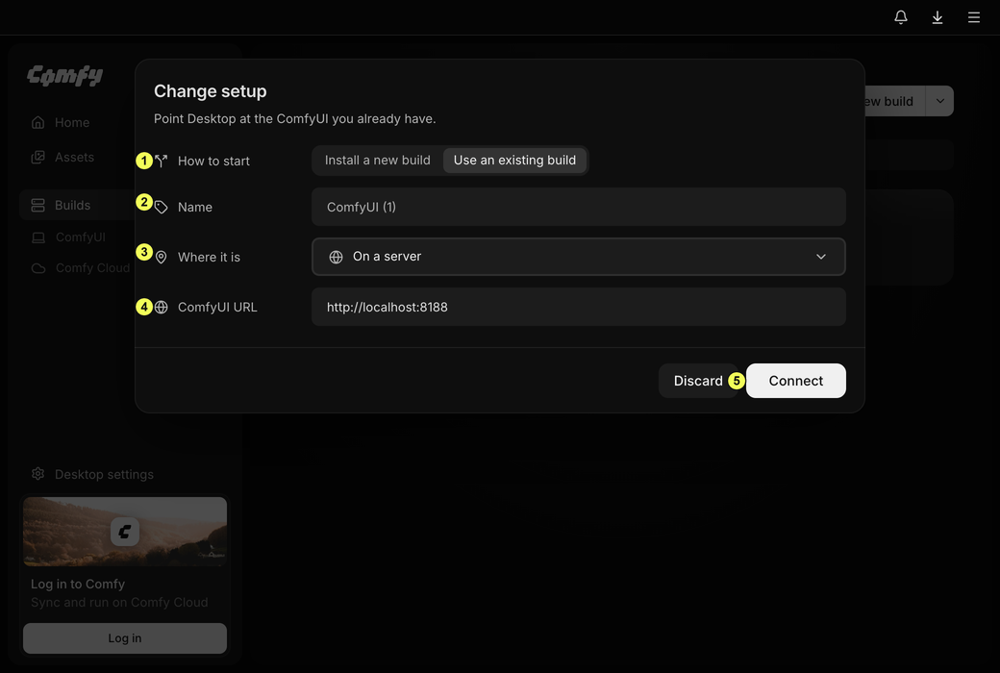

在 Comfy Desktop 中，你可以在本机、Comfy Cloud 或另一台机器上的 ComfyUI 服务器上运行 ComfyUI。每一种都称为一个构建。Comfy Desktop 会为你列出 Comfy Cloud，其他构建则需要先安装、添加或连接，然后才能打开。本页介绍**构建**页面：构建的类型、如何查找构建、快捷操作菜单、如何安装、添加或连接构建，以及如何启动、停止、重启和设置自动启动。管理构建的每个部分都有单独的页面，列在[管理构建](#管理构建)下。

## Comfy 构建类型

构建的运行位置决定了你可以用它做什么。**构建**页面会按运行位置对构建进行分组：

| 运行位置 | 是什么 | 如何获取 |
| --- | --- | --- |
| **此计算机** | 安装在此计算机上的 ComfyUI。其类型为 **Standalone**、**Git clone**、**Portable**、**传统 Desktop** 或 **Build**（来自团队工作区的 Developer Platform 构建）。 | [安装新构建](#安装新的构建)，或[添加已有的 ComfyUI](#添加已有的-comfyui)。 |
| **云端** | Comfy Cloud。它运行在云端的 GPU 上，需要 Comfy 账户。 | Comfy Desktop 会将其作为 **Comfy Cloud** 为你列出。 |
| **远程** | 运行在另一台机器上的 ComfyUI 服务器，通过其 URL 访问。 | [连接到 ComfyUI 服务器](#连接到-comfyui-服务器)。 |

<Note>
  在你[登录](/zh/installation/desktop/overview#登录并打开-comfy-cloud)之前，Comfy Cloud 会显示 **登录后使用**。它的快捷操作菜单中没有**停止**、**自动启动**或**卸载**，并且始终保留 **Comfy Cloud** 这一名称。
</Note>

## 查找你的构建

**构建**页面列出了工作区中的每个构建。要打开它，请点击**侧边栏**中的**构建**。

页面顶部：

- **新建构建**：开始新构建。点击旁边的箭头（**更多构建选项**）可查看**添加现有构建**和**加载快照**。
- **运行位置**：筛选列表。**全部**和**本机**始终存在。**云端**和**远程**在你拥有该类型的构建时显示。
- **排序**：按**最近使用**或**名称**排列构建。正在安装的构建会停留在顶部。
- **搜索构建**：按名称查找构建。如果没有匹配项，请点击**清除筛选**。

每个构建都是一个磁贴。磁贴会显示构建的状态，例如**运行中**、**正在启动…**、**自动启动**或**错误**。将指针悬停在磁贴上可查看点击效果：**点击以启动**、**点击以打开**或**点击以查看日志**。

当你没有任何构建时，页面会显示**暂无构建**和**在本机安装 ComfyUI，或在 Comfy Cloud 上运行。**

**侧边栏**也会在**构建**下方列出每个构建：

- 旋转图标和百分比表示构建正在安装。
- 绿点表示构建正在运行。
- 红点表示构建崩溃或未启动。将指针悬停在构建上可查看原因。
- 点击构建可打开其[构建页面](#管理构建)。
- 右键点击构建可查看其[快捷操作菜单](#从构建列表进行快捷操作)。

有关**主页**和**侧边栏**的其余部分，请参阅[浏览 Comfy 桌面版](/zh/installation/desktop/usage/overview)。

### 从构建列表进行快捷操作

在**侧边栏**中右键点击构建，或在**构建**页面右键点击其磁贴，或在**主页**右键点击其卡片，即可打开快捷操作菜单。在磁贴或卡片上，你还可以将指针悬停其上，直到右侧出现 **⋯** 按钮，然后点击它。

菜单只显示当前适用于该构建的操作。截图中的编号对应该构建上的菜单：1 启动，2 自动启动，3 管理，4 复制，5 在访达中显示，6 导出快照，7 恢复快照，8 卸载。

- **启动**，或在构建运行时显示**查看日志**、**重新启动**和**停止**。在安装或启动期间，显示**查看日志**和**取消**。崩溃后，显示**查看错误**。
- **自动启动**或**关闭自动启动**。请参阅[Comfy 桌面版打开时启动构建](#comfy-desktop-打开时启动构建)。
- **管理**，打开[构建页面](#管理构建)。
- **更新**（有可用更新时），以及**迁移到独立版**（构建可迁移到独立版构建时）。请参阅[稍后迁移](/zh/installation/desktop/usage/migrate#稍后迁移)。
- **复制**，以及**在访达中显示**、**在资源管理器中显示**或**在文件夹中显示**。
- **导出快照**和**恢复快照**。请参阅[快照](/zh/installation/desktop/usage/build-snapshots#保存和恢复快照)。
- **上传构建**（已登录工作区时）。请参阅[团队构建](/zh/installation/desktop/usage/workspaces-and-builds)。
- **卸载**。请参阅[移除构建](/zh/installation/desktop/usage/build-duplicate-and-remove#移除构建)。

**自动启动**、**重新启动**、**查看日志**和**上传构建**仅在此菜单中提供。其他所有操作也位于构建页面上。当某项为灰色时，将指针悬停其上以查看原因，例如**请先停止正在运行的构建。**

## 安装新的构建

新构建是 Comfy桌面版 为你安装的 ComfyUI：可以是作为**独立版**构建的官方发布版，也可以是来自你团队工作区的 Developer Platform 构建。**新建构建**对话框会为此计算机选择设置。安装过程会下载 ComfyUI 并设置其 Python 环境，因此在点击**安装**之前请检查摘要。

<Steps>
  <Step title="打开“新建构建”对话框">
    通过以下任一方式打开该对话框：

    - 在**侧边栏**中，将指针悬停在**构建**上，然后点击加号（**+**）按钮（**新建构建**）。
    - 在**构建**页面上，点击**新建构建**。
    - 在**主页**上，当**主页**显示**新建构建**磁贴时，点击该磁贴。

    **新建构建**对话框打开时，导语为“设置全新的 ComfyUI 安装。”
  </Step>
  <Step title="检查摘要">
    当你已登录且你的工作区中有构建时，对话框会打开到**你的团队构建**。其**发布渠道**行会列出这些构建，并显示占位文本**选择构建**。要改为安装官方发布版，请在下一步将**来源**设为**官方发布版**。

    对于官方发布版，对话框会显示将要安装的内容：

    

    - **名称**：该构建在**侧边栏**和**构建**页面中显示的名称。输入框中会显示建议名称。留空即可使用该名称，或输入你自己的名称。
    - **检测到**：Comfy桌面版找到的计算机或 GPU，以及其内存大小（GB）。点击其旁边的**更改**以更改设置。
    - **发布渠道**：**稳定版**用于经过测试的发布版本，或 **GitHub 上的最新版**。
    - **硬件**：该构建所适用的 GPU 类型，例如 **NVIDIA**、**AMD**、**Intel Arc (XPU)**、**Apple Silicon (MPS)** 或 **CPU**。其说明如下：
      - **检测到**：GPU 类型与 Comfy桌面版检测到的 GPU 匹配。
      - **无 GPU 加速**：该构建面向 **CPU**。
      - **不支持**：此计算机不支持所选的 GPU 类型。
    - **版本**：将要安装的 ComfyUI 版本及其发布渠道，例如**稳定版**。
    - **位置**：该构建安装到的文件夹，以及该驱动器上的可用空间和安装所需的空间。点击**浏览**以选择其他文件夹。

    当**硬件**说明显示**检测到**，且**位置**显示可用空间、其下方没有警告时，该设置适合此计算机。

  </Step>
  <Step title="更改设置（可选）">
    点击**更改**以打开**更改设置**。其中显示“此处的一切都已设置为适合此计算机。”

    

    - **如何开始**：保留**安装新的构建**。
    - **来源**：**官方发布版**会安装 ComfyUI。**你的团队构建**会从你的工作区安装 Developer Platform 构建。请参阅[团队构建](/zh/installation/desktop/usage/workspaces-and-builds)。
    - **发布渠道**：**稳定版**会安装经过测试的发布版本。在**稳定版**旁边的列表中选择版本。**GitHub 上的最新版**会安装 master 分支中的最新提交。
    - **位置**：安装文件夹。请选择一个不位于 Comfy桌面版文件夹、OneDrive、共享的模型、输入或输出文件夹，或另一个构建内部的文件夹。点击**浏览**以选择其他文件夹。
    - **硬件**：该构建所适用的 GPU 类型。每个选项都会列出其 ComfyUI 版本、Python 版本和下载大小。

    点击**保存更改**返回摘要，或点击**放弃**放弃你的更改。

  </Step>
  <Step title="点击安装">
    点击**安装**。在安装开始之前，Comfy桌面版可能会阻止你继续：

    - 当文件夹无法容纳构建时，**位置**下方会显示问题，且**安装**会保持灰色不可用。点击**浏览**并选择其他文件夹。
    - 当驱动器可用空间少于安装所需空间，或少于 1 GB 时，会打开**磁盘空间不足**。点击**仍然继续**进行安装，或关闭对话框并选择其他文件夹。
    - 当你的驱动程序版本低于 580 时，**NVIDIA** 构建会打开**更新 NVIDIA 驱动程序**。其中会显示你的驱动程序版本和建议的最低版本。点击**仍然继续**以使用当前驱动程序进行安装，或先更新驱动程序。
  </Step>
  <Step title="查看安装进度">
    Comfy桌面版会返回**主页**，安装会在后台运行。该构建会在**主页**和**构建**页面显示**正在安装 ComfyUI**和百分比，并在**侧边栏**显示旋转加载图标和百分比。

    要查看每个步骤，请点击该构建的磁贴，或在[快捷操作菜单](#从构建列表进行快捷操作)中选择**查看日志**。**正在安装 ComfyUI**对话框会列出以下步骤：

    1. **下载**
    2. **解压**
    3. **设置环境**
    4. **获取最新的 ComfyUI**，或**获取 ComfyUI**以及你选择的版本

    在对话框中点击**查看日志**以查看安装输出。

    要停止安装：

    1. 在快捷操作菜单中，选择**取消**。
    2. 点击**取消安装**。

    安装会停止，Comfy桌面版会删除其下载的文件。
  </Step>
</Steps>

安装完成后，**侧边栏**中的旋转加载图标会消失，该构建会显示其笔记本电脑图标。有关**自动启动**的信息，请参阅[在 Comfy桌面版打开时启动构建](#comfy-desktop-打开时启动构建)。如果安装失败，请参阅[修复失败的构建](/zh/installation/desktop/usage/build-troubleshooting#修复失败的构建)。

## 添加已有的 ComfyUI

如果你是自己搭建的 ComfyUI（通过 Git 克隆或便携版下载包），可以将其添加到 Comfy桌面版。Comfy桌面版会从其所在文件夹运行它，不会移动或复制其中的文件。

1. 在 **构建** 页面，点击 **新建构建** 旁的箭头（**更多构建选项**），然后选择 **添加现有构建**。你也可以打开 **新建构建**，点击 **更改**，将 **启动方式** 设为 **使用现有构建**，并将 **所在位置** 设为 **此计算机**。面板会显示 **让桌面版指向你已有的 ComfyUI。**

   

2. 在 **安装位置** 旁点击 **浏览**，然后选择 ComfyUI 文件夹。
3. 检查 **检测到的类型**。它会显示 **独立版**、**便携版**、**Git 克隆** 或 **传统桌面版**。如果显示 **传统桌面版**，请停止并关闭对话框：在这里添加会使 Comfy桌面版无法迁移它。请改为按照 [从传统桌面版迁移](/zh/installation/desktop/usage/migrate) 操作。如果显示 **未检测到已知安装**，请选择直接包含 ComfyUI 本身的文件夹，而不是它上级的文件夹。
4. 在 **名称** 中，保留建议的名称，或输入你自己的名称。
5. 对于 **Git 克隆**，检查 **版本**、**仓库** 和 **分支**。**虚拟环境** 会显示 Comfy桌面版找到的 `.venv`、`venv`、`.env` 或 `env` 文件夹。点击其旁边的 **浏览** 可以选择其他文件夹。
6. 点击 **添加构建**。

该构建会出现在 **侧边栏** 和 **构建** 页面中。如果已有其他构建使用你输入的名称，**名称** 会显示 **名为"…"的构建已存在。请选择其他名称。**

要基于快照文件创建构建，请在 **更多构建选项** 中选择 **加载快照**。参见 [从快照文件创建构建](/zh/installation/desktop/usage/build-snapshots#从快照文件创建构建)。

## 连接到 ComfyUI 服务器

远程构建会打开一个运行在另一台机器上的 ComfyUI 服务器，例如你网络中的 GPU 服务器。你需要该服务器的 URL。

1. 打开 **新建构建** 对话框，方法参见[安装新构建](#安装新的构建)，然后点击 **更改**。
2. 将 **启动方式** 设为 **使用现有构建**。
3. 将 **所在位置** 设为 **在服务器上**。

   

4. 在 **名称** 中，保留建议的名称，或输入你自己的名称。
5. 在 **ComfyUI URL** 中，输入服务器的地址。输入框中会显示 `http://localhost:8188` 作为示例。
6. 点击 **连接**。

该构建会出现在**侧边栏**和**构建**页面中，并且**运行位置**过滤器中会增加**远程**选项。如果输入的地址不是 URL，对话框会显示 **请输入有效 URL（例如 `http://localhost:8188`）。** 如需稍后更改该地址，请参见[更改远程构建的 URL](/zh/installation/desktop/usage/build-management#更改远程构建的-url)。

## 启动、停止和重新启动构建

要启动构建并打开 ComfyUI，请参阅[打开 ComfyUI](/zh/installation/desktop/overview#打开-comfyui)。Comfy Cloud 构建会在其页面上通过 **Open Cloud** 打开，而远程构建则通过 **Open remote** 打开。

### 运行多个构建

当您在这台计算机上启动一个构建，而另一个构建正在运行或正在启动时，Comfy Desktop 会打开 **已有构建正在运行** 对话框。在 **将被停止** 下方，它会列出将被停止的构建。

<Warning>
  **关闭并启动** 会停止列出的构建，并丢失其中所有未保存的工作。请先保存您的工作流。
</Warning>

- **关闭并启动**：停止列出的构建，然后启动您选择的那个构建。
- **全部运行**：启动该构建，并让其他构建继续运行。

关闭对话框即可取消启动。若要不再看到此对话框，请从 **侧边栏** 打开 **桌面设置**，然后在 **首选项** 下关闭 **在运行多个构建前发出警告**。

### 停止或重新启动

在卸载构建之前请先停止它。重新启动它可以应用对启动参数的更改。

<Warning>
  停止或重新启动构建会丢失 ComfyUI 中所有未保存的工作。请先保存您的工作流。
</Warning>

要停止正在运行的构建：

1. 在[构建页面](#管理构建)上，点击 **更多**（**⋯**），然后选择 **停止**。您也可以在[快捷操作](#从构建列表进行快捷操作)中选择 **停止**。
2. 在 **停止 ComfyUI** 中，点击 **停止**。

ComfyUI 停止运行，其窗口随之关闭。

要重新启动正在运行的构建：

1. 在[快捷操作](#从构建列表进行快捷操作)中，选择 **重新启动**。
2. 在 **重新启动 ComfyUI** 中，点击 **重新启动**。

该卡片会显示 **正在启动…**，随后显示 **运行中**。重新启动绝不会打开 **已有构建正在运行**。

## Comfy Desktop 打开时启动构建

**自动启动**会在每次打开 Comfy Desktop 时启动一个构建。同一时间只能有一个构建启用 **自动启动**。

- 在本机上的构建或远程构建的[快捷操作菜单](#从构建列表进行快捷操作)中，选择 **自动启动**。

该构建的磁贴会显示 **自动启动**。如果另一个构建此前启用了 **自动启动**，则该构建会失去该设置。要关闭它，请在同一菜单中选择 **关闭自动启动**。

在本机安装第一个构建时，如果其他构建都没有启用 **自动启动**，新构建会获得该设置。如果该构建第一次没有启动成功，Comfy Desktop 会关闭它的 **自动启动**。

## 管理构建

构建自身的页面为每类设置提供一个标签页。选择你需要的部分：

<CardGroup cols={2}>
  <Card title="管理构建" icon="sliders" href="/zh/installation/desktop/usage/build-management">
    打开构建页面、使用“更多”菜单，以及更新 ComfyUI、PyTorch 或远程构建的 URL。
  </Card>
  <Card title="文件夹" icon="folder-tree" href="/zh/installation/desktop/usage/build-folders">
    选择构建使用的模型、输入和输出文件夹。
  </Card>
  <Card title="启动参数" icon="terminal" href="/zh/installation/desktop/usage/build-startup-arguments">
    设置标志、ComfyUI Manager 策略、窗口、端口和环境变量。
  </Card>
  <Card title="快照" icon="clock-rotate-left" href="/zh/installation/desktop/usage/build-snapshots">
    保存、恢复、导出和导入构建的 ComfyUI 版本、自定义节点和软件包。
  </Card>
  <Card title="终端" icon="code" href="/zh/installation/desktop/usage/build-terminal">
    在构建的 Python 环境中运行命令。
  </Card>
  <Card title="复制或移除" icon="copy" href="/zh/installation/desktop/usage/build-duplicate-and-remove">
    复制构建、忘记构建，或卸载构建及其文件。
  </Card>
  <Card title="修复构建" icon="triangle-exclamation" href="/zh/installation/desktop/usage/build-troubleshooting">
    排查未完成的安装、崩溃、文件夹问题或端口冲突。
  </Card>
</CardGroup>
