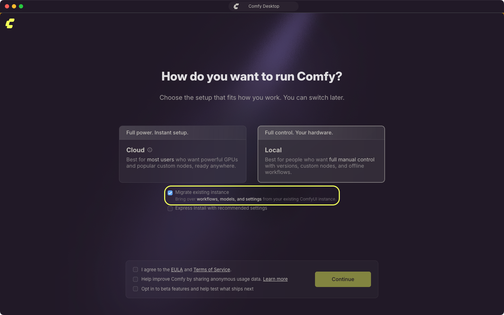
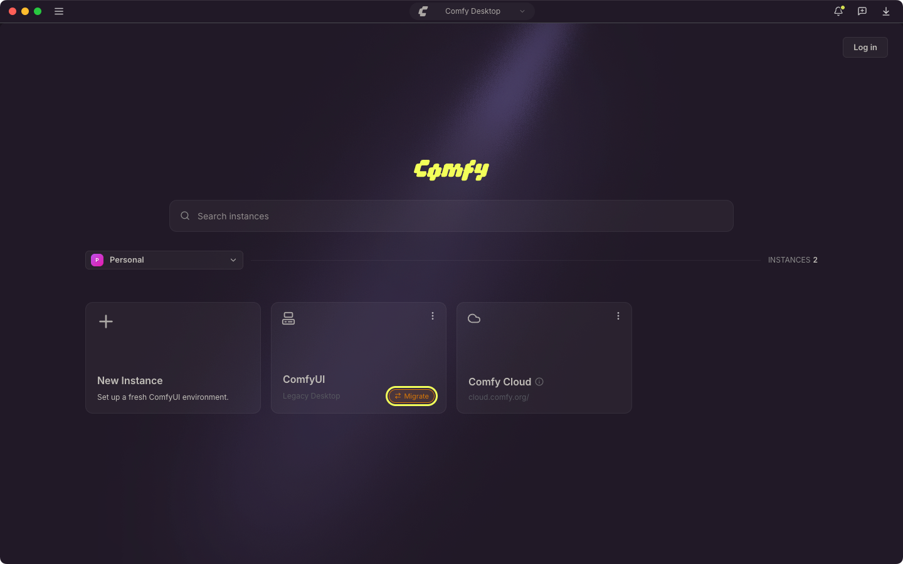
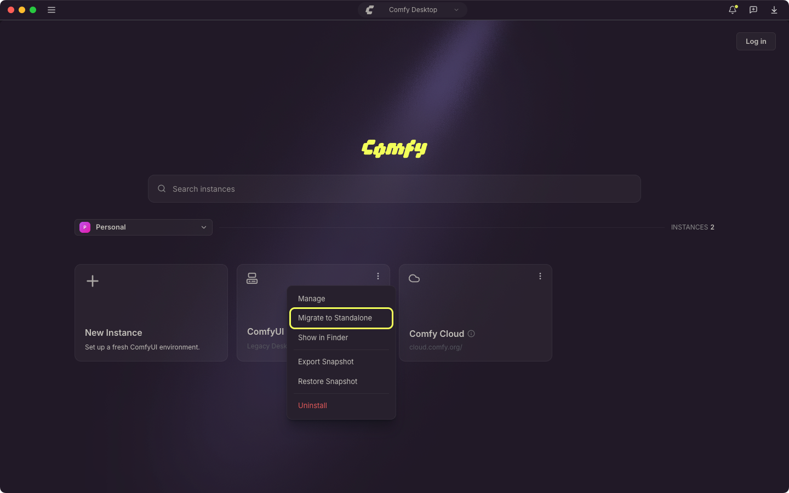
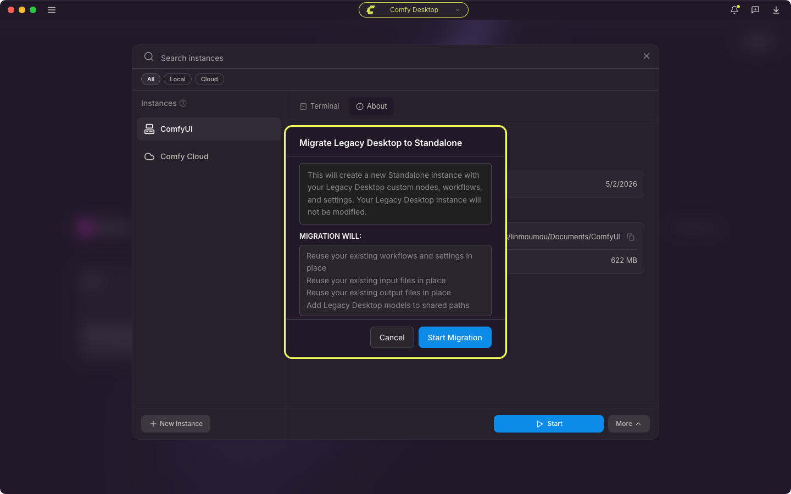

<Info>
本页介绍从 **Legacy Desktop**（旧版单实例桌面应用）迁移到 Comfy Desktop。如果您是首次使用，可以跳过此页。
</Info>

<CardGroup cols={1}>
  <Card title="正在寻找其他安装方式？" icon="compass" href="/zh/installation/desktop/usage/instance-management#追踪已有安装">
    如果您已经有 ComfyUI 安装（portable、手动 git clone 等）并想将其添加到 Comfy Desktop，请参见**实例管理中的“追踪已有安装”**。
  </Card>
</CardGroup>

如果您已经安装了 Legacy Desktop，Comfy Desktop 可以检测到它并进行迁移，在 Chooser 视图中创建一个新的 Standalone 安装。

## 迁移内容

Legacy Desktop 是单实例应用。Comfy Desktop 是多实例管理器。迁移时：

- **工作流和设置**：就地复用，新实例沿用同一份用户数据。
- **自定义节点**：保留在您现有的 `custom_nodes` 文件夹中。迁移后的实例以 Legacy Desktop 数据文件夹作为基础目录运行，因此加载的是同一批节点，它们的依赖包也留在被复用的 Python 环境里。
- **模型**：您原有的模型文件夹会被加入共享模型目录，所有实例都能直接读取原位置的文件。
- **输入文件和输出**：就地复用现有目录中的文件。
- **Python 环境**：先检查再复用您现有的环境。Comfy Desktop 会确认它能导入 torch，然后把 ComfyUI 自身的依赖安装进去，不会替换您现有的 PyTorch 包。
- **ComfyUI 版本**：ComfyUI 源码会被暂存到新的托管目录，之后由 Comfy Desktop 管理更新。

迁移会就地复用您的 Legacy Desktop 数据文件夹和 Python 环境，而不是复制它们，因此您得到的是一个正在使用的环境，而不是第二份副本。如果需要保留一份完整的旧版副本，请在迁移前自行备份。

## 迁移会备份什么

在改动任何内容之前，Comfy Desktop 会把 Legacy Desktop 的设置文件复制到旧版配置文件夹下按时间命名的目录中：

- macOS：`~/Library/Application Support/ComfyUI/legacy-backup/<timestamp>/`
- Windows：`%APPDATA%\ComfyUI\legacy-backup\<timestamp>\`

只有实际存在的文件会被复制：

- `config.json`：Legacy Desktop 应用设置，包括它使用的数据文件夹。
- `comfy.settings.json`：存放在旧版用户文件夹中的 ComfyUI 前端设置。
- `extra_models_config.yaml`：您在 Legacy Desktop 中配置的额外模型路径。
- `window.json`：保存的窗口大小和位置。

这份备份只包含设置。模型、工作流、自定义节点、输入文件和输出都不会被复制进去，因为迁移后的实例会继续在原位置使用它们。迁移还会把旧版环境的快照（包含其自定义节点和已安装的依赖包）写入旧版数据文件夹下的 `.snapshots/`。

如果某个文件无法复制，迁移会在日志中记录并继续，因此备份失败不会中断迁移。

## 迁移运行时会发生什么

迁移会显示独立的进度界面，依次经过以下步骤：

1. **备份旧版状态**
2. **检查文件夹访问权限**（仅 macOS）
3. **验证 Python 环境**
4. **捕获快照**
5. **分配安装文件夹**
6. **暂存 ComfyUI 源码**
7. **安装需求**
8. **迁移设置**
9. **注册安装**

某些步骤会停下来等待您回答：

- **需要文件夹访问权限**（macOS）：macOS 阻止了对 Legacy Desktop 文件夹的访问。请在系统设置 → 隐私与安全性中为 Comfy Desktop 授予完全磁盘访问权限，然后重新开始迁移。
- **Python 环境似乎已损坏**：旧版环境无法导入 torch。选择**仍然接管**以继续使用该环境，或选择**取消**停止迁移。
- **ComfyUI 源码不可用**：无法获取新实例所需的 ComfyUI 源码。选择**重试**，或选择**取消**并改为从仪表板创建新实例。

进度界面会把所有步骤的输出保存在**查看日志**面板中，某一步失败时该面板会自动展开。可以用其中的复制按钮复制文本，同样的输出也会写入 Desktop 应用日志。依赖安装失败只会作为警告记录，不会中断迁移。

## 迁移后的变化

迁移完成后，您的新 Standalone 安装与其他 Comfy Desktop 安装一样工作：

- **启动** — 在 Chooser 视图中点击新安装卡片的播放按钮即可启动 ComfyUI。
- **端口** — 旧版配置中的端口以及其他自定义启动参数会一并继承。
- **管理** — 使用 Manage 面板更新、创建快照和配置安装。
- **更新** — Standalone 安装可以通过 Manage 面板独立更新。与 Legacy Desktop 不同，您不再需要为每次更新下载新构建版本。
- **多实例** — 您可以拥有多个并行的 Standalone 安装，每个都有自己的 ComfyUI 版本和配置。
- **共享存储** — 模型默认在所有 Standalone 安装之间共享。输入和输出目录固定到被采用的 Legacy 工作区，因此您现有的文件位置不变。

迁移后的实例不会自行更新 ComfyUI。需要新的 ComfyUI 版本时，使用 Manage 面板的[更新选项卡](/zh/installation/desktop/usage/manage#更新选项卡)。

## 我的旧链接还能用吗？

Legacy Desktop 默认在端口 `8000` 上运行。新安装会**继承端口**设置，因此 `http://localhost:8000` 应该仍然可用。如果您配置过自定义 CLI 参数（例如 `--port 8188`），这些参数也会一并继承。

如果您使用了 URL 缩短器、书签或引用 Legacy Desktop 应用的其他地址的外部集成，您可能需要检查新安装的 Startup Args 选项卡并相应更新。

## 分步迁移

<Steps>
<Step title="安装 Comfy Desktop">
从[官方下载页面](https://comfy.org/download)下载并安装 Comfy Desktop。
</Step>

<Step title="启动 Comfy Desktop">
首次打开 Comfy Desktop 时，首次运行设置会自动检测系统中的 Legacy Desktop 安装。选择**本地**后，设置中会显示**迁移现有实例**并默认选中，继续后即可迁移您现有的环境。

</Step>

<Step title="确认迁移">
点击**继续**，然后在确认对话框中选择**开始迁移**。Comfy Desktop 将：

1. 就地复用您的工作流、设置、自定义节点、输入文件和输出
2. 复用您的 Python 环境，并把 ComfyUI 源码暂存到新的托管目录，以便更新正常工作
3. 将模型文件夹添加为共享目录，并把 ComfyUI 的依赖安装到被复用的环境中

完成后，新的 Standalone 安装卡片会出现在 Chooser 视图中。
</Step>

<Step title="验证">
启动新安装并确认：
- 您的工作流可用
- 自定义节点已安装
- 模型可访问
- 您的服务器在继承的 URL 上运行（默认为 `http://localhost:8000`）
</Step>
</Steps>

## 从 Chooser 中迁移

如果您已经完成首次运行设置，或 Legacy Desktop 安装已出现在 Chooser 中，可以直接从实例卡片发起迁移：

1. 找到 Legacy Desktop 实例卡片，卡片上带有**迁移**胶囊按钮。

   

2. 点击该胶囊按钮，或打开卡片的 **⋮** 菜单并选择**迁移到独立版**。

   

3. 确认弹窗中的改动后，点击**开始迁移**。

   

Legacy Desktop 安装会被就地接管，出现在 Chooser 中的实例就是您现有环境在 Comfy Desktop 下的托管版本。已跟踪的 Git 和 portable 实例则不同，迁移会新建一个 Standalone 安装，原跟踪安装保持原样。

待更新状态优先：这类卡片会显示更新胶囊按钮，而不是**迁移**。

## 故障排查

### Legacy Desktop 未自动检测到

Legacy Desktop 源仅用于迁移，不会出现在**新建实例**选择器中，因此无法手动添加。如果 Comfy Desktop 没有检测到您的 Legacy Desktop 安装：

1. 将该安装作为已跟踪实例添加。参见 [**追踪已有安装**](/zh/installation/desktop/usage/instance-management#追踪已有安装)。
2. 实例出现在 Chooser 后，通过卡片上的**迁移**胶囊按钮或 **⋮** 菜单中的**迁移到独立版**进行迁移。

### 迁移失败

- **查看日志**：在迁移界面选择**查看日志**，或打开 Desktop 应用日志（`app.log`）：macOS 位于 `~/Library/Logs/Comfy Desktop`，Windows 位于 `%APPDATA%\Comfy Desktop\logs`。
- **检查 Legacy 安装是否完整**：迁移会从现有文件夹读取模型、工作流和自定义节点，文件夹被移动或删除会导致迁移中断。
- **重试**：网络问题可能让源码暂存步骤失败，第二次尝试可能会成功。

### 迁移中途停止

在任一提示中选择**取消**会停止本次迁移，某一步直接失败也会如此（依赖安装的警告不算）。停止的迁移不会向 Chooser 添加实例，请从卡片上的**迁移**胶囊按钮重新发起。您的 Legacy Desktop 文件夹不会被删除。

### 迁移后模型丢失

模型是加入共享模型目录，而不是复制。如果模型没有显示：

1. 打开 [桌面设置 → 存储](/zh/installation/desktop/usage/settings#存储)
2. 确认旧模型文件夹以及 Legacy Desktop `extra_models_config.yaml` 中列出的额外模型路径都已加入共享目录。如果有缺失，选择 **+ 添加共享目录** 并选中它。
3. 在迁移后实例的 Manage 面板中打开**存储标签页**，确认**包含共享目录**已开启。
