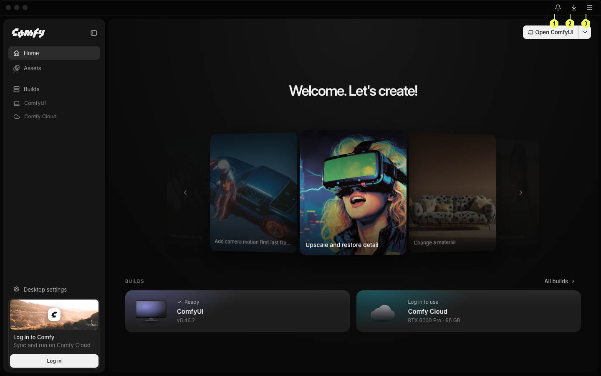

本页介绍首次启动 Comfy Desktop 后你会用到的各个界面：**Home**、引导教程、**侧边栏**、**标题栏**、你的工作区以及**积分**。如需安装 Comfy Desktop 并完成你的第一个构建，请参阅 [Comfy Desktop](/zh/installation/desktop/overview)。

## 从 Home 开始

**Home** 是 Comfy 桌面版启动时打开的页面。在 **Home** 中，你可以一键打开 ComfyUI。**Home** 从上到下依次显示：

- **Open ComfyUI**：位于右上角的按钮。它会在其提示中指定的版本里打开 ComfyUI。当你有多个版本时，点击它旁边的箭头可选择要打开的版本。
- **[应用](/zh/installation/desktop/usage/apps)**：开启**应用**后显示的一排现成工具。点击 **See all apps** 打开**应用**页面。
- **示例工作流**：未开启**应用**时，这一排会改为显示示例工作流。点击中间的卡片，可在浏览器中打开它在 comfy.org 上的页面。
- **[版本](/zh/installation/desktop/usage/instance-management)**：最多显示三个版本，每个版本一张卡片。点击卡片可启动该版本，或在该版本运行时打开它。点击 **All builds** 查看全部版本。如果你还没有本地版本，这一排末尾会显示一个 **New build** 磁贴。点击它即可新建一个。

在你[登录](/zh/installation/desktop/overview#登录并打开-comfy-cloud)之前，Comfy Cloud 卡片会显示 **Log in to use**。

当页面标题显示 **Welcome. Let's create!** 时，说明你正处于 **Home** 页面。

## 体验引导导览

首次打开**首页**时，一段简短的导览会指向页面和**侧边栏**的各个部分。它会说明构建是什么、Comfy Cloud 构建卡片和本地构建卡片、在哪里查看所有构建并新建一个构建，以及**资产**。如果你之前使用过 Comfy桌面版，导览开头会显示**实例现在称为构建**。

- 点击**下一步**进入下一步，点击**上一步**返回上一步，或点击**跳过**关闭导览。也可以按 `Esc` 跳过导览。

导览会显示当前位置，例如 **1 of 6**，并跳过不在屏幕上的部分。最后一步只有**上一步**和**完成**。点击**完成**关闭导览。

#

### 重播导览

要再次查看导览：

1. 在**标题栏**中，点击铃铛图标（**新功能**）。
2. 选择**开始导览**。

**首页**会打开，导览会再次开始。

## 认识侧边栏 {#find-your-way-around-the-sidebar}

**Home** 窗口左侧的**侧边栏**用于在各页面之间切换。

每个条目都会打开一个页面：

| 条目 | 打开的页面 |
| --- | --- |
| **Home** | **Home**。当**侧边栏**展开时，点击顶部的 Comfy 标志也可以打开它。 |
| **Apps** | [**Apps**](/zh/installation/desktop/usage/apps) 页面，你可以在其中使用 **Search apps** 搜索应用并打开它。仅当**应用**功能开启时，此条目才会出现。 |
| **Assets** | [**Assets**](/zh/installation/desktop/usage/assets)，你可以在其中浏览你的构建和 Comfy Cloud 生成的内容。 |
| **Builds** | 你的所有构建。 |

在 **Builds** 下方，**侧边栏**会列出每个构建：

- 点击构建可打开其构建页面。
- 右键点击构建可打开操作菜单。
- 要开始新的构建，请将指针悬停在 **Builds** 上，然后点击加号（**+**）按钮（**New build**）。

构建上的绿色圆点表示它正在运行。红色圆点表示它已崩溃或未能启动。将指针悬停在构建上即可查看原因。

在**侧边栏**底部：

- **Desktop update**：当 Comfy 桌面版有可用更新时出现。点击它，然后点击 **Download**。当它显示 **Desktop update ready** 时，点击它，然后点击 **Restart & update**。
- **Desktop settings**：打开 Comfy 桌面版的设置。请参阅 [Comfy 桌面版设置](/zh/installation/desktop/usage/settings)。
- **Credits**：登录后显示的积分余额。请参阅[查看你的积分](#查看您的积分)。
- **Log in to Comfy**：用于登录的卡片。登录后，你的工作区将取代它。请参阅[登录并打开 Comfy Cloud](/zh/installation/desktop/overview#登录并打开-comfy-cloud)。

要腾出空间，请点击侧边栏顶部的 **Collapse sidebar**。各条目将仅保留图标，**Log in to Comfy** 卡片会变为 **Log in** 图标。要在独立窗口中打开某个页面，请右键点击对应条目，然后选择 **Open in new window**。

## 使用标题栏

**标题栏**位于每个 Comfy桌面版窗口的顶部。

其右侧的按钮如下，编号与截图一致：

- **1** **新功能**（铃铛图标）：打开一个菜单，其中包含**开始导览**。请参阅[重放导览](#重播导览)。
- **2** **下载**：打开下载托盘。徽标会统计进行中的下载、失败的下载以及你尚未查看的已完成下载。
- **3** **菜单**：打开标题栏菜单。

在**首页**上，**菜单**包含**性能测试**和**基准测试**。在运行 ComfyUI 的窗口中，**菜单**还包含：

- **桌面设置**：打开 Comfy桌面版的设置。
- **重置缩放（N%）**：当你在 ComfyUI 中放大或缩小时出现。选择它可恢复到 100%。
- **关闭窗口**：关闭此窗口。
- **退出桌面版**：退出 Comfy桌面版。

运行 ComfyUI 的窗口还会在**标题栏**左侧显示一个**首页**按钮。点击它即可返回**首页**。

首次启动进行设置期间，**菜单**中只有**跳过新手引导**。

## 使用工作区菜单

登录后即可使用 Comfy Cloud 并查看你的积分。要登录，请按照[登录并打开 Comfy Cloud](/zh/installation/desktop/overview#登录并打开-comfy-cloud)操作。

登录后，你的工作区会替换**侧边栏**底部的 **登录 Comfy** 卡片。点击它会打开一个菜单：

- 点击顶部的工作区名称以切换到另一个工作区。随后，**主页**和**侧边栏**会列出该工作区的构建。
- **工作区设置**和**管理计划与积分**会在你的浏览器中打开。
- 菜单还会显示你的电子邮件和**退出登录**。

## 查看您的积分

**侧边栏**底部的**积分**位于工作区上方，会显示您的余额。将指针悬停在**积分**上即可刷新余额。

- 如需添加积分或更改计划，请点击**积分**。您工作区的**管理计划与积分**页面将在浏览器中打开。

## 深入了解

这些页面涵盖构建、应用、资产和设置。

<CardGroup cols={2}>
  <Card title="构建" icon="layer-group" href="/zh/installation/desktop/usage/instance-management">
    安装、启动、更新和配置构建，并保存快照。
  </Card>
  <Card title="应用" icon="shapes" href="/zh/installation/desktop/usage/apps">
    在 Comfy Cloud 或你自己的 GPU 上运行现成的工具。
  </Card>
  <Card title="资产" icon="images" href="/zh/installation/desktop/usage/assets">
    浏览你的构建和 Comfy Cloud 已生成的产物。
  </Card>
  <Card title="设置" icon="cog" href="/zh/installation/desktop/usage/settings">
    更改 Comfy Desktop 的更新、存储及其他设置。
  </Card>
</CardGroup>

## 故障排除

当**首页**或**侧边栏**的某一部分无法加载时，请使用以下条目。

<AccordionGroup>
  <Accordion title="示例工作流无法加载">
    **首页**显示**示例工作流无法加载。请检查网络连接，然后点击“重试”。**
  </Accordion>
  <Accordion title="应用无法加载">
    **首页**显示**应用无法加载。请检查网络连接，然后点击“重试”。**
  </Accordion>
  <Accordion title="积分显示无法加载余额">
    Comfy桌面版无法读取你的余额。将指针悬停在**积分**上可重新加载。
  </Accordion>
</AccordionGroup>

在 [GitHub](https://github.com/Comfy-Org/Comfy-Desktop/issues) 上反馈 Comfy桌面版的问题。在[文档仓库](https://github.com/Comfy-Org/docs/issues)中反馈本文档的问题。
