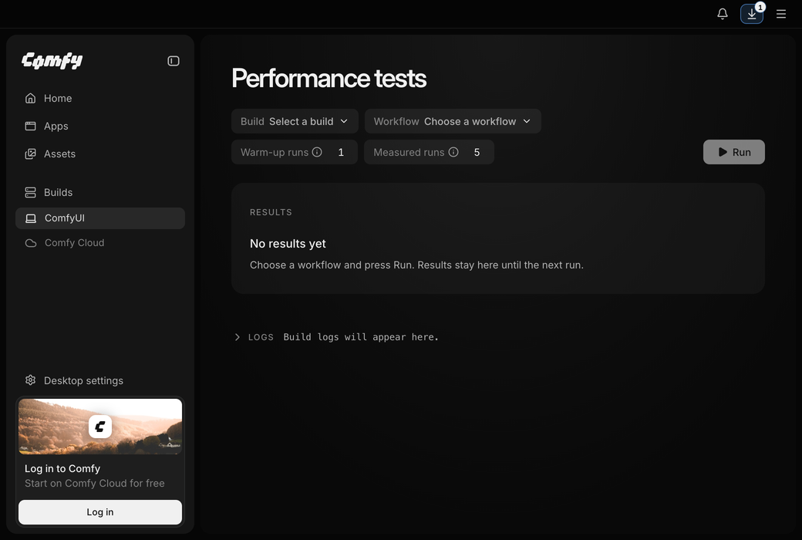

在 Comfy Desktop 中，您可以为工作流在您的某个实例上的运行计时，例如示例视频工作流或您自己的图像工作流，并把结果与在其他 GPU 或其他实例上运行的结果进行比较。只有当没有其他任务争用 GPU，并且您清楚结果是哪套硬件产生的时候，计时才有意义。因此，性能测试会在该实例上单独运行工作流，重复多次，并把每次结果连同系统信息一起保存。您在 **Performance tests** 中运行测试、读取结果，并在 **Benchmarks** 中比较已保存的运行。

## 打开性能测试或基准测试

这两个页面都从**标题栏**中的**菜单**打开。有关其中其他按钮的说明，请参阅[使用标题栏](/zh/installation/desktop/usage/overview#使用标题栏)。

1. 在**主页**上，点击**标题栏**右端的**菜单**。
2. 选择**性能测试**或**基准测试**。

页面会在**主页**窗口中打开，位于**侧边栏**旁边。在运行 ComfyUI 的窗口中，相同的**菜单**项会在新的 Comfy 桌面版窗口中打开该页面。


## 运行性能测试

性能测试会在独立会话中启动构建，多次运行你的工作流，并在完成后停止构建。你可以在 **性能测试** 顶部的工具栏中从左到右进行设置：**构建**、**工作流**、**预热运行**、**测量运行** 和 **运行**。

在选择任何内容之前，**构建** 显示 **选择构建**，**工作流** 显示 **选择工作流**，**结果** 显示 **暂无结果**。



### 选择构建

你选择的构建就是测试启动并计时的构建，其名称会随结果一起保存。

- 点击 **构建**（在你选择之前，它会显示 **选择构建**），然后选择一个构建。

列表中的每个构建都会显示名称，下方显示其类型和版本。该列表包含 **侧边栏** 中所选工作区内的构建。要测试另一个工作区中的构建，请先切换工作区，具体操作如[使用工作区菜单](/zh/installation/desktop/usage/overview#使用工作区菜单)所述。切换工作区会清除你选择的构建。

<Note>
  Comfy Cloud 构建不会列出，因为测试需要由 Comfy Desktop 启动的构建。当你退出登录时，列表仅显示已安装的构建。
</Note>

### 选择工作流

选定构建版本后，选择要计时的工作流。使用 Comfy Desktop 自带的示例工作流，或导入你自己的工作流。

#### 使用示例工作流

示例工作流可直接运行：Comfy Desktop 会下载每个工作流所需的模型。

1. 点击**工作流**，然后选择**选择示例工作流**。
2. 在**选择示例工作流**中，选择**视频**、**图像**或**音频**标签页，然后选择一张卡片。每张卡片显示工作流的名称、任务以及将下载的模型的大致大小。如果显示的是硬盘图标而不是大小，表示模型已在磁盘上。将指针悬停在图标上可查看**已下载**和大小。
3. 点击**使用工作流**。

Comfy Desktop 会下载不在磁盘上的模型。工具栏下方会显示一行状态：**正在准备工作流并下载所需模型…**，随后会显示带有进度条的下载进度以及**取消下载**。这些下载也会出现在**标题栏**的**下载**托盘中。要跟踪这些下载，请参见[Comfy Desktop 中的下载](/zh/installation/desktop/usage/downloads)。下载完成后，**工作流**会显示示例的名称，并带有**示例**标签。

如果出现导致示例无法加载的问题，工具栏下方或对话框中会出现一行红色提示：

| 消息 | 操作 |
| --- | --- |
| **完成安装此构建版本以使用示例工作流。** | 选择已安装的构建版本，或完成安装此构建版本。 |
| **需要连接互联网才能下载示例工作流。** | 连接到互联网后重试。 |
| **需要约 X，但只有 Y 可用。请释放空间或选择更轻量的工作流。**（在对话框中，且**使用工作流**不可用） | 释放磁盘空间，或选择模型更小的卡片。 |
| **无法下载此工作流所需的全部模型。** | 重新选择该示例。Comfy Desktop 会移除下载失败的示例。 |

示例与你为其选择的构建版本绑定。如果你选择另一个构建版本，Comfy Desktop 会将该示例从**性能测试**中移除。如果已有测试使用过该示例，其文件仍会保留在磁盘上。

#### 导入自己的工作流

导入的工作流必须采用 [API 格式](/zh/development/api-development/workflow-api-format)。请先在 ComfyUI 中按该格式导出。

- 点击**工作流**，选择**导入 API 工作流**，然后选择 `.json` 文件。你也可以将 `.json` 文件拖放到**工作流**上。

**工作流**会显示文件名，并带有 **API** 标签。如果文件不是 API 格式，工具栏下方的红色提示行会显示：**已选文件不是 ComfyUI API 格式工作流。** 名为 `jobs.json` 或 `results.json` 的文件会被拒绝，因为这些名称保留给结果使用。

Comfy Desktop 会将文件复制到新的会话文件夹中（参见[结果的存储位置](#结果存储位置)），因此即使你移动或编辑原始文件，测试仍会运行该副本。

#### 移除工作流

- 点击**工作流**，选择**删除工作流**，然后点击**删除工作流**以确认。

这会将工作流从**性能测试**中移除。如果尚无运行使用过该工作流，Comfy Desktop 会删除其副本。你的原始文件以及先前运行的结果会保留。示例正在下载时，同一菜单项会显示为**取消下载**。

### 设置运行次数

预热运行会在计时开始前加载模型，因此第一次较慢的运行不会影响结果的准确性。

| 设置 | 范围 | 默认值 | 作用 |
| --- | --- | --- | --- |
| **预热运行** | 0 到 5 | 1 | 最先运行，用于加载模型并预热缓存。它们不计入结果。将其设为 0 可跳过预热。 |
| **测量运行** | 1 到 100 | 5 | 在预热运行之后计时的运行。它们的耗时构成结果。 |

点击 **Run** 时，超出范围的值会变为最接近的限值。每次运行都会使工作流中每个种子输入加一，因此 ComfyUI 不会返回缓存的结果。

### 开始测试

其他会占用 GPU 的工作（例如游戏或视频导出）仍会影响数值，因此在运行测试之前请先停止这些工作。

1. 点击 **运行**。

   如果 **运行** 不可用，请将指针悬停在它上面以查看原因：**请先选择一个构建。**、**请先选择一个工作流。**、**请等待工作流准备就绪。** 或 **请等待构建启动完成。**

2. 在 **结果** 中跟踪测试进度。它会显示 **正在启动构建…**，随后在进度条下方显示 **第 N 次运行，共 M 次**，以及 **预热运行** 或 **第 X 次测量运行，共 Y 次**。**日志** 会打开并显示构建的输出。

测试运行期间，**停止** 会取代 **运行**。点击 **停止** 可取消测试。它会显示 **正在停止…**，直到构建停止。

所有运行完成后，Comfy Desktop 会停止构建并显示结果。如果 Comfy Desktop 发送这些运行 4 小时后它们仍未完成，测试会停止，并显示 **等待性能测试作业超时。**

### 停止会阻塞测试的构建

测试会单独运行，因此不会有其他程序争用 GPU 和内存。如果这台计算机上的另一个构建正在运行、正在启动或正在停止，测试就不会启动。这包括你正在测试的构建已在 ComfyUI 中打开的情况，以及另一个构建上正在进行的性能测试。远程构建和 Comfy Cloud 构建在其他位置运行，绝不会阻塞测试。

**结果**随后会显示 **性能测试未启动**，并列出每个造成阻塞的构建。列表中的性能测试会显示为 **性能测试：**，后面是该构建的名称。

<Warning>
  停止构建会丢失其 ComfyUI 窗口中所有未保存的工作。请先保存工作流。
</Warning>

1. 点击列表中某个构建旁边的 **停止**。
2. 在 **停止 ComfyUI** 中点击 **停止**。该行会显示 **已停止**。
3. 对列表中的每个构建重复此操作，然后再次点击 **运行**。

你也可以从构建页面停止构建。请参阅[停止或重新启动](/zh/installation/desktop/usage/instance-management#停止或重新启动)。

### 查看结果

结果会显示工作流在此构建上花费了多长时间，以便你将其与其他构建和 GPU 进行比较。

- 标题栏会标明工作流以及测试运行所在的构建。
- 大号数字是中位运行时长，单位为秒。其下方的 **中位运行 · N 次测量 · N 次失败** 统计了产生时长的运行次数以及失败的运行次数。
- **运行时长** 以条形图比较 **最快运行**、**中位运行**、**平均运行** 和 **最慢运行**。
- **系统信息** 列出了 **计算设备**、**VRAM**、**RAM**、**PyTorch 版本**、**xFormers 版本**、**CPU**、**CPU 核心数**、**操作系统** 和 **架构**。

一次运行的时长是 ComfyUI 执行该任务所花费的时间，从执行开始到执行结束，而不是你等待的时间。失败的运行不计入时长。

结果标题栏右侧有两个按钮：

- macOS 上的 **在 Finder 中显示**、Windows 上的 **在资源管理器中显示**，或 Linux 上的 **在文件夹中显示**，会打开会话文件夹。
- **导出结果** 会要求选择一个文件夹。点击 **在此导出** 可将结果保存为 `performance-test-results-<timestamp>.png`。

如果测试失败，**结果** 会显示 **测试未完成** 并附上错误，随后是 **请查看下方日志以了解详情。** 展开 **日志** 以查看该构建的输出。如果工作流需要该构建没有的节点或模型，就会以这种方式失败。

结果会保留在页面上，直到你下次运行。之后如需再次查看，请打开 **基准测试**。

## 在基准测试中比较运行记录

基准测试会读取结果文件夹中保存的每一项测试，并将它们列在一张表中，以便你查看某块 GPU、某个工作流或某个构建比另一个快多少。在测试完成之前，页面会显示**尚无性能测试结果**。点击**打开性能测试**来运行一项测试，或在测试完成后点击**刷新会话**。


### 筛选并排序运行记录

使用工具栏将表格缩小到要比较的运行记录：

- **工作区**、**构建**、**硬件**和**工作流**：仅显示匹配的运行记录。每项默认显示**全部**。
- **比较依据**：表格用于比较的时长，可选**最快**、**平均**、**中位数**或**最慢**。默认是**中位数**。
- **刷新会话**（圆形箭头）：在测试完成后重新加载结果文件夹。
- **搜索运行记录…**：匹配会话、工作流、构建、工作区和硬件。
- **列**：选择表格显示的内容。**指标**会添加时长列，**要显示的列**会添加诸如**工作区**、**日期 / 时间**、**运行次数**和**GPU / 硬件**等列。

默认情况下，表格显示**会话**、**工作流**、**构建**、**中位数和范围**、**中位数**和**与基线比较**。两个**中位数**列会随**比较依据**变化。运行记录按**比较依据**的时长排序，最快的在前。

- 要按某一列排序，请点击该列标题。再次点击可反转顺序。
- 要移动运行记录，请拖动行左侧的拖动手柄，或将焦点移到手柄上并按 `Alt+Up` 或 `Alt+Down`。
- 要移动已添加的列，请拖动其标题，或将焦点移到标题上并按 `Alt+Left` 或 `Alt+Right`。

如果没有运行记录匹配，页面会显示**无匹配结果**。点击**清除筛选**可查看所有运行记录。

### 与基线比较

每条运行记录都会与一条参考运行记录进行比较。默认情况下，参考记录是按**比较依据**的时长最快的运行记录，并标记为**最快**。

**与基线比较**列会为其他每条运行记录显示以下内容：

- **快 N 倍**：该运行记录的耗时是基线的 1/N。
- **慢 N 倍**：该运行记录的耗时是基线的 N 倍。
- **速度相同**：该运行记录与基线的差异在 0.5% 以内。
- **不可用**：该运行记录没有可比较的时长。

要与所选的运行记录进行比较：

- 将指针悬停在该行上，然后点击旗帜图标（**设为基线**）。你也可以点击行末的**⋯**，然后选择**设为基线**。

该运行记录会被标记为**基线**。要回到最快的运行记录，请再次点击旗帜图标（**重置基线**）。如果筛选器隐藏了基线，表格下方会显示一条提示：“与筛选器隐藏的会话 N 进行比较。”

### 导出比较结果

将比较结果导出为图像以便分享。

1. 勾选要导出的每条运行记录左侧的复选框。底部的栏会显示已选择多少条运行记录。
2. 点击栏中的**导出结果**。
3. 选择文件夹，然后点击**导出到此处**。

Comfy桌面版会将该文件保存为 `benchmark-comparison-<timestamp>.png`，放在该文件夹中。仅当你设置了基线时，图像才会包含相对速度图表。最多可导出 20 条运行记录。如果选择了更多，**导出结果**将不可用，并且将指针悬停在其上时会显示**最多 20 条运行记录**。要清除选择，请点击栏中的**清除选择**（**✕**）。

### 重命名或删除会话

每项测试都会保存为一个会话，默认以添加其工作流的时间命名。请为会话指定一个易于识别的名称，或删除不再需要的会话。

重命名会话：

1. 点击**会话**列中的会话名称。将指针悬停在其上时会显示铅笔图标。你也可以点击行末的**⋯**，然后选择**重命名会话**。
2. 输入新名称，然后按 `Enter`。按 `Escape` 可取消。

重命名会话会重命名其文件夹。如果另一个会话已使用该名称，则该会话不会被重命名。

删除会话：

1. 点击行末的**⋯**，然后选择**删除文件**。
2. 点击**删除文件**以确认。

删除操作会移除会话文件夹中的所有文件。此操作无法撤回。

### 比较来自另一台计算机的结果

基准测试会读取它找到的每个会话文件夹中的 `results.json` 文件。要比较来自另一台计算机的运行记录，请将其会话文件夹复制到一个文件夹中。

1. 点击**基准测试**顶部的**选择文件夹**。
2. 选择包含会话文件夹的文件夹。

## 结果存储位置

当你添加工作流时，Performance Tests 会创建一个会话文件夹，并以那一刻的时间戳（`YYYYMMDDHHMMSS`）命名：

```text
ComfyUI-Shared/
└── benchmarks/
    ├── 20260930141522/
    │   ├── my_workflow.json
    │   ├── jobs.json
    │   ├── results.json
    │   └── logs.txt
    └── 20260930163005/
        └── ...
```

| 平台 | 默认结果文件夹 |
| --- | --- |
| Windows | `%LOCALAPPDATA%\Comfy-Desktop\ComfyUI-Shared\benchmarks` |
| macOS 和 Linux | `~/ComfyUI-Shared/benchmarks` |

每个会话文件夹包含：

- `my_workflow.json`（你的文件名）：测试所运行的工作流副本
- `jobs.json`：ComfyUI 为这些运行返回的任务细节
- `results.json`：Benchmarks 读取的摘要
- `logs.txt`：测试期间该构建的输出

再次运行同一个工作流会写入同一个会话文件夹，并替换其中已存储的结果。若要保留某次结果用于对比，请在下次测试之前重新选择或导入该工作流。这样会创建一个新的会话文件夹。
