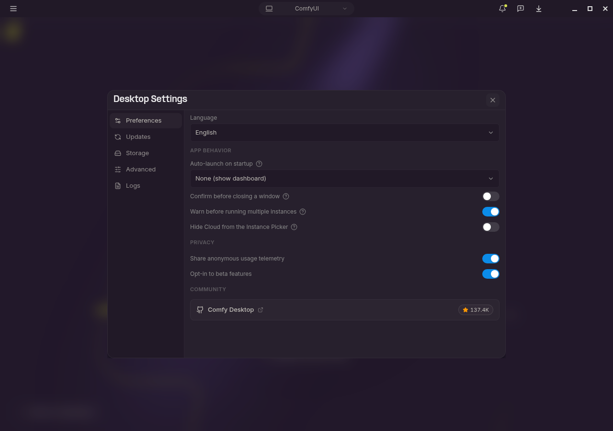
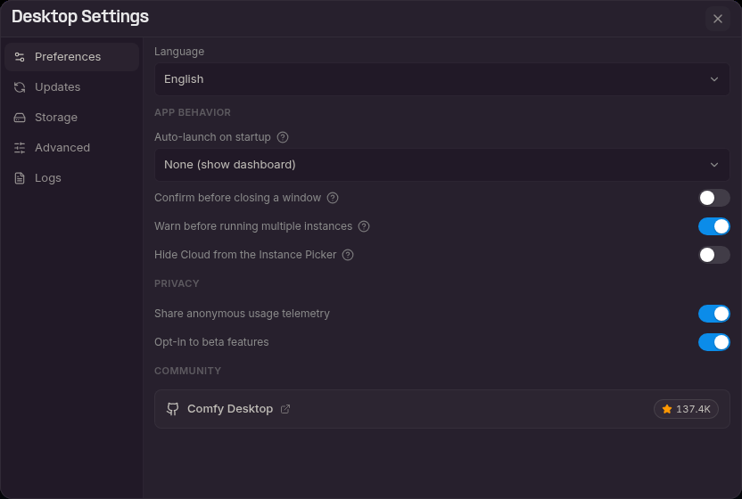
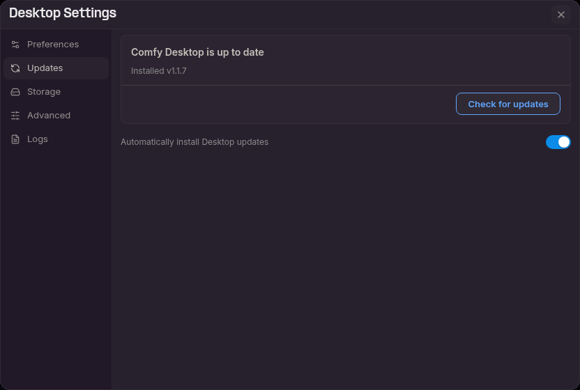
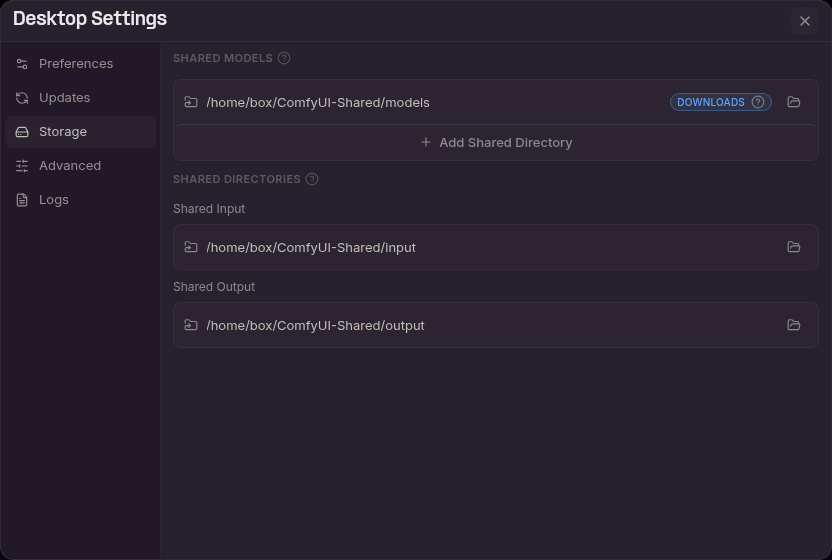
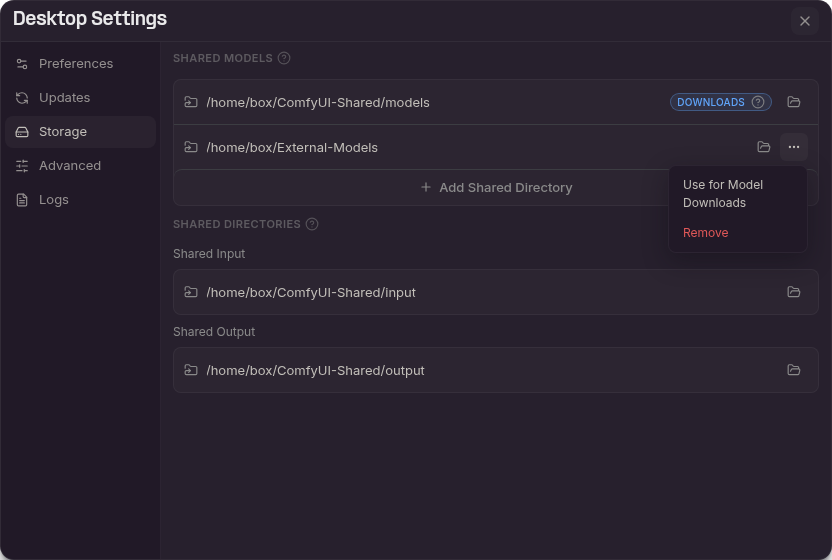
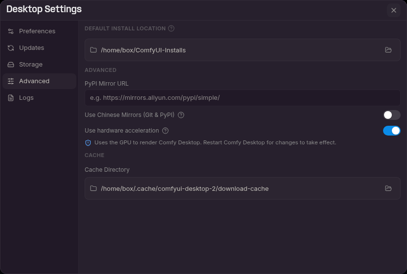

点击左上角 **☰ 菜单**（1）并选择 **Desktop Settings**（2）进入全局设置。



设置面板分为五个标签页，点击侧边栏标签即可切换。

## 偏好设置



偏好设置标签页首先是 **语言** 选择器，其余控件分为三个部分。

- **语言**：选择显示语言。支持 **English** 和 **简体中文**。

### 应用行为

- **启动时自动启动**：选择打开 Comfy桌面版 时自动启动的实例。默认选项为 **无（显示仪表盘）**。你也可以选择 **上次使用的实例**，或某个特定的安装。
- **关闭窗口前确认**：关闭正在运行本地安装的窗口之前请求确认。
- **运行多个实例前警告**：当已有本地 ComfyUI 实例正在运行或正在启动时，在启动另一个本地 ComfyUI 实例之前显示警告。
- **从实例选择器中隐藏云端**：从仪表盘中隐藏云端行。如果稍后重新启用此选项，云端仍然可用。

### 隐私

- **分享匿名使用遥测数据**：发送匿名使用数据，以帮助改进 Comfy桌面版。
- **加入 Beta 功能测试**：让 Comfy桌面版 为你的实例提前开启 Core 功能。需要先用 **分享匿名使用遥测数据** 确认数据共享，否则该开关保持禁用，即使遥测已经开启也是如此。

Beta 功能以额外的启动参数形式添加在你自己的参数之上：Comfy桌面版 绝不会删除或替换你自己的参数。当某个实例开启 Beta 功能时，标题栏会出现标题为 **已启用 Beta 功能** 的卡片。选择 **知道了** 关闭它，选择 **设置** 会在本面板中打开该开关。Beta 功能添加了哪些参数，可以在该实例的启动参数标签页中查看，位于 **启动参数** 旁边的 **+N beta** 标签内。

### 社区

- **Comfy桌面版**：一张链接到 [Comfy桌面版 GitHub 仓库](https://github.com/Comfy-Org/Comfy-Desktop) 的卡片，并显示 Star 数。

## 更新



- **状态**：显示 Comfy Desktop 是否为最新版本以及当前安装的版本。执行过一次检查后，还会显示上次检查的时间。
- **检查更新**：手动检查新版本。有更新时按钮变为**下载**，下载完成后变为**重启并更新**。
- **自动安装桌面端更新**：后台自动下载并安装更新。

## 存储

存储标签页用于配置 Comfy Desktop 查找和存储文件的位置。核心概念是**共享**：与其让每个实例拥有各自独立的模型、输入和输出，不如设置可供所有实例访问的共享目录。



- **共享模型**：此处列出的每个目录都会被所有实例扫描以查找模型。带 **DOWNLOADS** 角标的目录是新模型的下载位置。

  

  - 点击目录路径可在文件管理器中打开该目录。
  - **⋯** 菜单（1）出现在除当前下载目录之外的每个共享目录上。选择 **Use for Model Downloads**（2）即可把该目录设为模型下载位置，或选择 **Remove** 将其从列表中移除。移除目录不会删除其中的文件。
  - 点击 **+ 添加共享目录** 可添加更多模型目录。
- **共享输入**：所有实例查找输入文件（图像、视频等）的共享路径。
- **共享输出**：所有实例保存已生成输出的共享路径。自定义此路径可将所有结果集中存放在一处。
- 点击文件夹图标可浏览并选择新路径。**?** 工具提示提供更多详情。

每个实例的覆盖设置（包含共享目录、拆分输入/输出、额外模型文件夹）位于实例 [管理](/zh/installation/desktop/usage/manage#存储标签页) 页面中的存储标签页内。

## 高级



- **默认安装位置**：新独立实例的创建位置。点击文件夹图标更改。
- **PyPI 镜像 URL**：自定义 pip 镜像地址（如 `https://mirrors.aliyun.com/pypi/simple/`）。
- **使用中国镜像（Git & PyPI）**：对 Git 和 PyPI 使用中国镜像服务器。在中国大陆使用时很有帮助。当应用语言为中文时，该开关位于「偏好设置」标签页的 **应用行为** 分组中。
- **使用硬件加速**：使用 GPU 渲染 Comfy Desktop。更改将在重启 Comfy Desktop 后生效。
- **缓存目录**：Comfy 桌面版存储临时和缓存数据的目录。点击文件夹图标更改。

### 下载缓存

每个独立安装都需要一个 ComfyUI 安装包才能解压。Comfy Desktop 会先在下载缓存里找这个安装包，只有没命中时才下载。命中时下载步骤的状态行显示 **使用缓存的下载**，安装直接进入解压。这就是为什么同一个安装包和硬件变体的第二个实例安装得快很多。

**缓存目录** 本身就是下载缓存：它的默认值以 `download-cache` 结尾，每个安装包存放在以其安装包版本和硬件变体命名的子文件夹中。

| 平台 | 默认下载缓存位置 |
|----------|------------------------|
| Windows | `%LOCALAPPDATA%\Comfy-Desktop\ComfyUI-Cache\download-cache`；如果 Comfy Desktop 安装在另一个硬盘上，则为 `<drive>\Comfy-Desktop\ComfyUI-Cache\download-cache`。沿用旧数据布局的安装仍位于 `%APPDATA%\Comfy Desktop\download-cache` |
| macOS | `~/Library/Application Support/Comfy Desktop/download-cache` |
| Linux | `~/.cache/comfyui-desktop-2/download-cache` |

- **默认只保留一个安装包。** 下载完成后，较早的缓存安装包会被删除，因此换一个硬件变体或有了新的安装包版本时，会替换掉缓存里的那个。
- **缓存跟着安装包走，而不是你在向导里选的 ComfyUI 版本。** 在向导里换一个 ComfyUI 版本仍会复用同一个缓存安装包，安装完成后再更新到该版本。只有新的安装包版本，或换到另一个硬件变体，才会重新下载。
- **两个安装不会在同一时间下载同一个安装包。** 第二个安装会等待，并显示 **等待另一个安装完成下载…**，直到第一个下载完成。
- **中断的下载会被清理。** 超过一天的未完成下载会在 Comfy Desktop 启动时被删除。

请让 **缓存目录** 专用于缓存。下载完成时，Comfy Desktop 会删除其中的较早子文件夹，所以放在这里的其他文件夹也可能被删除。删除专用的缓存文件夹只会让下一次安装重新下载一次，因为模型、输入、输出和实例都在别的位置。更改 **缓存目录** 只改变新下载的缓存位置，旧文件夹仍留在原处。

## 日志

- **诊断**：**打开日志文件夹** 会打开 Comfy 桌面版应用的日志目录（`app.log`）。参见[如何查看 Comfy 桌面版启动日志？](/zh/installation/desktop/faq#如何查看-comfy-desktop-启动日志)。

## 数据存储位置

Comfy桌面版会将数据存储在特定平台的目录中。

<Tabs>
  <Tab title="Windows">
```
App data:     %APPDATA%\Comfy Desktop
Logs:         %APPDATA%\Comfy Desktop\logs
Installs:     %LOCALAPPDATA%\Comfy-Desktop\ComfyUI-Installs
Shared data:  %LOCALAPPDATA%\Comfy-Desktop\ComfyUI-Shared
```

新安装会将大型数据（安装、共享模型、缓存）存放在 `%LOCALAPPDATA%\Comfy-Desktop` 下。如果升级之前你的用户档案中已有 `ComfyUI-Installs` 或 `ComfyUI-Shared`，则会保留这些主目录根文件夹。如果你将应用安装到其他驱动器，则大型数据会存放在 `<drive>\Comfy-Desktop\` 中。
  </Tab>
  <Tab title="macOS">
```
App data:     ~/Library/Application Support/Comfy Desktop
Logs:         ~/Library/Logs/Comfy Desktop
Installs:     ~/ComfyUI-Installs
Shared data:  ~/ComfyUI-Shared
```
  </Tab>
  <Tab title="Linux">
```
Config:       ~/.config/comfyui-desktop-2
Data:         ~/.local/share/comfyui-desktop-2
Cache:        ~/.cache/comfyui-desktop-2
State:        ~/.local/state/comfyui-desktop-2
Logs:         ~/.config/comfyui-desktop-2/logs
Installs:     ~/ComfyUI-Installs
Shared data:  ~/ComfyUI-Shared
```

在 Linux 上，Electron 会将用户数据存储在包名称 `comfyui-desktop-2` 下，而不是显示名称 Comfy桌面版。
  </Tab>
</Tabs>

## 键盘快捷键

| 快捷键 | 操作 |
|--------|------|
| `Ctrl+R` / `Cmd+R` | 刷新当前 ComfyUI 视图 |
| `Ctrl`/`Cmd` + `+` / `-` / `0` | 放大、缩小 ComfyUI 视图，或恢复到 100% |
| `Escape` | 关闭对话框或弹出层 |

Comfy桌面版 没有绑定 `Ctrl+W` / `Cmd+W`，因此误触不会关掉正在运行实例的窗口。要关闭窗口，请使用 ☰ 菜单中的 **Close Window**。

## 问题反馈

发现了 bug 或有建议？Comfy桌面版是开源项目，你可以在这里反馈问题并查看计划中的功能：

- **Comfy桌面版问题**：[github.com/Comfy-Org/Comfy-Desktop/issues](https://github.com/Comfy-Org/Comfy-Desktop/issues)
- **文档问题**：[github.com/Comfy-Org/docs/issues](https://github.com/Comfy-Org/docs/issues)

有关 ComfyUI 的常规问题，请访问 [ComfyUI GitHub Discussions](https://github.com/Comfy-Org/ComfyUI/discussions) 或加入 [ComfyUI Discord](https://www.comfy.org/discord)。
