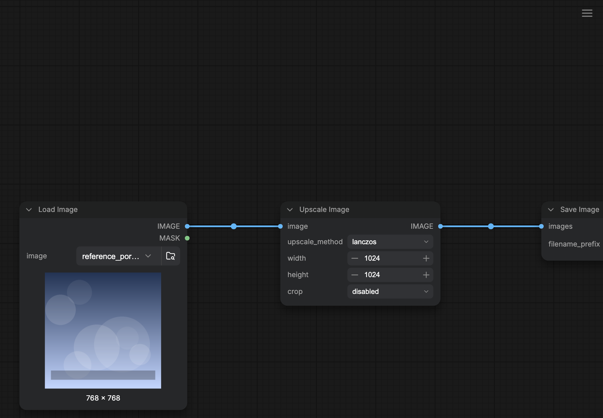
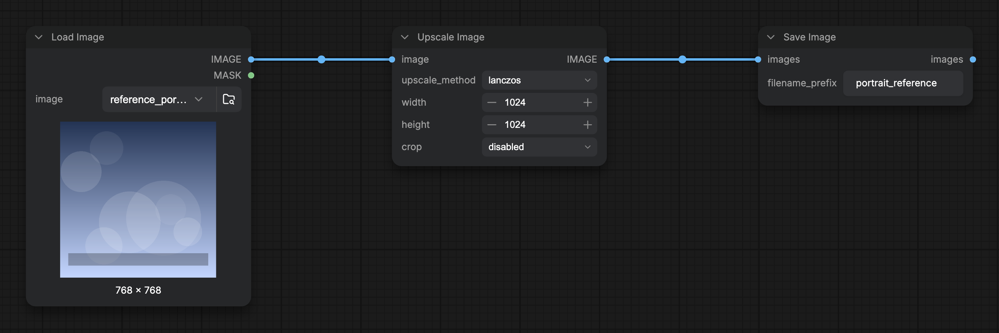
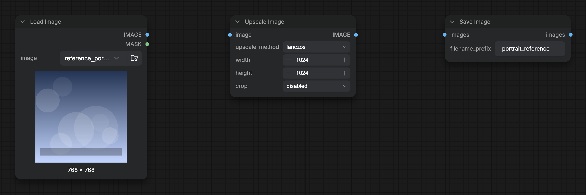

画布右下角工具栏与 **View** 菜单控制你如何在图中移动。核心 View 命令包括切换底部面板、浏览模板、**Focus Mode**、画布性能信息、小地图、连线可见性、放大/缩小与适应视图。

## 画布工具栏

当 **Show graph canvas menu**（`Comfy.Graph.CanvasMenu`）开启（默认）时，画布右下角有浮动工具栏：

| 控件 | 作用 |
| --- | --- |
| **Canvas mode** | 在 **Select**（编辑节点）与 **Hand**（仅平移 / 只读画布）之间切换。默认：`v` 解锁 Select，`h` 锁定 Hand。 |
| **Fit view** | 将图框入视口（`Comfy.Canvas.FitView`，默认 `.`）。 |
| **Zoom** | 打开弹出层：放大、缩小、缩放到适应，以及百分比字段（1-1000%）。默认快捷键含 `Alt` + `=` / `Alt` + `-`。 |
| **Minimap** | 切换概览图（`Comfy.Canvas.ToggleMinimap`，默认 `Alt` + `Shift` + `M`）。持久化为 `Comfy.Minimap.Visible`。 |
| **Link visibility** | 通过隐藏连线渲染模式显示或隐藏连接线（`Comfy.Canvas.ToggleLinkVisibility`）。 |

可在 Lite Graph / Canvas 设置中用 **Show graph canvas menu** 隐藏整个工具栏。

## View 菜单

**View** 菜单注册相同的导航命令，可从菜单栏或命令面板运行：

- Toggle Bottom Panel
- Browse Templates
- Focus Mode
- Canvas Performance（`Comfy.ToggleCanvasInfo`，切换 `Comfy.Graph.CanvasInfo`）
- Toggle Minimap
- Toggle Link Visibility
- Zoom In / Zoom Out / Fit View

## Focus Mode（专注模式）

**Focus Mode**（`Workspace.ToggleFocusMode`）隐藏工作区边框控件，便于专注于图。开启时：

- 顶部菜单区域隐藏（新菜单）。
- 左右侧栏面板与底部面板不在分割布局中渲染。
- 出现汉堡控件以便退出 Focus Mode（**Show menu**）。

再次切换 Focus Mode，或使用汉堡控件，即可恢复完整工作区。

## 小地图选项

除显示/隐藏外，设置中的 Minimap 项控制地图绘制内容（节点颜色、连线、分组、bypass 状态、错误状态）。见 [Lite Graph 设置](/zh/interface/settings/lite-graph) 及出现时的相关 Appearance 条目。

## 连线与画布全局设置

连线形状以及是否显示已连接的连线，也可在未选中任何内容时，通过 [右侧面板](/zh/interface/right-side-panel) 的 **全局设置** 快速切换，并可在 Lite Graph 设置中完整配置（`Comfy.LinkRenderMode` 及相关选项）。网格间距与吸附到网格也位于相同的全局设置 / Lite Graph 区域。

### 选择连线

需要 ComfyUI 前端 1.58.0 或更高版本。用框选来选择连线是选择模式下的默认画布行为（不是设置中的开关）。

在想要操作的连接线上拖动选框。如果框选没有捕获任何节点、分组或改道点，则会选中它经过的所有可见连线，选择工具箱会把节点按钮替换为两个连线操作：**隐藏** 会保留连接并隐藏连线，**删除** 则会把连线从图中移除。每个操作都算一步撤回，`Delete` 或 `Backspace` 也可以移除选中的连线。

`Shift` 和 `Alt` 框选只会选中节点和分组，Hand 画布模式永远不会选中连线。

### 点击节点的输入或输出点以操作其连线

需要 ComfyUI 前端 1.60.0 或更高版本。点击节点的输入或输出点，而不是从该点拖拽。画布会选中连接到该点的所有连线：输入点上只有一条连线，输出点上则是其全部连线；选择工具箱会提供 **隐藏** 和 **删除**，与框选时使用的操作相同。

- 如果选中的连线全部已隐藏，工具箱会显示 **显示** 而不是 **隐藏**。
- **隐藏** 只作用于可见连线，**显示** 只作用于已隐藏连线，因此两者都不会产生空的撤回步骤。
- **删除** 会移除该点上的所有连线，包括已隐藏的连线。
- 点击时按住 `Shift`、`Ctrl`、`Cmd` 或 `Alt` 可保留当前选择。
- 按住 `Ctrl` + `Alt` 点击则会改为断开连线，与画布其他位置的行为一致。
- 没有连线的点会忽略点击；关闭连线可见性的画布也会忽略点击，因为此时所有连线都已隐藏。从点上拖拽仍会新建连线。

### 隐藏连线并标注其徽标

隐藏连线有两种方式：

- 用框选选中连线，然后点击选择工具箱中带叉的眼睛图标（**隐藏**）。框选在选择模式下直接拖拽或按住 `Ctrl` 均可使用。
- 右键点击连线中部，选择 **隐藏连线**。

无论采用哪种方式，该连线都不再绘制，每个插槽会显示一个徽标，标明连线的数据类型或标签。右键点击徽标可 **重命名**。前端 1.59.1 及更高版本会把同一插槽的多个标签堆叠成单个徽标，例如 `IMAGE ×3`；更早版本则为每条连线绘制一个徽标。要重新绘制已隐藏的连线，右键点击其徽标并选择 **显示连线**。

<video controls className="w-full">
  <source src="/images/interface/canvas-controls/hide-link.mp4" type="video/mp4" />
</video>

## 相关页面

- [界面概览](/zh/interface/overview)
- [快捷键](/zh/interface/shortcuts)
- [Lite Graph 设置](/zh/interface/settings/lite-graph)
- [右侧面板](/zh/interface/right-side-panel)（Global Settings 快速开关）
- [底部面板](/zh/interface/bottom-panel)
