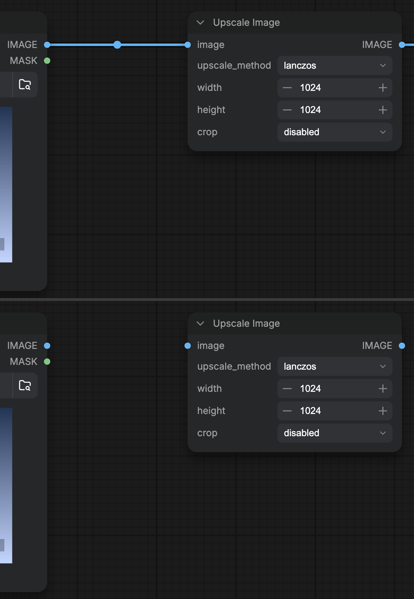
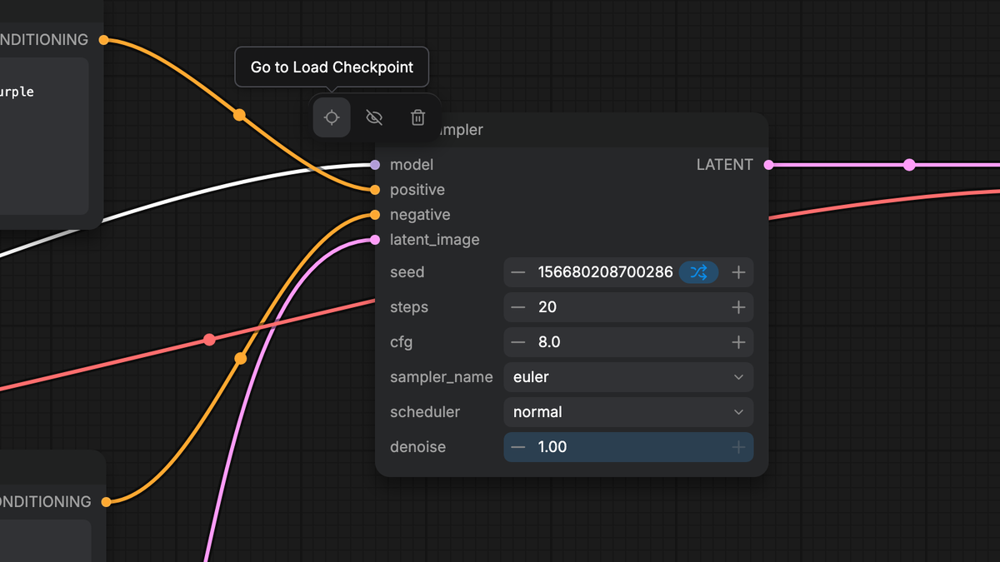
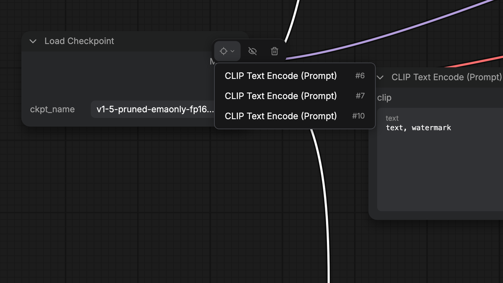
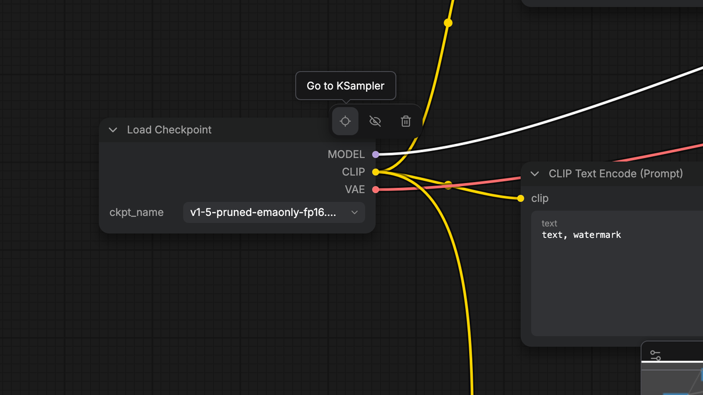

画布右下角工具栏与 **View** 菜单控制你在画面中的移动方式。核心 View 命令包括切换底部面板、浏览模板、**Focus Mode**、画布性能信息、小地图、连线可见性、放大/缩小以及适应视图。

## 画布工具栏

当 **显示图形画布菜单**（`Comfy.Graph.CanvasMenu`）开启（默认）时，画布右下角会显示一个浮动式工具栏：

<Frame caption="位于右下角的画布工具栏，其上方展开了小地图面板。">
  
</Frame>

| 控件 | 作用 |
| --- | --- |
| **画布模式** | 用于在 **选择**（编辑节点）与 **拖拽**（仅平移 / 只读画布）之间切换的菜单。默认：`v` 解锁选择，`h` 锁定拖拽。 |
| **适应视图** | 将画面框入视口（`Comfy.Canvas.FitView`，默认 `.`）。 |
| **缩放** | 打开弹出面板，其中包含放大、缩小、适合画面，以及百分比输入框（1-1000%）。默认快捷键包括 `Alt` + `=` / `Alt` + `-` 用于放大/缩小。 |
| **小地图** | 切换概览地图（`Comfy.Canvas.ToggleMinimap`，默认 `Alt` + `Shift` + `M`）。持久化为 `Comfy.Minimap.Visible`。 |
| **连线可见性** | 通过切换隐藏连线渲染样式来隐藏或显示连接线（`Comfy.Canvas.ToggleLinkVisibility`）。 |

你可以在画面 / 画布设置中用 **显示图形画布菜单** 隐藏整个工具栏。

## View 菜单

**View** 菜单注册了相同的导航指令，因此你可以从菜单栏或命令面板中运行它们：

- 底部面板
- 浏览模板
- 专注模式
- 画布性能（`Comfy.ToggleCanvasInfo`，切换 `Comfy.Graph.CanvasInfo`）
- 小地图
- 节点连接（`Comfy.Canvas.ToggleLinkVisibility`）
- 放大 / 缩小 / 适合画面

## 专注模式

**专注模式**（`Workspace.ToggleFocusMode`）会隐藏工作区的外围界面元素，让你可以专注于画面。开启后：

- 顶部菜单区域会被隐藏（新菜单）。
- 左右侧边栏面板和底部面板不会在分割布局中渲染。
- 会出现一个汉堡按钮，供你退出专注模式（**显示菜单**）。

再次切换专注模式，或使用汉堡按钮，即可恢复完整的工作区。

## 小地图选项

除显示/隐藏外，设置中的 Minimap 项控制地图绘制内容（节点颜色、连线、分组、bypass 状态、错误状态）。见 [Lite Graph 设置](/zh/interface/settings/lite-graph) 及出现时的相关 Appearance 条目。

## 连线与画布全局设置

连线形状以及是否显示已连接的连线，也可在未选中任何内容时，通过 [右侧面板](/zh/interface/right-side-panel) 的 **全局设置** 快速切换，并可在 Lite Graph 设置中完整配置（`Comfy.LinkRenderMode` 及相关选项）。网格间距与吸附到网格也位于相同的全局设置 / Lite Graph 区域。

### 连线可见性

**连线可见性** 会一次性隐藏画布上的所有连线。使用 [画布工具栏](#画布工具栏) 最右端的打叉连线按钮，或 **视图** > **节点连接**。不会移除任何连线，画面仍可运行：插槽会保留圆点，只有连线停止绘制，这在画面过于密集难以辨认时很有帮助。

该指令（`Comfy.Canvas.ToggleLinkVisibility`）会把 `Comfy.LinkRenderMode` 设为 **隐藏**，并在下次使用该指令时恢复上一个模式（直角线、线性或曲线）。

<Frame caption="同一画面上，连线可见性开启（上）与关闭（下）。只有连线发生变化；插槽仍保留圆点。">
  
</Frame>

本节其余部分则介绍如何隐藏单条连线。这种方式会在插槽上保留一个徽标，以便你标注该连接并单独将其恢复。

### 选择连线

需要 ComfyUI 前端 1.59.0 或更高版本。用框选来选择连线是选择模式下的默认画布行为（不是设置中的开关）。

在想要操作的连接线上拖动选框。如果框选没有捕获任何节点、分组或改道点，则会选中它经过的所有可见连线，选择工具箱会把节点按钮替换为两个连线操作：**隐藏** 会保留连接并隐藏连线，**删除** 则会把连线从画面中移除。每个操作都算一步撤回，`Delete` 或 `Backspace` 也可以移除选中的连线。

`Shift` 和 `Alt` 框选只会选中节点和分组，Hand 画布模式永远不会选中连线。

### 点击节点的输入或输出点以操作其连线

需要 ComfyUI 前端 1.59.1 或更高版本。点击节点的输入或输出点，而不是从该点拖拽。画布会选中连接到该点的所有连线：输入点上只有一条连线，输出点上则是其全部连线；选择工具箱会提供 **隐藏** 和 **删除**，与框选时使用的操作相同。

- 如果选中的连线全部已隐藏，工具箱会显示 **显示** 而不是 **隐藏**。
- **隐藏** 只作用于可见连线，**显示** 只作用于已隐藏连线，因此两者都不会产生空的撤回步骤。
- **删除** 会移除该点上的所有连线，包括已隐藏的连线。
- 点击时按住 `Shift`、`Ctrl`、`Cmd` 或 `Alt` 可保留当前选择。
- 按住 `Ctrl` + `Alt` 点击则会改为断开连线，与画布其他位置的行为一致。
- 没有连线的点会忽略点击；关闭连线可见性的画布也会忽略点击，因为此时所有连线都已隐藏。从点上拖拽仍会新建连线。

### 隐藏连线并标注其徽标

隐藏连线有两种方式：

- 先选中连线，然后点击选择工具箱中带叉的眼睛图标（**隐藏**）。
- 右键点击连线中部，选择 **隐藏连线**。

无论采用哪种方式，该连线都不再绘制，每个插槽会显示一个徽标，标明连线的数据类型或标签。右键点击徽标可 **重命名**。前端 1.59.1 及更高版本会把同一插槽的多个标签堆叠成单个徽标，例如 `IMAGE ×3`；更早版本则为每条连线绘制一个徽标。要重新绘制已隐藏的连线，右键点击其徽标并选择 **显示连线**。堆叠徽标会提供 **显示链接**，并恢复它所代表的每一条连线。

下面的录制会先隐藏为预览节点提供输入的三条连线，重命名它们的徽标，然后重新显示这些连线：

<video controls className="w-full">
  <source src="/images/interface/canvas-controls/hide-link.mp4" type="video/mp4" />
</video>

### 跳转到连线的另一端

需要 ComfyUI 前端 1.61.8 或更高版本。选中节点的输入或输出接口后，选择工具箱会多出一个按钮，把视图移动到这些连线另一端的节点。

- 在输入接口上，按钮会写明来源节点，例如 **转到 Load Checkpoint**。在连接到多个不同节点的输出接口上，按钮显示为 **转到已连接的节点**，点击后展开菜单，每个节点占一行，显示节点标题与 ID，顺序与它们在画布上的位置一致。多条连线连到同一个节点时只算一个目标，这类输出仍直接显示按钮。
- 跳转完成后，选中项会移到落点的接口上，因此再按一次按钮即可返回。在输出接口上，菜单会再次列出全部已连接的节点。
- 经过改道点的连线会直接跳到节点本身，隐藏的连线同样可以跳转。
- 框选没有点击端，因此不显示跳转按钮。
- 在子图边界上，跳转会落在 **子图输入** 或 **子图输出** 节点上。

在连接到三个节点的输出接口上，按钮会展开菜单；跳转完成后，落点接口上的按钮可以带你返回：

## 相关页面

- [界面概览](/zh/interface/overview)
- [快捷键](/zh/interface/shortcuts)
- [Lite Graph 设置](/zh/interface/settings/lite-graph)
- [右侧面板](/zh/interface/right-side-panel)（Global Settings 快速开关）
- [底部面板](/zh/interface/bottom-panel)
