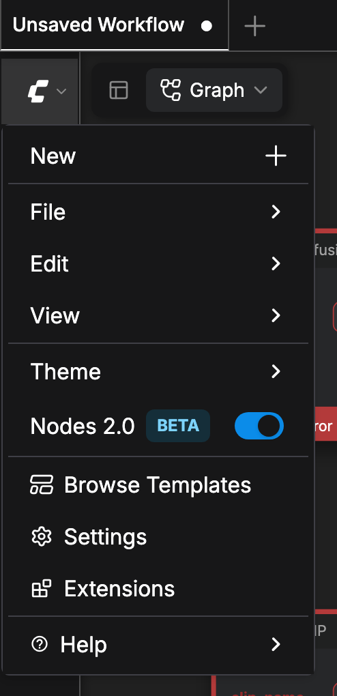
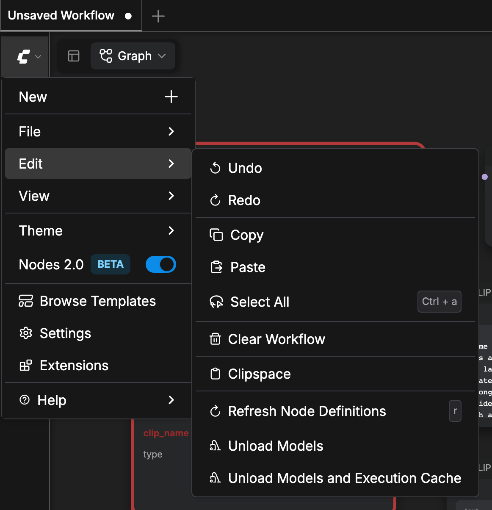

Comfy 菜单从左侧边栏顶部的 Comfy 标志打开。它包含那些在画布上没有对应控件的命令：启动和保存工作流、剪贴板编辑、视图切换、GPU 内存清理，以及帮助链接。

点击该标志或其旁边的箭头即可打开菜单。右侧带箭头的条目含有子菜单：将鼠标悬停其上即可打开。

## 菜单项

| 菜单项 | 作用 |
| --- | --- |
| **新建** | 启动一个空白工作流 |
| **文件** | 打开、保存和导出工作流 |
| **编辑** | 撤销与重做、剪贴板、剪贴空间、节点定义、GPU 显存 |
| **视图** | 底部面板、专注模式、小地图、节点连接、缩放 |
| **主题** | 内置和自定义主题的子菜单，当前主题会被勾选 |
| **Nodes 2.0** | Nodes 2.0 渲染器的开关，参见 [Nodes 2.0](/zh/interface/nodes-2) |
| **浏览模板** | 打开模板浏览器，参见 [模板](/zh/interface/features/template) |
| **设置** | 打开设置对话框，与 `Ctrl + ,` 相同 |
| **管理扩展功能** | 打开自定义节点和前端扩展的管理器 |
| **帮助** | 问题追踪、文档、Discord、论坛、关于以及支持 |

### 文件

| 菜单项 | 快捷键 | 作用 |
| --- | --- | --- |
| **打开** | `Ctrl + O` | 从磁盘打开一个工作流 |
| **保存** | `Ctrl + S` | 保存当前工作流 |
| **另存为** | | 以新的名称保存 |
| **导出** | | 将工作流下载为 JSON |
| **导出（API）** | | 下载 API 格式的提示词，参见 [工作流 API 格式](/zh/development/api-development/workflow-api-format) |
| **导出（工作流图像）** | | 下载一张内嵌工作流数据的画布 PNG，需要 ComfyUI 前端 1.61.4 或更高版本，参见 [工作流](/zh/basic-concepts/workflow) |

### 编辑

| 菜单项 | 快捷键 | 作用 |
| --- | --- | --- |
| **撤销** / **重做** | | 在画布的变更中前后切换 |
| **复制** / **粘贴** | | 复制已选择的节点 |
| **全选** | `Ctrl + A` | 选中画布上的所有节点 |
| **清除工作流** | | 清空画布。已保存的工作流仍保持已保存状态 |
| **剪贴空间** | | 打开用于图像和已复制节点的剪贴板空间 |
| **刷新节点定义** | `R` | 无需重启 ComfyUI 即可重新加载节点定义 |
| **卸载模型** | | 释放已加载模型占用的 GPU 显存 |
| **卸载模型和执行缓存** | | 同时丢弃缓存结果，因此下次运行会重新计算它们 |

### 视图

| 菜单项 | 快捷键 | 作用 |
| --- | --- | --- |
| **底部面板** | | 显示或隐藏[底部面板](/zh/interface/bottom-panel) |
| **浏览模板** | | 打开模板浏览器 |
| **专注模式** | | 隐藏除画布之外的所有内容，参见[画布控制](/zh/interface/canvas-controls) |
| **画布性能** | | 显示或隐藏画布性能读数 |
| **小地图** | `Alt + Shift + M` | 显示或隐藏小地图 |
| **节点连接** | | 显示或隐藏连线的渲染 |
| **放大画面** / **缩小画面** | `Alt + =` / `Alt + -` | 缩放画布 |
| **缩放以适应** | `.` | 让选中的节点适应视图；未选中节点时适应整个工作流 |

### 帮助

| 菜单项 | 打开内容 |
| --- | --- |
| **ComfyUI 问题** | GitHub 上的 ComfyUI 问题追踪器 |
| **ComfyUI 文档** | docs.comfy.org |
| **Comfy-Org Discord** | 社区 Discord 服务器 |
| **ComfyUI 论坛** | ComfyUI 论坛 |
| **关于ComfyUI** | 版本和系统信息，参见[关于](/zh/interface/settings/about) |
| **联系支持** | 支持表单 |

## 不重启释放内存

编辑菜单中有两个条目可在会话期间释放内存：

- **卸载模型**：清除 GPU 内存中所有已加载的 checkpoint、LoRA 和 VAE。
- **卸载模型和执行缓存**：同时清除缓存的执行结果，因此下次运行时会重新计算，而不是复用这些结果。

当你想要加载其他模型时使用第一个，在更改磁盘上的模型文件之后使用第二个。两者都仅限本地：Comfy Cloud 会隐藏它们，因为服务器负责管理模型内存。

## 菜单的差异之处

- **Comfy Cloud** 会隐藏两个卸载条目。其他每个条目的行为均与本节所述一致。
- **Comfy Desktop** 会在「帮助」子菜单中添加条目：桌面版用户指南、DevTools、打开文件夹子菜单、检查更新和重新安装。

## 相关页面

- [界面概览](/zh/interface/overview)
- [键盘快捷键](/zh/interface/shortcuts)
- [Comfy 设置](/zh/interface/settings/comfy)
