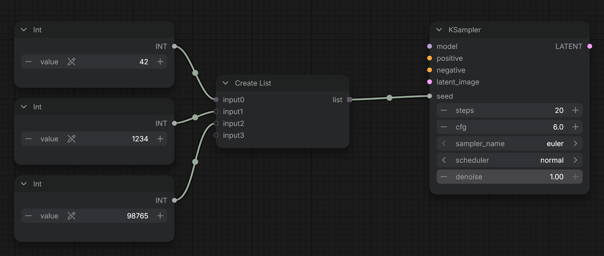
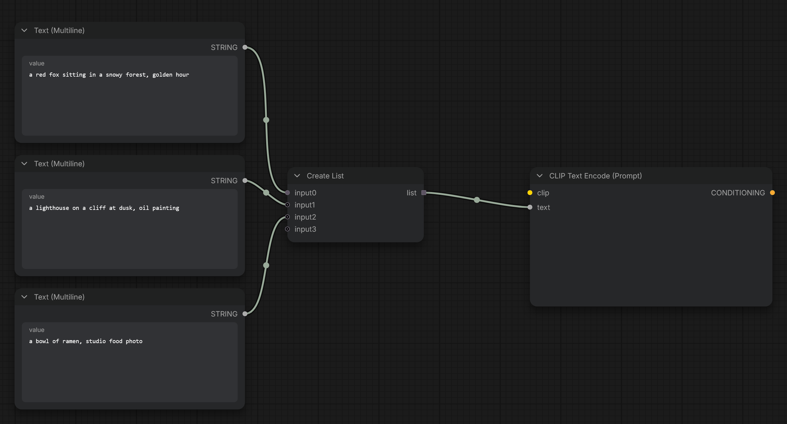
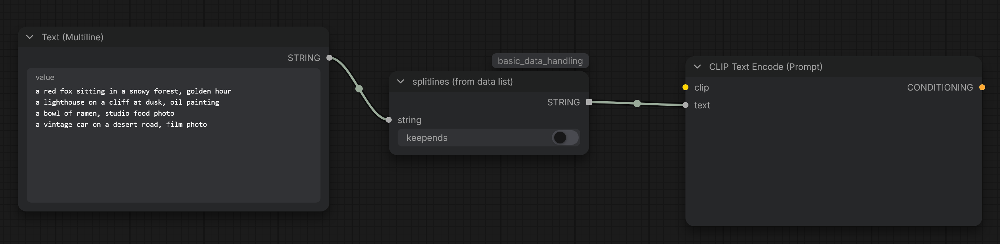
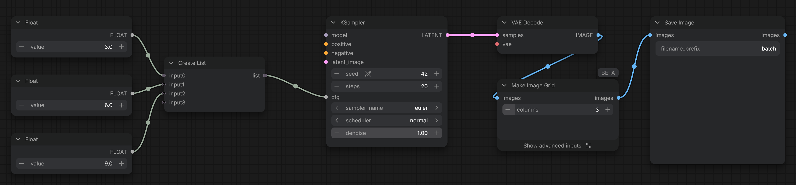
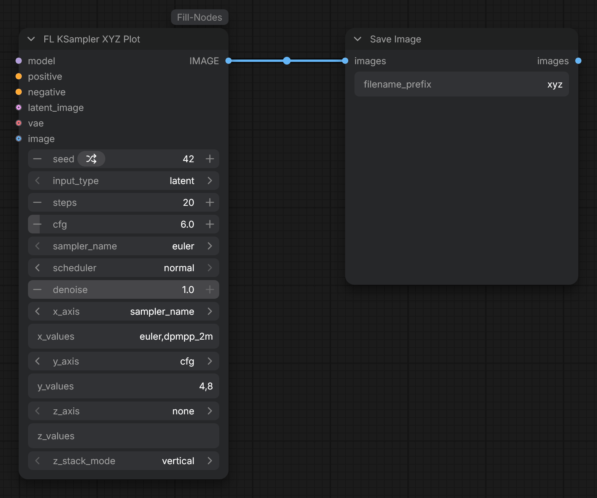
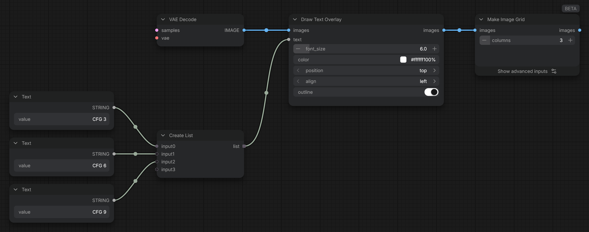

**批处理生成**是指多次运行同一个工作流，并在每次运行之间改变某些内容：种子、提示词、CFG、采样器、模型，或同时改变其中几项。**设置网格**是它的一种用法：使用相同的提示词和种子，每个单元格更改一到两项设置，以便看出每项设置的作用。

本指南从最简单的场景开始，每次增加一个步骤：

1. [批处理种子](#batch-seeds)：一个提示词的多种变体
2. [批处理提示词](#batch-prompts)：每个提示词运行一次
3. [批处理任意设置](#batch-any-setting)：CFG、步数或任何其他输入的每个取值运行一次
4. [循环](#loops)：Start Loop 和 End Loop
5. [设置网格](#settings-grids)：交叉两个或更多设置并排列结果
6. [使用 Comfy API 编写脚本](#scripting-with-the-comfy-api)：任意组合，任意规模


| 方法 | 每次运行之间变化的内容 | 章节 |
|--------|---------------------------|---------|
| 批次数量 | 种子，或任何设置为 `increment` 或 `randomize` 的控件 | [批处理种子](#batch-seeds) |
| `batch_size` | 一次采样过程中每张图像的噪波 | [批处理种子](#batch-seeds) |
| 列表 | 从列表提供的任何输入：种子、提示词、CFG、步数 | [批处理提示词](#batch-prompts)、[批处理任意设置](#batch-any-setting) |
| Start Loop / End Loop | 任意输入，每次迭代处理一个 | [循环](#loops) |
| XY 绘图节点 | 交叉两个或三个采样器设置 | [设置网格](#settings-grids) |
| 脚本 | 任意内容，覆盖所有组合 | [编写脚本](#scripting-with-the-comfy-api) |

<Tip>
只需要一个简单的设置网格，或者想在自行搭建之前先看看它能呈现什么效果？[Comfy Hub](https://comfy.org/hub/workflows) 上的开放模型文生图页面带有一个 **Grid** 标签页，可在同一种子下并排展示 CFG、步数、采样器和调度器，无需任何设置。可以试试 [MOSS-Image 的 Grid 标签页](https://comfy.org/hub/workflows/moss-image-text-to-image/)。更多内容请参见[设置网格](#settings-grids)。
</Tip>

<Note>
某些步骤会使用自定义节点。本页提到的每个自定义节点都已安装在 [Comfy Cloud](https://cloud.comfy.org) 上，在该平台上，自定义节点会在添加之前接受审核。在你自己的 ComfyUI 上，请先[安装节点包](/zh/installation/install_custom_node)。
</Note>

## 批量种子 {#batch-seeds}

种子决定起始噪波，因此新的种子会为同一提示词生成新的构图。更改种子是最简单的批处理。

### 批次数量

**批次数量**位于运行栏中 **运行** 按钮的旁边。它设置每次点击会把工作流加入队列多少次。有关它的位置，请参见[运行栏](/zh/interface/overview)。

1. 将 `KSampler` 种子的 `control after generate` 设置为 `randomize` 或 `increment`。
2. 将 **批次数量** 设置为想要的图像数量。
3. 点击 **运行**。每个加入队列的运行都会获得下一个种子。


`control after generate` 适用于任何支持它的数字控件，而不只是种子。如果每个控件都设置为 `fixed`，那么每次加入队列的运行都完全相同，并生成相同的图像。

### Latent 上的 `batch_size`

`Empty Latent Image` 节点上的 `batch_size` 会一次创建多个 Latent，而 `KSampler` 会在一次处理中将它们一起去噪。批次中的每张图像都会获得不同的噪波。

1. 在 `Empty Latent Image` 上，将 `batch_size` 设置为图像数量，例如 `4`。
2. 点击 **运行**。`Save Image` 会保存全部图像。

更大的批次会占用更多显存，因为所有图像会同时采样。

### 特定种子

要重新运行已经喜欢的种子，例如在新的设置下比较它们，可以通过列表来提供种子：

1. 为每个种子添加一个 [整数](/zh/built-in-nodes/PrimitiveInt) 节点。
2. 添加一个 [创建列表](/zh/built-in-nodes/CreateList) 节点，并将每个 `Int` 连接到其下一个空闲输入。连接时会出现新的输入。
3. 将 `Create List` 的 `list` 输出连接到 `KSampler` 的 `seed` 输入。
4. 点击 **运行**。`KSampler` 会为每个种子运行一次。



下一节将说明列表的工作原理。

## 批处理提示词 {#batch-prompts}

当一个节点收到**列表**时，ComfyUI 会针对列表中的每一项将该节点运行一次，并将每个结果传递到下游。将提示词列表连接到 `CLIP Text Encode`，即可为每个提示词生成一张图像。

### 每个提示词一个文本节点

1. 为每个提示词添加一个[文本（多行）](/zh/built-in-nodes/PrimitiveStringMultiline)节点。
2. 使用 `Create List` 将它们合并为一个列表。
3. 将 `list` 输出连接到正向 `CLIP Text Encode` 的 `text` 输入。
4. 点击 **运行**。每个提示词都会作为独立的一次运行进行编码和采样。



### 每行一个提示词

如果提示词较多，可以将它们放在同一个文本框中，每行一个提示词，然后使用 [Basic data handling](https://github.com/StableLlama/ComfyUI-basic_data_handling) 插件包中的 **splitlines (from data list)** 节点将其拆分为列表。

1. 添加一个 `Text (Multiline)` 节点，并每行写入一个提示词。
2. 添加一个 **splitlines (from data list)** 节点（搜索 `splitlines`），并将文本连接到它的 `string` 输入。关闭 `keepends`，这样换行符就不会包含在提示词中。
3. 将其输出连接到正向 `CLIP Text Encode` 的 `text` 输入。
4. 点击 **运行**。每一行都会成为独立的一次运行。



你可以通过这种方式将整个提示词文件粘贴到文本框中。空行会变成空提示词，因此请先移除空行。

## 批处理任意设置 {#batch-any-setting}

列表几乎可以为任何输入提供数据，而不仅仅是种子和提示词。要把列表连接到 `cfg` 这样的控件上，请将连线拖到该控件上。要遍历 CFG：

1. 为每个 CFG 值各添加一个[浮点](/zh/built-in-nodes/PrimitiveFloat)节点，例如 `3`、`6` 和 `9`。
2. 用 `Create List` 将它们合并，并把该列表连接到 `KSampler` 的 `cfg` 输入。
3. 保持种子固定：将种子的 `control after generate` 设置为 `fixed`。
4. 将 `VAE Decode` 连接到[图像表格](/zh/built-in-nodes/ImageGrid)节点，然后再连接到 `Save Image`。
5. 点击 **运行**。`KSampler` 和 `VAE Decode` 会为每个 CFG 值各运行一次，`Make Image Grid` 会接收所有图像。



`steps`、`denoise`、图像尺寸和 LoRA 强度也以同样的方式生效，只需使用 `Int` 或 `Float` 节点。

<Warning>
当节点获得**多个列表**时，ComfyUI 会按位置配对各项：第一个对第一个，第二个对第二个，而较短列表的最后一项会重复。它不会生成所有组合。三个提示词和三个种子会得到三张图像，而不是九张。要交叉两个设置，请参阅[设置网格](#settings-grids)或[脚本编写](#scripting-with-the-comfy-api)。
</Warning>

**下拉框。** `sampler_name`、`scheduler` 和模型文件都是下拉框，文本值列表无法直接为其提供数据。要比较几个值，请为每个值复制一份 `KSampler` 和 `VAE Decode` 节点，将它们连接到相同的模型、提示词和 Latent，把每份副本设置为不同的值，再用 `Make Image Grid` 收集图像。对于采样器和调度器，[设置网格](#settings-grids)中的 XY plot 节点更快。

## 循环 {#loops}

[Start Loop](/zh/built-in-nodes/StartLoop) 和 [End Loop](/zh/built-in-nodes/EndLoop) 节点会在每次迭代中运行位于它们之间的节点。`Start Loop` 有三种模式：

| 模式 | 迭代次数 |
|------|------------|
| `simple` | 执行 `num_iterations` 次，`iteration_index` 从 0 开始 |
| `For` | 从 `start_iteration_index` 到（不包含）`max_iteration`，步长为 `step` |
| `List` | 对连接的 `list` 中的每一项执行一次；当前项由 `list_item` 输出 |

要对一组值（例如 CFG）进行循环：

1. 如上所述，用 `Float` 节点和 `Create List` 构建列表。提示词或种子的列表也是同样的做法。
2. 添加一个 `Start Loop` 节点，将 `mode` 设为 `List`，并把列表连接到它的 `list` 输入。
3. 将 `Start Loop` 的 `list_item` 连接到你想更改的输入，这里是 `KSampler` 的 `cfg` 输入。
4. 添加一个 `End Loop` 节点。将 `VAE Decode` 的 `IMAGE` 输出连接到 `output_value`，并开启 `accumulate`，这样 End Loop 会返回每次迭代的图像，而不只是最后一次。
5. 将 `End Loop` 的 `outputs` 连接到 `Make Image Grid`，再连接到 `Save Image`。
6. 点击 **运行**。

对于同一个列表，使用循环和直接使用普通列表会得到相同的图像。循环还能让一次迭代把值传给下一次迭代（End Loop 上的 `next_iteration_value`，Start Loop 上的 `current_iteration_value`），并且可以通过将外层循环的 `iteration_index` 连接到内层循环的 `parent_iteration`，把一个循环嵌套在另一个循环内部。

<Note>
Start Loop 和 End Loop 是最近新增的核心节点。如果找不到它们，请[更新 ComfyUI](/zh/installation/update_comfyui)。Comfy Cloud 会在每个 ComfyUI 稳定版发布之后更新。
</Note>

## 设置网格 {#settings-grids}

设置网格保持提示词、模型和种子不变，只改变采样器设置，因此两个单元格之间的任何差异都来自你更改的那个设置。如果使用随机种子，每个单元格还会得到不同的构图，你就无法再判断变化是来自设置还是来自噪波。

除了提示词和模型之外，对图像影响最大的四个 `KSampler` 设置是：

| 设置 | 它改变了什么 |
|---------|-----------------|
| `cfg` | 模型遵循提示词的严格程度。低值看起来松散柔和；高值看起来饱和且过度锐化。 |
| `steps` | 采样器执行的降噪步数。更多步数在一定程度上会增加细节，再往后只会增加时间。 |
| `sampler_name` | 在每一步去除噪波的算法（`euler`、`dpmpp_2m` 等）。 |
| `scheduler` | 噪波水平如何逐步下降（`normal`、`karras`、`simple` 等）。 |

完整的扫描会迅速倍增：4 个 CFG 值 × 3 个步数 × 3 个采样器 × 2 个调度器就是 72 张图像。先从一个或两个设置开始，找到看起来不错的范围，然后再缩小范围。

### Comfy Hub 上的 Grid 标签页

如果你只需要一个简单的设置网格，就不必自行构建。[Comfy Hub](https://comfy.org/hub/workflows) 上的开放模型文生图页面有一个 **Grid** 标签页，其中包含在一个种子下预渲染的 CFG × 步数 × 采样器 × 调度器扫描，例如 [MOSS-Image](https://comfy.org/hub/workflows/moss-image-text-to-image/)。

- 选择哪些设置放在列和行上，然后点击任意单元格以查看完整尺寸。
- 输入你自己的提示词，选择要比较的值，然后点击 **Run** 在 Comfy Cloud 上批处理运行它们。该标签页会在你运行前显示这会产生多少张图像以及费用。
- **Download with workflow** 会保存一张图像，你可以将其拖入 ComfyUI 以加载其精确设置。


如需更多设置、其他模型或你自己的工作流，请按下文所述自行构建网格。

### 使用 XY 绘图节点交叉设置

来自 [Fill-Nodes](https://github.com/filliptm/ComfyUI_Fill-Nodes) 包的 **FL KSampler XYZ Plot** 节点会替换 `KSampler`，并为你交叉最多三个设置。它会渲染每一种组合，并返回一张在坐标轴上标注了数值的图像。

1. 用 **FL KSampler XYZ Plot** 替换 `KSampler`。连接来自 checkpoint 加载器的 `model`、`positive`、`negative`、`latent_image` 以及 `vae`。
2. 设置种子以及你不更改的那些设置的基础值。
3. 将 `x_axis` 和 `y_axis` 设置为 `steps`、`cfg`、`denoise`、`sampler_name` 和 `scheduler` 中的两项。
4. 在 `x_values` 和 `y_values` 中输入每个轴的值，用逗号分隔，例如 `euler,dpmpp_2m` 和 `4,8`。
5. 要交叉第三个设置，请设置 `z_axis` 和 `z_values`。`z_stack_mode` 决定将额外的网格放置在彼此下方还是旁边。
6. 将 `IMAGE` 输出连接到 `Save Image`，然后点击 **Run**。




要交叉其他输入，例如提示词 × 种子或 LoRA 强度 × CFG，请使用[嵌套循环](#loops)或[脚本](#scripting-with-the-comfy-api)。

### 自行排布网格

当图像来自列表或循环时，[图像表格](/zh/built-in-nodes/ImageGrid)节点会将它们按行排列，从左到右、从上到下。

| 输入 | 它的作用 |
|-------|--------------|
| `columns` | 每行的图像数量。将其设置为水平轴上的数值个数。 |
| `cell_width`、`cell_height` | 每张图像被缩放到的尺寸。 |
| `padding` | 单元格之间的像素数。 |

要为每个单元格添加标签，请在 `VAE Decode` 和 `Make Image Grid` 节点之间放置一个[绘制文字覆盖](/zh/built-in-nodes/TextOverlay)节点。使用 `Text` 节点和 `Create List` 构建第二个标签列表，例如 `CFG 3`、`CFG 6` 和 `CFG 9`，并将其连接到 `text` 输入。由于图像和标签都是列表，每张图像都会获得同一位置的标签。本页顶部的网格就是以这种方式制作的。



## 使用 Comfy API 编写脚本 {#scripting-with-the-comfy-api}

一旦超过两三个设置，或者需要交叉遍历提示词、种子和模型，脚本就比图更简单。脚本会构建出所有组合，把每个组合作为独立任务提交，并保存结果以及每次运行改动的记录。

### 1. 以 API 格式导出工作流

1. 在 ComfyUI 中构建并测试单次运行所需的工作流。
2. 打开工作流菜单，选择 **导出（API）**。这会以 [API 格式](/zh/development/api-development/workflow-api-format) 保存图，其中每个节点都以节点 ID 作为键。
3. 打开 JSON，记下每个要修改的节点 ID。在默认的文生图工作流中，`KSampler` 的 ID 是 `"3"`，正向 `CLIP Text Encode` 的 ID 是 `"6"`。

### 2. 为每个组合提交一个任务

[Comfy API v2](/zh/api-reference/v2/overview) 在 `POST /api/v2/jobs` 接收 API 格式的工作流图，并返回一个可在 `GET /api/v2/jobs/{id}` 轮询的任务。同一套 API 既运行在 Comfy Cloud 上，也可通过 [comfy-api-proxy](https://github.com/Comfy-Org/comfy-api-proxy) 运行在你自己的 ComfyUI 上，因此只需修改 `BASE_URL`，下面的脚本在两者上都能工作。

Comfy Cloud 按套餐同时运行固定数量的任务，其余任务则留在队列中等待：

| 套餐 | 同时运行的任务数 |
|------|------------------|
| Standard | 1 |
| Creator | 3 |
| Pro | 5 |

最多可以有 100 个任务排队。要同时运行多个任务，需要使用 API 和付费套餐。详情请见[云端并发限制](/zh/development/deploy/cloud-usage#并发限制)。

在 `AXES` 中，每个键都是 `<node ID>.<input name>`，每个值是要尝试的取值列表。脚本会运行所有组合。它同一时间最多只提交 `MAX_IN_FLIGHT` 个任务，因此大批量任务永远不会占满队列；当服务器返回 `429` 时，它会退避等待。它需要 Python 3.9 或更高版本，以及 `pip install requests`。请先把 `COMFY_API_KEY` 设置为你的 [API 密钥](/zh/development/api-development/getting-an-api-key)。

```python batch.py
import itertools, json, os, time
import requests

BASE_URL = "https://cloud.comfy.org"  # 自己的 ComfyUI 经 comfy-api-proxy："http://127.0.0.1:8189"
API_KEY = os.environ.get("COMFY_API_KEY", "")
HEADERS = {"Authorization": f"Bearer {API_KEY}"} if API_KEY else {}

WORKFLOW_FILE = "workflow_api.json"  # 来自“导出 (API)”
MAX_IN_FLIGHT = 5                    # 与套餐的同时运行上限一致；切勿超过 100
OUT_DIR = "batch"

# "<node ID>.<input name>"：要尝试的取值。每个组合都会运行。
AXES = {
    "3.seed": [42],
    "3.cfg": [3.0, 5.0, 7.0],
    "3.sampler_name": ["euler", "dpmpp_2m"],
    "6.text": ["a red fox in snow, photo", "a lighthouse at dusk, oil painting"],
}

def apply(graph, cell):
    for key, value in cell.items():
        node_id, name = key.split(".", 1)
        graph[node_id]["inputs"][name] = value

def submit(graph):
    while True:
        r = requests.post(f"{BASE_URL}/api/v2/jobs", headers=HEADERS, json={"workflow": graph})
        if r.status_code == 429:  # 队列已满或触发速率限制：等待后重试
            time.sleep(int(r.headers.get("Retry-After", "10")))
            continue
        r.raise_for_status()
        return r.json()["id"]

def save_outputs(job, name):
    files = []
    for i, output in enumerate(o for o in job["outputs"] if o["type"] == "image"):
        data = requests.get(output["url"], headers=HEADERS).content  # 跟随重定向到存储
        ext = os.path.splitext(output["name"])[1] or ".png"
        path = os.path.join(OUT_DIR, f"{name}_{i}{ext}")
        with open(path, "wb") as f:
            f.write(data)
        files.append(path)
    return files

def main():
    os.makedirs(OUT_DIR, exist_ok=True)
    with open(WORKFLOW_FILE) as f:
        base = json.load(f)

    cells = [dict(zip(AXES, values)) for values in itertools.product(*AXES.values())]
    pending = [(f"{n:04d}", cell) for n, cell in enumerate(cells)]
    in_flight = {}  # 任务ID -> (名称, 组合)
    manifest = {}   # 名称 -> 该次运行改动的设置及其文件

    while pending or in_flight:
        while pending and len(in_flight) < MAX_IN_FLIGHT:
            name, cell = pending.pop(0)
            graph = json.loads(json.dumps(base))
            apply(graph, cell)
            in_flight[submit(graph)] = (name, cell)

        time.sleep(3)
        for job_id, (name, cell) in list(in_flight.items()):
            r = requests.get(f"{BASE_URL}/api/v2/jobs/{job_id}", headers=HEADERS)
            if r.status_code != 200:
                continue  # 触发速率限制或临时错误：下一轮再检查
            job = r.json()
            if job["status"] == "succeeded":
                manifest[name] = {"settings": cell, "files": save_outputs(job, name)}
                with open(os.path.join(OUT_DIR, "manifest.json"), "w", encoding="utf-8") as f:
                    json.dump(manifest, f, indent=2, ensure_ascii=False)
            elif job["status"] not in ("failed", "canceled", "expired"):
                continue  # 仍在排队或运行中
            else:
                print(f"{name} {cell}: {job['status']} {job.get('error')}")
            del in_flight[job_id]
            print(f"{len(cells) - len(pending) - len(in_flight)}/{len(cells)} done")

if __name__ == "__main__":
    main()
```

文件按编号命名（`0000_0.png`、`0001_0.png` 等），`batch/manifest.json` 记录每个文件的设置。

一些常见的 `AXES` 条目：

```python
"3.seed": list(range(1, 9)),             # 八个种子
"3.seed": [42],                          # 一个固定种子，用于设置网格
"3.scheduler": ["normal", "karras"],     # 任意下拉选项，按选项名称填写
"6.text": [line.strip() for line in open("prompts.txt", encoding="utf-8") if line.strip()],  # 每行一个提示词
```

<Tip>
面向 Python 和 TypeScript 的 [Comfy SDK](/zh/development/api-development/sdks) 封装了这些接口，包括上传文件、等待任务完成以及队列已满时重试。
</Tip>

### 3. 排列结果

要把脚本化批处理的结果拼成网格，可以用几行 [Pillow](https://pillow.readthedocs.io/)（`pip install pillow`）代码将保存的文件组合起来。下面这个示例把一项设置放在各列、另一项设置放在各行，其余设置保持固定，并把取值写在网格边缘：

```python make_grid.py
import json
from PIL import Image, ImageDraw

COLS = ("3.cfg", [3.0, 5.0, 7.0])
ROWS = ("3.sampler_name", ["euler", "dpmpp_2m"])
FIXED = {"3.seed": 42, "6.text": "a red fox in snow, photo"}
CELL, LABEL = 384, 100

with open("batch/manifest.json", encoding="utf-8") as f:
    runs = list(json.load(f).values())

def path(col, row):
    want = {COLS[0]: col, ROWS[0]: row, **FIXED}
    for run in runs:
        if all(run["settings"].get(k) == v for k, v in want.items()):
            return run["files"][0]
    raise KeyError(f"no run with {want}")

sheet = Image.new("RGB", (LABEL + CELL * len(COLS[1]), LABEL + CELL * len(ROWS[1])), "white")
draw = ImageDraw.Draw(sheet)
for x, col in enumerate(COLS[1]):
    draw.text((LABEL + x * CELL + 8, 12), f"{COLS[0]} {col}", fill="black")
for y, row in enumerate(ROWS[1]):
    draw.text((6, LABEL + y * CELL + 8), f"{row}", fill="black")
    for x, col in enumerate(COLS[1]):
        img = Image.open(path(col, row)).convert("RGB").resize((CELL, CELL))
        sheet.paste(img, (LABEL + x * CELL, LABEL + y * CELL))
sheet.save("grid.png")
```

请为剩余设置的每一种组合各制作一张拼接图，例如为每个提示词分别生成一张 CFG × 采样器拼接图。

## 动手试一试

1. 下载本页顶部的网格图像，并将其拖入 ComfyUI。它会加载 CFG sweep 工作流（该工作流使用 `sd_xl_base_1.0.safetensors`）。
2. 将 `Float` 节点替换为 `Int` 节点，并把列表改为连接到 `seed`；或者将它们替换为 **splitlines (from data list)** 节点，并连接到提示词。
3. 当你需要多个设置的所有组合时，使用 **Export (API)** 导出工作流，并用脚本运行它。
