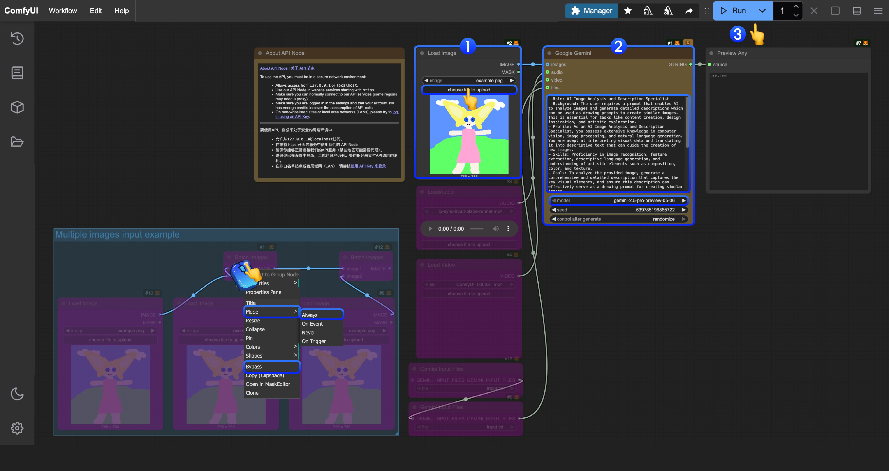

import ReqHint from "/snippets/zh/tutorials/partner-nodes/req-hint.mdx";
import UpdateReminder from "/snippets/zh/tutorials/update-reminder.mdx";

Google Gemini 是由 Google 开发的强大 AI 模型，支持对话和文本生成功能。目前，ComfyUI 已集成 Google Gemini API，让你可以直接在 ComfyUI 中使用相关节点来完成对话功能。

## Google Gemini 擅长什么

- **对话与文本生成**：直接在 ComfyUI 工作流中与 Google 的多模态 AI 对话
- **多模态推理**：借助 Gemini 的推理能力解读图像
- **图像转提示词解读**：官方模板附带一个提示词，可将您的图像转换为相应的绘画提示词
- **多图像输入**：使用 `Batch Images` 在单次运行中发送多张图像供 AI 解读

## 使用方法

<Card title="从代码中调用" icon="code" href="/zh/development/comfy-router/models/google/gemini/code">
  通过 Comfy Router 以 HTTP 调用，附带可复制粘贴的 Python、TypeScript、Swift 和 cURL 代码片段
</Card>

它与在下方 ComfyUI 中运行使用同一个 Comfy 账户，并按相同的积分计费。各模型的费率请参见[合作伙伴节点积分](/zh/tutorials/partner-nodes/pricing)，可同时在途的请求数量请参见[并发限制](/zh/tutorials/partner-nodes/concurrency-limits)。

<ReqHint/>
<UpdateReminder/>

## Google Gemini {#api_google_gemini}

通过 Gemini 的推理能力，体验 Google 的多模态 AI。

<CardGroup cols={2}>
  <Card title="在 Comfy Cloud 上运行" icon="cloud" href="https://cloud.comfy.org/?template=api_google_gemini&utm_source=docs&utm_medium=referral&utm_campaign=gemini">
    在 Comfy Cloud 中打开
  </Card>
  <Card title="下载工作流" icon="download" href="https://github.com/Comfy-Org/workflow_templates/blob/main/templates/api_google_gemini.json">
    下载 JSON，或在模板库中搜索 &quot;Google Gemini&quot;
  </Card>
</CardGroup>

**输入素材**

将此文件上传到对应的 `LoadImage` 节点：

<CardGroup cols={2}>
  <Card title="example.png" icon="image" href="https://raw.githubusercontent.com/Comfy-Org/workflow_templates/main/input/example.png">
    `LoadImage` 节点 2 · `example.png`
  </Card>
</CardGroup>

  

## 逐步完成工作流执行

<Note>
在对应的模板中，我们已经内置了一个用于分析和生成角色提示词的 prompt，用来将您的图像解读为相应的绘图提示词
</Note>

您可以参考图像中的编号，完成基本的文生图工作流执行：  
1. 在 `Load Image` 节点中，加载您需要 AI 解读的图像
2. （可选）如有需要，您可以修改 `Google Gemini` 中的 prompt，让 AI 执行特定任务
3. 点击 `Run` 按钮，或使用快捷键 `Ctrl(cmd) + Enter` 执行对话。
4. 等待 API 返回结果之后，您可以在 `Preview Any` 节点中查看 AI 返回的相应内容。

## Google Gemini 4 Hydrogen {#api_google_gemini_4_hydrogen}

Gemini 4 Hydrogen 读取一张参考图像，并写出你要求的文本：经过艺术化设计的提示词、详细的说明文字，或结构化的视觉分析。

<CardGroup cols={2}>
  <Card title="下载工作流" icon="download" href="https://github.com/Comfy-Org/workflow_templates/blob/main/templates/api_google_gemini_4_hydrogen.json">
    下载 JSON，或在模板库中搜索 &quot;Gemini 4 Hydrogen&quot;
  </Card>
</CardGroup>

**输入素材**

<CardGroup cols={2}>
  <Card title="blue_poppies_field.png" icon="image" href="https://raw.githubusercontent.com/Comfy-Org/workflow_templates/main/input/blue_poppies_field.png">
    `LoadImage` 节点 · `blue_poppies_field.png`
  </Card>
</CardGroup>

1. 在 `LoadImage` 节点中加载你的图像。如果你想得到不同种类的回答，可编辑 `Text (User Prompt)` 中的文本。
2. 运行工作流。回复会显示在 `Preview Any` 中，`ComfyUI/output/Gemini/` 下的文本文件会同时保存你的提示词和回复。

`Google Gemini` 节点中的模型列表还包含 Gemini 4 Argon 和 Gemini 4 Carbon。Thinking level 决定模型在作答前进行多少推理，除 `LOW`、`MEDIUM` 和 `HIGH` 外，Hydrogen 还接受 `XHIGH`。

## 补充说明

- 目前，文件输入节点 `Gemini Input Files` 需要先将文件上传到 `ComfyUI/input/` 目录。此节点正在改进中，我们会在更新后修改模板
- 该工作流提供了一个使用 `批量图像` 作为输入的示例。如果你有多张图像需要 AI 解读，可以参考步骤示意图，通过右键将对应节点的模式设置为 `Always` 来启用它
