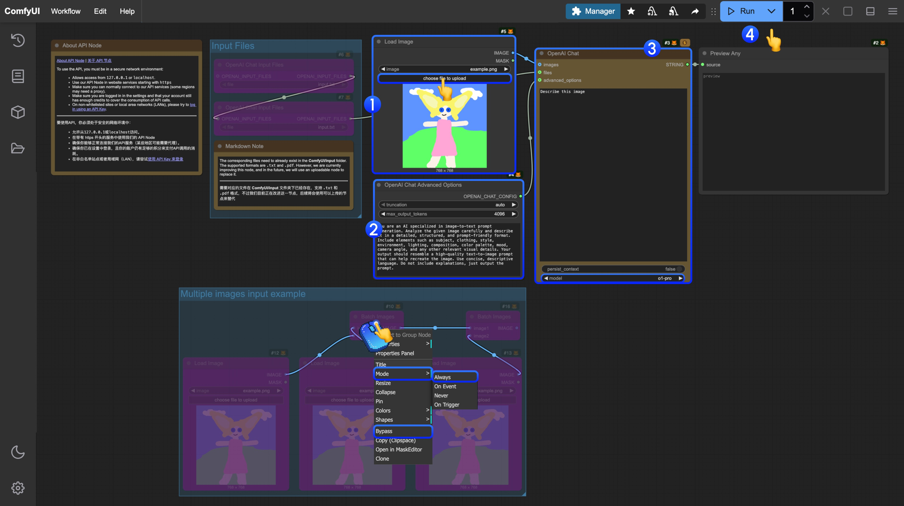

import ReqHint from "/snippets/zh/tutorials/partner-nodes/req-hint.mdx";
import UpdateReminder from "/snippets/zh/tutorials/update-reminder.mdx";

OpenAI 是一家专注于生成式 AI 的公司，提供强大的对话能力。目前，ComfyUI 已集成 OpenAI API，你可以直接在 ComfyUI 中使用相关节点来完成对话功能。

## OpenAI Chat 擅长什么

- **智能对话**：直接在 ComfyUI 内与 OpenAI 的高级语言模型交流互动
- **图像理解**：加载图像供 AI 解读并作出回应
- **任务控制**：调整 `OpenAI Chat Advanced Options`，让 AI 执行特定任务，例如分析图像和生成提示词
- **模型选择**：在 `OpenAI Chat` 节点中选择不同的 OpenAI 模型
- **多图像输入**：当需要 AI 解读的图像不止一张时，可将多张图像一起批处理

<ReqHint/>
<UpdateReminder/>

## 模型与节点版本

默认模型是 `gpt-6.2-sol`。`model` 下拉框还包含 `gpt-6.2-astra`，以及 GPT-6.x 和 GPT-5.5/5.6 系列模型。`gpt-5`、`gpt-5-mini`、`gpt-5-nano`、`gpt-4.1`、`o3` 等较早的选项只保留在旧版节点上。

模板仍使用旧版 ChatGPT 节点，并搭配单独的 `OpenAI ChatGPT Advanced Options` 节点。这对节点已弃用：已保存的工作流可以继续运行，但新工作流会得到单个 **OpenAI ChatGPT** 节点，`prompt`、最多 16 张图片、可选的文本或 PDF 文件、`reasoning_effort`、`max_output_tokens`、`seed` 和 `system_prompt` 都在这个节点上。

## OpenAI：ChatGPT {#api_openai_chat}

与 OpenAI 的高级语言模型交互，进行智能对话。

<CardGroup cols={2}>
  <Card title="在 Comfy Cloud 上运行" icon="cloud" href="https://cloud.comfy.org/?template=api_openai_chat&utm_source=docs&utm_medium=referral&utm_campaign=chat">
    在 Comfy Cloud 中打开
  </Card>
  <Card title="下载工作流" icon="download" href="https://github.com/Comfy-Org/workflow_templates/blob/main/templates/api_openai_chat.json">
    下载 JSON，或在模板库中搜索“OpenAI: ChatGPT”
  </Card>
</CardGroup>

**输入材料**

将此文件上传到匹配的 `LoadImage` 节点：

<CardGroup cols={2}>
  <Card title="example.png" icon="image" href="https://raw.githubusercontent.com/Comfy-Org/workflow_templates/main/input/example.png">
    `LoadImage` 节点 5 · `example.png`
  </Card>
</CardGroup>

  

## 逐步完成工作流执行

<Note>
在对应的模板中，我们内置了一个用于分析提示词生成的角色设定。
</Note>

您可以参考图片中的编号，完成基础文生图工作流的执行：
1. 在 `Load Image` 节点中，加载您需要 AI 解读的图像。
2. （可选）如果需要，您可以修改 `OpenAI Chat Advanced Options` 中的设置，让 AI 执行特定任务。
3. 在 `OpenAI Chat` 节点中，您可以修改 `Prompt` 来设置对话提示词，或修改 `model` 以选择不同的模型。
4. 点击 `Run` 按钮，或使用快捷键 `Ctrl(cmd) + Enter` 来执行对话。
5. 等待 API 返回结果之后，您可以在 `Preview Any` 节点中查看 AI 返回的相应内容。

## 补充说明

- 目前，文件输入节点 `OpenAI Chat Input Files` 要求先将文件上传到 `ComfyUI/input/` 目录。此节点正在改进中，我们将在更新之后修改模板
- 该工作流提供了一个使用 `Batch Images` 作为输入的示例。如果你有多个需要 AI 解读的图像，可以参考步骤图，并使用右键将相应节点的模式设置为 `Always` 以启用它
